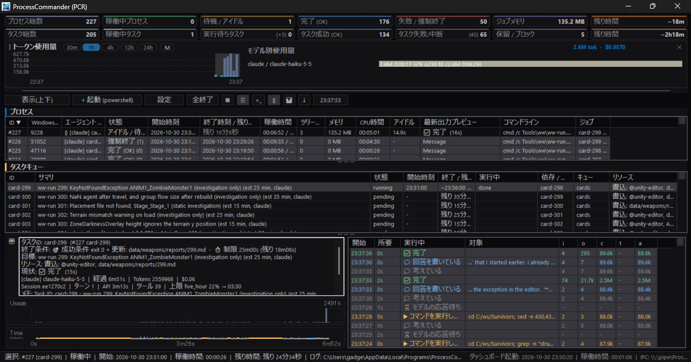

# Hancho

**[English](README.md) | [日本語 (Japanese)](README-ja.md)**

**Hancho**（班長）は、Windows で AI コーディングエージェントの作業を仕切る「現場の班長」です。LLM やあなたが仕事を渡すと、Hancho はそれを実際の端末プロセスとして順番どおりに、失敗すればリトライしながら走らせ、その様子をダッシュボードで見せます。

この考えを軸に、ConPTY マルチターミナルのダッシュボード、依存関係・タイムアウト・リトライ付きのタスクキュー、複数手順の計画を任せられるビヘイビアツリー、**MCP** と **CLI** の両方からの操作を備えています。`claude`、`opencode`、`codex`、ビルドスクリプト、対話シェル（PowerShell、cmd、Git Bash）を同じように扱えます。

バージョンは `hancho-cli.exe --version` で確認できます（現在: 0.9.14）。

### 対象ユーザー

- **LLM コーディングエージェント（Claude Code、opencode、Codex など）を使う Windows 開発者**で、監督役の LLM から別の CLI エージェントをワーカープロセスとして動かし、作業を任せたい人。
- **長時間・並列・対話型のジョブ**（ビルド、テスト、開発サーバー、TUI エージェント）を扱う人。チャットのセッションより長く動かしたい作業、依存関係やリトライのある決まった計画で進めたい作業、Claude 以外のワーカーが混ざる作業向けです。
- **多数のエージェント端末を 1 つのダッシュボードで見ながら操作したい人**。タイムアウト、リトライ、依存関係を設定でき、ログは再起動後も残ります。

**向いていないケース**: 短い推論やコード修正だけで、LLM のサブエージェントで足りている場合。トークンコストはどちらを使ってもほぼ同じです。Hancho で何が得られるか（耐久性、決定的な制御、可視性）は [サブエージェント vs. Hancho](doc/pros-cons-comparison-ja.md#トークンコストが決め手でなくなった今) を、全体は [Pros/Cons 比較](doc/pros-cons-comparison-ja.md) を参照してください。



ダッシュボードのプロセス一覧・タスクキュー一覧の下には **実行状態監視ペイン** があります。選択中のプロセスに追従し、目標、今何をしているか、TODO の進捗、ジョブの成功条件・試行回数・制限時間、経過時間付きの平易な活動履歴を表示します。JSON ストリーミング中のプロセスはプロセス一覧で `{}` が付きます。詳しくは [主な特徴](doc/features-ja.md) を参照してください。

---

## Hancho の概要

Hancho には、1 コマンドだけ、順番のあるジョブのキュー、あるいはビヘイビアツリー全体を渡せます。各ステップは専用のタイムアウト・成功判定・リトライ・リソースロック・ログを持つ実際の端末プロセスとして実行され、結果だけが LLM に返ります。計画を決めるのは supervisor LLM、プロセスを所有するのは Hancho です。

詳しくは [概要](doc/overview-ja.md) を参照してください。`run_worker`、ジョブ終了後の PC サスペンド、ビヘイビアツリー、安定したイベントとアダプター、Hancho をやめるとき（卒業）の手順をまとめています。

## Hancho スキルを使う

`skills/hancho/SKILL.md` は、AI エージェントが Hancho をうまく使うためのスキルです。supervisor / Hancho / worker の役割、1 ジョブ = 1 コマンドの原則、`start` とタスクキューとビヘイビアツリーの使い分け、`run_worker`、トリアージ、Chat、メモリ、よくある失敗をまとめています。Markdown だけなのでビルドは不要です。

**1. 先に Hancho を用意する。** リリースをインストールし、`hancho-cli.exe` に `PATH` を通します。必要ならプロジェクトごとに MCP を一度だけ登録します。

```powershell
hancho-cli.exe --version
hancho-cli.exe mcp install --client opencode   # Claude なら --client claude
```

**2. エージェントがスキルを探す場所に置く。** このリポジトリからなら（セットアップ後は同じものが `%LOCALAPPDATA%\Programs\Hancho\skills\hancho` にあります）:

```powershell
# opencode: プロジェクト単位
New-Item -ItemType Directory -Force .opencode\skills | Out-Null
New-Item -ItemType Junction -Path .opencode\skills\hancho -Target (Resolve-Path skills\hancho)

# opencode: 全体（すべてのプロジェクト）
New-Item -ItemType Directory -Force "$env:USERPROFILE\.config\opencode\skills" | Out-Null
New-Item -ItemType Junction -Path "$env:USERPROFILE\.config\opencode\skills\hancho" -Target "D:\path\to\Hancho\skills\hancho"

# Claude Code: プロジェクト単位
New-Item -ItemType Directory -Force .claude\skills | Out-Null
New-Item -ItemType Junction -Path .claude\skills\hancho -Target (Resolve-Path skills\hancho)
```

`hancho` フォルダをそのままコピーしてもかまいません（ジャンクションなら実体を 1 つに保てます）。opencode では `opencode.json` に `"skills": ["./skills"]` を追加する方法もあります。

**3. エージェントを再起動または再読み込みして、普通に頼む。** スキルは説明文をもとに自動で提示されるので、「Hancho でビルドして」「この手順をキューにして」「worker LLM に任せて」のような依頼で読み込まれます。opencode では `@hancho` と名前で指定することもできます。

スキルは最初に `hancho-cli.exe help --json` を実行するため、表示されるコマンドは古い一覧ではなく、インストール済みバージョンのものになります。


## ドキュメント

| ドキュメント | 内容 |
| :--- | :--- |
| [概要](doc/overview-ja.md) | 動作モデル、`run_worker`、サスペンド、ビヘイビアツリー、安定イベント、卒業 |
| [スタート](doc/start-ja.md) | LLM エージェント向けクイックスタート、ビルド方法、`Hancho.exe` と `hancho-cli.exe` |
| [主な特徴](doc/features-ja.md) | ダッシュボード GUI、シェル起動、履歴、トレイ、ログ、設定、タスクキュー概要 |
| [CLI](doc/cli-ja.md) | `hancho-cli.exe` の使い方、stdin モード、完了通知 |
| [タスクキュー](doc/taskqueue-ja.md) | 順序・依存・ジョブのフィールド・状態・ChainGuard |
| [ビヘイビアツリー](doc/behavior-tree-ja.md) | BT の形式、ノードの種類、変数、ワーカーのエンジン、escalate、例 |
| [BT トークン削減ガイド](doc/behavior-tree-token-optimization-ja.md) | トークン削減アーキテクチャ、`compact: true`、軽量化パケット |
| [BT 設計計画書](doc/behavior-tree-plan.md) | ビヘイビアツリーエンジンのアーキテクチャと実装計画 |
| [MCP サーバー](doc/mcp-ja.md) | MCP 登録と MCP ツール |
| [WCSP](doc/wcsp.md) | WinConsoleServer プロトコル（WCSP v1）: フレーミング、ハンドシェイク、フレーム、セッション、セキュリティ |
| [データディレクトリ](doc/data-directory-ja.md) | プロジェクト内・git 管理の `--data-dir` |
| [Pros/Cons](doc/pros-cons-comparison-ja.md) | サブエージェント等との使い分け |
| [批判的比較](doc/critical-comparison-ja.md) | Hancho の限界と使うべきでないケースを辛口に整理 |
| [競合比較](doc/competitive-comparison-ja.md) | エージェントフレームワークやメモリサービスとの位置づけ |
| [Hancho v3 設計](doc/design-v3.md) | イベントスキーマとアダプター、ヘッドレス/リモート、意味的メモリ、失敗分析、卒業指針 |
| [リリースチェックリスト](doc/release-checklist-ja.md) | リリースごとの卒業用機能対応表の見直しと片付けコマンドの確認 |
| [CLI help 出力](doc/cli-help-ja.md) | `Hancho.exe --help` と `hancho-cli.exe help` の全文 |
| [Hancho スキル](skills/hancho/SKILL.md) | Hancho をうまく使うためのエージェントスキル |
| [tools/ww](tools/ww/README-ww.md) | 任意・独立のタスクカード実行テンプレート（Hancho の一部ではない） |

---

## リリースノート

### v0.9.16
- **タブ式ターミナルクライアント**: WCSP クライアントをダッシュボードから分離し、独立ウィンドウ（`Hancho.exe terminal`）にしました。タブごとに独立したセッションなので、ローカル/リモートのコンソールを複数同時に接続できます。`+ Launch` と `[>_]` でクライアントを開きます。
- **ターミナルクライアントの操作**: ダッシュボードのテーマに追従し、編集メニューと右クリックにコピー/貼り付けを追加しました。常に手前、ウィンドウ位置の記憶、バイト単位のスクロールバック（タブごとに 64〜2048 MB、既定 1024 MB）に対応します。`terminal.history_bytes`（既定 32 MiB）がサーバー側のリプレイ量を決め、リプレイをフレーム分割することで 6 MB（約 10 万行）の履歴も正しく接続できます。
- **ダッシュボード**: ウィンドウレイアウトを記憶し、状態に応じたツールチップを表示します。スタンドアロンのダッシュボードは内蔵ターミナルタブを描画しなくなりました。
- **性能**: 使用量グラフと監視ペインの更新間隔を設定できるようにし、タスクキューの検索にジョブインデックスを使い、アイドル時のポーリング負荷を減らしました。
- **Chat**: 「Hancho Chat に調査を依頼 (入力欄にコピー)」で入力欄に下書きを入れ、ワーカーの結果イベントから回答を取り出します。非表示起動した Chat はウィンドウを隠したままにします。
- **自動起動**: クライアントはコンソールを隠し、非表示の WMI 起動に失敗しても動作を続けます。
- **ドキュメント**: 概要、WCSP プロトコル、CLI help のページ、`skills/hancho` エージェントスキルを追加し、README を書き直しました。
- **パース**: `sscanf` / `sscanf_s` を `src/parse_util.h` のヘルパーに置き換えました（MSVC C4996 警告なし）。

### v0.9.15
- **トリアージ**: 失敗したタスクキュージョブ、BT のエスカレーション失敗、タスクに属さないプロセス失敗、見積もり乖離、リソース待ちのそれぞれに永続カードを作ります。Hancho が原因・背景・環境・条件・理由の情報、処置候補、決定論的な推奨を用意し、人がダッシュボード、`hancho-cli triage`、MCP の `triage_list` / `triage_get` / `triage_decide` から判断を選んで記録します。`triage_mode` で手動・半自動（既定。安全で高確信度の推奨は自動実行）・自動を選べ、任意の LLM 助言は非表示の `_triage` ジョブ、`triage handoff` は判断待ちカードを非表示の `_supervisor` キューのバッチ Supervisor に渡します。自然解消、フォロー、自動処置の確認、種別ごとのオン/オフに対応します。詳細は `doc/triage.md`。
- **ターミナルセッション（WCSP）**: コアがすべての ConPTY ジョブを WinConsoleServer プロトコル（WCSP v1）で公開し、スタンドアロンのダッシュボードはローカル TCP リスナー（`config.json` の `terminal`）経由で接続します。ダッシュボードを閉じたり、タブを切り替えたり、切断してもジョブは停止しません。`terminal.remote` を有効にすると、別 PC の WinConsoleTerminal から `attach:<id>` で接続できます。暗号化なしのプレーン TCP なので信頼できる LAN でのみ使ってください。詳細は `doc/features-ja.md`。
- **ダッシュボード**: 判断待ちのタスク／プロセスと未確認の自動処置をトリアージ KPI に表示し、タスク一覧に Triage 列を追加しました。設定ダイアログに **WinConsoleServer** タブ（ローカル／リモート接続のオンオフ）と **トリアージ** タブ（モード・LLM モード・種別スイッチ）を追加しました。
- **ガント**: 範囲ボタンが時間範囲ではなく直近 3 / 5 / 10 ジョブ（既定 10）を選ぶようになり、ジョブが少なくても表示が変わります。
- **コア起動**: 起動中のコアを最大 30 秒待ち、自動起動に失敗した後は 60 秒間再試行を抑止し、ダッシュボードを呼び出し元のプロセスツリー外で起動します。コアの二重起動や大量のプロセス発生を防ぎます。
- **修正**: hidden タスクの表示切り替えを設定の動作タブに配置しました。

### v0.9.14
- **Chat ハンドラのジョブを非表示**: 応答 LLM が処理するメッセージは `taskqueue list` とダッシュボードのタスク一覧に出なくなりました。実行（タイムアウト・同時実行数・使用量）は従来どおりで、`taskqueue get <id>` では確認できます。
- **返信の修正**: ハンドラのプロンプトをファイル読み込みではなく直接渡すようにし、headless の許可判定で回答が止まらないようにしました。生のストリーム出力を返信として送ることもなくなりました。
- **設定**: 「ツールの許可をスキップ（危険）」を追加し、`handler.skip_permissions` を設定できるようにしました。信頼できる LAN で、受信メッセージからローカルのツールを実行できます。
- **hidden タスクの表示**: ダッシュボードの設定に「hidden タスクも表示」を追加し、Chat ハンドラのジョブも必要なら表示できます。
- **エージェント名がニックネーム連動**: 既定の `<ニックネーム>-llm` がニックネーム変更に追従し、保存済みの `noname-llm` は自動値として再生成します。
- **Chat の送信モード**: ホスト一覧でホストを選ぶと、下段が送信モードに戻ります。
- **Chat ボタンのバッジ**: ダッシュボードの Chat ボタンに未読数を表示します。
- **ダークテーマ**: Chat ウインドウのコンボボックスが白背景・黒文字にならず、テーマに従います。

### v0.9.13
- **Chat のトレイメニュー**: 終了項目を **Hancho Chat終了** に変更し、Chat ウインドウだけが閉じてダッシュボード/コアは動き続けることを分かりやすくしました。

### v0.9.12
- **Chat ダイアログのレイアウト**: 左にメッセージ（一覧・受信本文・受信添付）、右上にホスト、右下に送信欄。
- **送信欄の整理**: 送信先（選択中のホスト / ローカルエージェント / 返信）だけを選びます。送信元は設定のエージェント名を使い、`to_agent` と宛先種別は表示しません。メッセージは相手の応答 LLM が処理します。
- **返信モード**: メッセージを選ぶか、送信先で「返信」を選ぶと受信本文・受信添付を表示します（未選択なら空）。別の送信先を選ぶと返信モードを抜けます。
- **ログ**: 「送信元」「送信先」を別列にしました。
- **ホスト一覧**: アドレス:ポート列を削除し、ピア名はホスト名を使って表示します。
- **設定**: 応答 LLM の設定は設定タブに集約しました。
- **既定値**: ニックネームは `noname`、エージェント名は `<nickname>-llm` を自動生成し、送信元名に使います。

### v0.9.11
- **Chat**: IPMsg 互換機能の名称を Chat に統一しました。`hancho-cli chat`（別名 `msg`）、MCP の `chat_*` ツール、単体 `Hancho.exe chat` ウインドウ、ダッシュボードのツールバーが対象です。`doc/ipmsg-ja.md` は `doc/chat-ja.md` になりました。
- **MCP `chat_handler`**: 受信 Chat に応答する LLM を表示・変更できます（エンジン、モデル、エージェント、cwd、指示、タスクキュー、自動返信、タイムアウト、最大ホップ数、同時実行数）。
- **Chat の信頼性**: ノード再起動を直列化し、未信頼のメッセージ本文を明確な区切りで囲んでから応答 LLM に渡すようにしました。旧 `ipmsg` のメッセージデータは `chat` へ移動します。
- **ドキュメント**: CLI・MCP・機能ドキュメントを Chat に合わせて更新しました。

### v0.9.10
- **Chat（IPMsg 互換）**: コアが古典的な IPMsg プロトコル（参加通知、メッセージ、開封通知、通常ファイル転送）を UDP/TCP ポート 2426 で話します。既定では無効です。LLM 同士のメッセージング用に `from_agent` / `to_agent` / `reply_to`、`audience`（human / agent）、ホップ数ガードを追加し、ワーカー LLM のハンドラが自動返信します。`hancho-cli chat`（別名 `msg`）、MCP の `chat_*` ツール（応答 LLM を変える `chat_handler` を含む）、単体ダイアログ（`Hancho.exe chat [--tray]`、ダッシュボードのツールバーからも起動可）とトレイ通知を利用できます。詳細は `doc/chat-ja.md`。
- **ダッシュボードのホバー**: プロセス・タスク・実行モニタ・ヒント履歴の一覧と JSON ツリーで、省略表示されたセルの全文をツールチップで表示します。
- **WebUI 設定**: 設定 → 管理タブにポート入力（1〜65535）と、LAN アドレスとセッショントークンを含む読み取り専用のアクセス URL を追加しました。
- **ダッシュボードのガント**: 6h / 12h / 24h / All の範囲ボタンを追加し、目盛りラベルをローカル時刻の時・日の境界に配置しました。
- **使用量パネル**: 4h の範囲を追加。未読のヒントがあるとヒント履歴ボタンにバッジを表示します。
- **実行モニタ**: 一覧のサブタスク／ステップを右クリックすると詳細ウインドウを開きます。説明・状態・時刻・トークン・ツール呼び出し・イベント内容・Raw JSON を表示し、コピーもできます。

### v0.9.9
- **Supervisor ヒント toast**: 自動消去の既定時間を 7 秒に変更しました（従来 6 秒）。`hint_auto_dismiss_sec` は `-1` で手動で閉じるまで表示、`0` で表示しない、正の値でその秒数後に自動消去します。`config.json` に保存済みの値がある場合はそちらが優先されます。

### v0.9.8
- **指定タスク終了後の PC サスペンド**: ジョブに `suspendWhenDone` / `suspendDelaySec` / `suspendHibernate` を付けるか、`hancho-cli power suspend --after-job <id>` で予約できます。対象ジョブと他の全タスクキュー・Hancho 管理プロセスがアイドルになった後、PC をスリープ（または休止）します。新しい作業が始まるとカウントダウンは取り消され、再びアイドルになってから再開します。`power status` / `power cancel`、MCP `power_suspend` / `power_cancel` / `power_status`、`--dry-run` に対応。ローカルホスト専用です。
- **ビヘイビアツリーの残り時間と仮タスク**: 実行中の BT が後で起動する job/worker 葉を `planned` 行としてダッシュボードに表示し、その見積もりをタスクの残り時間に加算します。行は現在のツリーから毎回作り直すため、retry / fallback / `if` の分岐変更や完了時に不要な行は自動で消えます。`bt_get` / `bt_list` は `pendingEstimateSec` と `plannedTasks` を返し、`taskqueue_list` は `include_planned` を受け付けます。
- **ダッシュボード**: `Hancho.exe gui` はコア未起動時に確認せず headless コアを自動起動します（`--no-prompt` は従来どおり起動せずエラー）。Supervisor ヒントウインドウのボタン文言を「解決させる」に変更。
- **一覧の検索とガント**: プロセス一覧・タスク一覧のラベル右側に検索ボタンを追加し、インラインで大文字小文字を区別せず絞り込めます。タスク・ガントは BT の仮行を実行順の予測チェーンとして表示し、タスク／BT の状態変化で即座に再描画します。
- **ドキュメント**: サスペンド、BT の仮タスク、`planned` 状態を追記。

### v0.9.7
- **Audit フィードバックの修正**: `timing_feedback` は最後に成功した試行だけを計測するようになりました（すぐ失敗した試行で `diverged_under` と判定されなくなりました）。5 秒未満の実行は `diverged_under` にしません。閾値は `config.json` の `audit_timing_divergence_threshold`（既定 2.0）と `audit_timing_under_threshold`（既定 0.33）から読みます。
- **`taskqueue list` に `resource_wait`**: 待機中のジョブがどのジョブのどのリソースを待っているかを、`taskqueue graph` と同じく一覧でも返します。
- **Supervisor ヒントウインドウ**: コピー用プロンプトのコマンドを実在するもの（`taskqueue why` / `retry`、`bt get --id`、`bt resume`）に修正。ビヘイビアツリーのエスカレーションを再び検出します。複数の見積もり乖離・失敗・リソース待ちを順に表示し、表示中のヒントは自動では差し替えず、条件が再発したものは再び表示します。
- **ヘルプ**: `hancho-cli help` に AUDIT 節、`help --json` に `agent.audit` を追加。`taskqueue add` の任意項目に `estimateSec` を記載。
- **ドキュメント**: Audit LLM の実装設計書（`doc/audit-llm-design.md`）。

### v0.9.6
- **Audit LLM / Supervisor フィードバック（プレビュー）**: `estimateSec` を持つジョブは、実実行時間・比率・`accurate` / `diverged_over` / `diverged_under`・具体的な助言を含む `timing_feedback` を返すようになりました。Windows ダッシュボードには見積もり乖離を知らせる Supervisor ガイダンス・ヒントウインドウを追加し、修正用プロンプトのワンクリックコピーと自動消去に対応。詳細は `doc/audit-llm-ja.md`。
- **WebUI 公開設定**: `<data-dir>/config.json` の `webui` で `enabled`、`scope`（`loopback` / `lan` / `custom`）、`host`、`port`、`allowed_hosts`、`allowed_origins` を設定できます。既定はループバック専用のまま。LAN モードは `0.0.0.0` にバインドし、トークン認証を維持しつつ、IP リテラルと設定したホスト名を許可します。`config_set` で即時反映。設定 → 管理タブから有効/無効、公開範囲、許可ホストを変更できます。
- **ヘルプとスモークテスト**: `hancho-cli help` に、`start` はプロセスでありタスクではないこと、タスク一覧とモデル別使用量には `taskqueue add` / `run` / `bt start` が必要であることを明記。`fileExists` は末尾要素の glob に対応。v0.9.5 レビューの 5 件（cli_top_smoke 登録、BT IPC のストリーミングとデータディレクトリ分離、headless の待機/エンコーディング、タイムスタンプ競合、イベントスキーマのパス）を修正。
- **ドキュメント**: Audit LLM 仕様、機能表の更新、アーキテクチャ画像の差し替え。

### v0.9.5
- **ブラウザダッシュボード**: `hancho-cli web` で、プロセス / キュー / 監視 / 失敗診断 / メモリの各画面を持つ HTTP + WebSocket ダッシュボード（127.0.0.1:9138、トークン認証）を開けます。`doc/browser-ui-ja.md` を参照。
- **対話 TUI**: `hancho-cli top` が 5 タブ、行移動、停止 / 再試行 / 取消、リモートジョブ、`--once --json` を備えた端末ダッシュボードになりました。外部 curses 依存はありません。`doc/tui-design-ja.md` を参照。
- **リモートホストの完成**: 1 本の WebSocket で要求を多重化し、ログ / イベントを seq 再開付きで配信。ローカルダッシュボード再起動後もリモート試行へ再接続し、`success.filesNewer` はリモートホスト側の時計で評価します。
- **長期使用量集計**: 日次 / 月次の `hancho.usage.day/1` ロールアップ、`hancho-cli usage stats|export|compact`、MCP `usage_stats` / `usage_export`、IPC `get_usage_daily`、ダッシュボードの期間選択。エンジン / モデル別の帰属は、JSON ストリームを出し `--model` を受け取るタスクキュー / ビヘイビアツリージョブから記録されます。
- **メモリ運用**: 外部ランカープラグイン（失敗時は BM25 に自動フォールバック）、`memory_max_bytes` 上限付きの `memory prune`、設定したワーカーによる L3 昇格、タスクキュー外の通常実行を L1 記録にする仕組み（`taskqueue record-plain`、`memory rebuild`）。
- **チェックと安全性**: `success.testReport`（JUnit / NUnit）とスコープ付き名前付きリソースロック（`@name:{root}`、`@name:{cwd}`）、`hancho.event/1` の `data` を厳密に型付け、`--schema legacy` を拒否。
- **ドキュメントと help**: `hancho-cli help` に、`start` はプロセスでありタスクではないこと、タスク一覧とモデル別使用量には `taskqueue add` / `run` / `bt start` が必要であることを明記しました。

### v0.9.4
- **意味的メモリ**: L1 実行記録、L2 ノート、L3 承認済み知識を `memory/` に保存。`hancho-cli memory search|get|brief|stats|note|approve|rebuild|prune` と MCP `memory_search` / `memory_get` / `memory_brief` / `memory_stats` / `memory_note` / `memory_retract`。`{memory}` で上限付きの brief を注入し、渡した id を試行に記録します。
- **失敗分析**: 試行ごとに決定的な診断（分類、確信度、要約、証拠、直前の活動、推奨アクション）。`hancho-cli taskqueue why <id>`、MCP のタスク結果、BT の条件から参照でき、再試行方針を分類ごとに変えられます。
- **ヘッドレス / POSIX / リモートの基礎**: `Hancho.exe --headless`、`hancho-cli run --exit-on-drain --report junit.xml`、POSIX ビルドとプラットフォーム境界、`hosts.json` とリモートジョブのミラー。初期段階です（`doc/build-posix.md`、`doc/remote-hosts.md`）。
- **卒業**: キュー / BT / 知識の `hancho-cli export`、`mcp uninstall`、`agent uninstall-template`、リリースチェックリスト。
- **ETA と paused 起動**: ジョブが `estimateSec` を受け取り、ダッシュボードがタイムアウトではなくカード見積を残り時間に表示。`bt start --paused true` はジョブを作らずにツリーを登録します。

### v0.9.3
- **旧ストリーム形式の非推奨化**: `hancho-cli worker stream` と MCP `get_worker_stream` は既定で `hancho.event/1` を返します。旧 `type` 文字列は `--schema legacy` / `schema: "legacy"` で v0.10.x まで利用でき、v0.11.0 で削除します。[移行手順](doc/LLM-jsonstream-format.md#legacy-type-strings-and-migration-to-hanchoevent1)を参照してください。
- **BT 全体のタスク一覧**: `hancho-cli bt tasks --id <id>`、`taskqueue list --bt <id>`、MCP `taskqueue_list` の `bt` で、ビヘイビアツリーの全ジョブを並列分岐のキューをまたいで一覧できます。並列分岐は専用キュー（と専用の並列度）を保ち、ダッシュボードは元々すべてのキューをまとめて表示します。

### v0.9.2
- **安定したイベントスキーマ**: ワーカーの出力を正規化した `hancho.event/1` イベントとして `logs/proc_<id>_<name>.events.jsonl` にも書きます（生の `.stream.jsonl` はそのまま）。`hancho-cli worker stream <id> --schema v1`、または MCP の `get_worker_stream` に `schema: "v1"` を渡して読めます。JSON Schema は `doc/schema/hancho.event.v1.json` に同梱します。
- **C++ なしで CLI に対応**: `<data-dir>/adapters/<name>.json` を置く（Tier 1: `match`、`rules`、JSON Pointer の `map`）か、`exec` に変換プロセスを指定します（Tier 3: stdin に生の行、stdout に `hancho.event` 行）。`engines.json` に `adapter` と `capabilities` を書けます。
- **スクリプトからイベントを送信**: pipe モードのワーカーには `HANCHO_EVENT_PIPE` が渡され、`hancho-cli event emit --kind ... --text ...` で書き込めます。`hancho-cli adapter test <name>` は記録した入力と期待する `{kind, data}` を照合します。
- **ビヘイビアツリーの並列分岐**: `parallel` ノードの子はそれぞれ専用のタスクキューで動くようになり、分岐が実際に同時実行されます。長いキュー名にはハッシュを付けてファイル名の衝突を防ぎます。
- **ドキュメントと help**: README と `hancho-cli help` に、イベントスキーマ、アダプター、`HANCHO_EVENT_PIPE`、`--schema v1`、`event emit`、`adapter test` を追記しました。

### v0.9.1
- **修正: リソース列のヘッダ色**: タスク一覧の「リソース」列のヘッダが、ほかの列と同じテーマ色（オーナードロー）で描画されます。これまではネイティブの既定色でした。
- **修正: `help --json` の MCP 自動登録コマンド**: `setup.mcp.auto_install` が `hancho-cli.exe mcp install` を案内するようになりました。以前は `Hancho.exe mcp install` と表示され、設定を書かずに MCP サーバーが起動していました。

### v0.9.0
- **ProcessCommander 2.9.x から Hancho 0.9.0 へ改名**: 製品名、実行ファイル（`Hancho.exe`）、GUI ウィンドウクラス、Named Pipe / ミューテックス名、既定のデータフォルダ（`.hancho`）、MCP サーバー名（`hancho`）、環境変数 `HANCHO_LOG_DIR` を Hancho に変更しました。コンソールクライアントは `pcder.exe` から `hancho-cli.exe` に改名しました。旧 `.processcommander` のデータや旧パイプ・ミューテックス名は自動移行しません。必要に応じて `--data-dir` で新しく作成してください。

### v2.9.3
- **どのセッションが追加したタスクか分かるように**: タスクキューの各ジョブに発行元（エージェントのセッション id、Claude デスクトップのセッション id、MCP クライアント、作業フォルダ、プロセス id）を記録します。MCP の `taskqueue_add`、`hancho-cli taskqueue add`、ビヘイビアツリーで自動的に入ります。`originLabel`、`--origin-label`、`PC_ORIGIN_LABEL` で作業に名前を付けられます。ダッシュボードの新しい **発行元** 列に表示され（マウスを乗せると全項目）、`taskqueue_list` の `origin: "self"`（`hancho-cli taskqueue list --origin self`）で自分のセッションのジョブだけを一覧できます。詳しくは [doc/taskqueue-ja.md](doc/taskqueue-ja.md) を参照してください。
- **ビヘイビアツリーの応答のトークンを削減**: ツリー全体を返すのは `bt_get` だけになりました。ほかの BT ツールと `bt_wait` の `compact: true` はツリーを省き、長い変数値とプロンプトは先頭部分だけになります。escalate の `include` に `lines` と `maxBytes` を指定できます。ワーカーのノードに `outputSchema` が渡されるようになりました。

### v2.9.1
- **監督役 LLM の `bt_wait` を軽く**: 何も起きずに時間切れになったとき、`bt_wait` はツリー全体ではなく `{state, version, nodeRuns, timedOut}` だけを返すようになりました。終了と escalate のときの応答は変わらず、すぐに返ります。
- **長く待てて取り消せる待機**: MCP の `bt_wait` は既定で最大 10 分待ちます（`timeoutMs` を負にすると無制限）。待っている間もほかの MCP 呼び出しに応答し、`notifications/cancelled` で約 2 秒以内に止まります。`hancho-cli bt wait` の既定は 60 秒のままです。

### v2.9.0
- **ビヘイビアツリー**: 監督役の LLM が、複数手順の作業全体（分岐、ビルド修正ループ、リトライ、条件の確認、ワーカー LLM の手順、判断）を 1 つの JSON のツリーとして `bt_start` で渡せるようになりました。Hancho がツリーを実行し、各手順を普通のタスクキューのジョブとして追加します。LLM が呼ばれるのは `escalate` の判断と終了時だけです。MCP ツール `bt_validate`, `bt_start`, `bt_get`, `bt_list`, `bt_wait`, `bt_resume`, `bt_retry`, `bt_update`, `bt_cancel`, `bt_pause` と `hancho-cli bt ...` コマンドを追加しました。詳しくは [ビヘイビアツリー](#ビヘイビアツリー-次に何をするかの判断を-hancho-の中で行う) と [doc/behavior-tree-ja.md](doc/behavior-tree-ja.md) を参照してください。
- **ワーカーのエンジン**: `worker` の手順は、エンジン（`claude`, `agy`, `opencode`, `codex`、またはデータディレクトリの `engines.json` の独自定義）とモデルで指定します。確認なしで動かすための引数はエンジン定義の側だけに置きます。
- **ビヘイビアツリーの表示**: ツールバーの **BT** ボタン（Ctrl+Shift+B）か、タスクの右クリックメニュー「ビヘイビアツリーで表示」で、各ツリー、どのノードがどのタスクを起動したか、どこまで進んだかを表示します。実行中のツリーが上に来て、24 時間より前に終わったツリーは「すべて表示」をオンにしない限り隠れます。
- **LLM 向けの help**: `Hancho.exe --help`、`hancho-cli help`、`hancho-cli help --json` に、ジョブを手で足す代わりにビヘイビアツリーを使う場面と使い方を書きました。
- **タスクキュー**: ビヘイビアツリーが起動したジョブに MCP や CLI から `taskqueue_retry` / `taskqueue_update` すると拒否します（`bt_retry` / `bt_update` を使います）。ダッシュボードの再実行は、その手順からツリーを再実行します。

### v2.7.2
- **実行されないジョブを残り時間から除外**: 合計残り時間（タスク残り時間の KPI とツールチップ）に、ブロックされたジョブや、上流が満たされない形で終わった保留ジョブを含めなくなりました。件数の表示は変わりません。
- **保留 / ブロック KPI のアニメーション**: 件数が 1 以上のとき、「保留 / ブロック」カードがアニメーションします。
- **OpenCode の使用量の分類**: モデル別の使用量表示で、OpenCode のトークン使用量が agy として数えられていた問題を直しました。OpenCode として記録されます。

### v2.7.1
- **リストの文字サイズ**: プロセス一覧とタスクキューの一覧で、それぞれ文字サイズ（10〜24 px）を変えられます。設定の「表示」タブで指定します。
- **行の色は「色」タブへ**: 状態別の行背景色を、設定の「表示」タブから新しい「色」タブに移しました。
- **ウィンドウタイトル**: `--data-dir` 付きで起動すると、タイトルにデータディレクトリを表示します。複数のダッシュボードを見分けられます。

### v2.7.0
- **タスクキューの時間絞り込み**: `hancho-cli taskqueue list --since 6h` で、指定期間内に更新されたジョブだけを表示します（MCP の `taskqueue_list` にも `since` を追加）。単位は m・h・d です。
- **失敗ジョブの一括再実行**: `hancho-cli taskqueue retry --failed [<キュー名>] [--since 6h]` で、失敗したジョブをまとめて再実行します。キュー名と期間で絞り込めます。MCP の `taskqueue_retry` も `id` を省いて `failed: true` を渡すと同じ一括再実行になります。
- **プロセスの後始末**: プロセスが終了したとき、残っていた子プロセス（python、cmd など）も終了させます。ジョブに子プロセスが取り残されなくなります。
- **監視ペイン**: アクティビティツリーには、サブエージェントだけを表示するようにしました。ルートエージェント自身の手順は表示しません。

### v2.5.2
- **トレイからの復帰**: Explorer を再起動した後もトレイアイコンを登録し直します。トレイアイコンを追加できない環境では、格納せず最小化します（ウィンドウに戻れなくなるのを防ぎます）。
- **クラッシュ記録**: ダッシュボード・IPC・プロセス監視・出力読み取りで発生した例外を、黙ってプログラムを終了させず監査ログ（`CRASH_GUARD`）に記録します。捕捉されなかった例外は `CRASH` として記録します。
- **終了時の点滅**: プロセス・タスクの行が終了すると数秒間点滅します。設定画面で無効にしたり、点滅時間（1〜60 秒）を変えたりできます。
- **失敗時の音**: 失敗・タイムアウト・強制終了したプロセスは、完了時とは別のシステム音を鳴らします。完了音の設定に従います。

### v2.5.1
- **行の背景色**: プロセス・タスク一覧の行を、設定画面で状態ごと（実行中・アイドル・完了・タイムアウト・失敗）に色分けできるようにしました。ダークテーマとライトテーマで別々に設定でき、文字色は背景に合わせて白か黒に自動で切り替わります。
- **`hancho-cli reset [--yes]`**: データディレクトリ内のプロジェクトデータをすべて削除します。`--yes` を付けないと削除対象を一覧表示するだけです。Hancho の実行中は実行できません。
- **`hancho-cli taskqueue purge --older-than-days N`**: N 日以上更新されていない終了済みジョブ（succeeded・failed・cancelled）を削除します。

### v2.5.0
- **ダッシュボードの更新間隔**: 既定を 2000 ms にし、設定画面で ms 単位に変更できるようにしました（100〜60000 ms）。実行中のプロセスやキューのジョブがないときは間隔を 2 倍にします。
- **ダッシュボードの再描画**: プロセス・タスク一覧と KPI カードは内容が変わったときだけ描き直すようにし、アイドル時の更新で描画する量を減らしました。
- **タスク監視**: ID 列の幅を 1.5 倍、キュー列の幅を 3/4 にしました。

### v2.3.7
- **タスク監視**: 目標欄の高さをペインの高さの半分にしました（以前の 150px の上限はなくなりました）。

### v2.3.6
- **セキュリティ**: ダッシュボード自動起動のコマンドインジェクションを修正しました。`‘` や `’` を含むパスやデータディレクトリによって、実行中のユーザーの権限で PowerShell コマンドが実行されるおそれがありました。

### v2.3.5
- **サブエージェント**: Claude のサブエージェントを個別に追跡し、タスク監視ペインにツリーで表示します。`hancho-cli worker status` と IPC の状態にも一覧が出ます。
- **ストリーム**: Claude の部分メッセージ（`--include-partial-messages`）と `codex exec --json` のイベントを解析します。
- **ツールバー**: 時計の左に更新アイコンボタンを追加しました。
- **設定**: プロセスごとに保持するストリームイベント数を変更できます（既定 2000、-1 でメモリが尽きるまで保持）。
- **ツール**: `hancho-cli worker install-template`（hancho-runner エージェント）、ww-run と ww-watch の `-Agent` / `WW_AGENT`、`tools/ww-unity` を追加しました。
- **リスト**: スクロールバーを押さえている間は更新を止め、タスクリストは更新してもスクロール位置を保ちます。
- **トークン**: Claude の使用量をメッセージごとに1回だけ数え、result 行ではメッセージに出なかった分だけを足します。

### v2.3.4
- **タスク監視**: 目標欄とプレビュー欄のスクロールバーをテーマの色に合わせました。

### v2.3.3
- **テーマ**: 濃い紫、薄い紫、濃い黄、薄い黄を追加しました。
- **リストヘッダ**: 背景にテーマのアクセント色をわずかに混ぜました。
- **スクロールバー**: プロセスリストとタスクリストのスクロールバーをダブルバッファにして、ちらつきを減らしました。
- **設定**: サウンドの項目が上のボタンと重なっていたのを直しました。

### v2.3.2
- **テーマ**: 背景が淡色のパステルテーマを5種類追加しました（パステル青、橙、桃、赤、緑）。
- **KPI カード**: 色の帯の高さを2倍にし、文字を太字にして、上下の余白を詰めました。
- **CLI**: `hancho-cli agent` を `hancho-cli worker` に改名しました。旧名も使えます。
- **MCP**: `get_agent_stream` / `get_agent_state` / `update_agent_info` を `get_worker_stream` / `get_worker_state` / `update_worker_info` に改名しました。旧名も使えますが、ツール一覧には表示されません。

### v2.3.1
- **MCP**: `run_agent` / `wait_agent` を `run_worker` / `wait_worker` に改名しました。ハーネス標準のサブエージェント機能との誤解を避けるためです。旧名も使えますが、ツール一覧には表示されません。

### v2.3.0
- **MCP**: 1つのタスクをワーカー LLM に任せ、最終結果だけを返すツールを追加しました。
- **モニターペイン**: ツール呼び出しの説明を専用の列に表示し、サブタスクリストの幅を3分の2に広げました。
- **タスク一覧**: ホバーで「リソース」の全文を表示でき、セルをコピーできます。
- **ww-run**: stdout が閉じた時点ではなく、エンジンの終了時に完了します。

それ以前のバージョン: [Releases](https://github.com/gadget114514/Hancho/releases)

