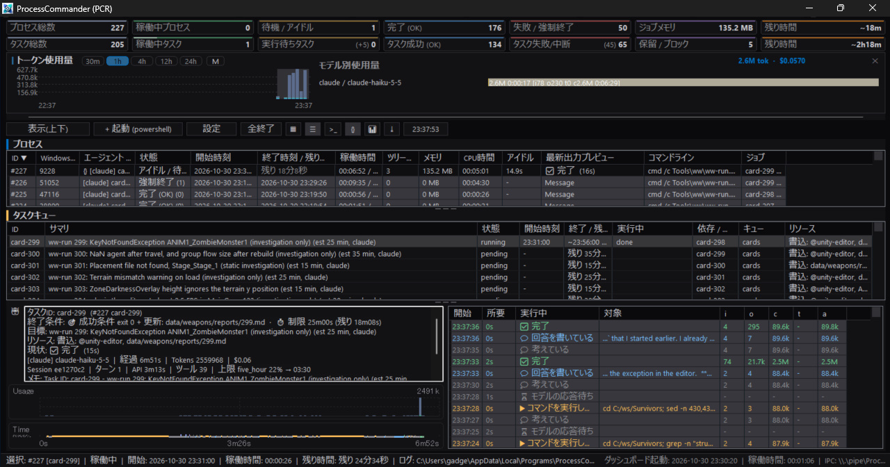

# Hancho

**[English](README.md) | [日本語 (Japanese)](README-ja.md)**

**Hancho**（班長）は、Windows で AI コーディングエージェントの作業を仕切る「現場の班長」です。LLM やあなたが仕事を渡すと、Hancho はそれを実際の端末プロセスとして順番どおりに、失敗すればリトライしながら走らせ、その様子をダッシュボードで見せます。

この考えを軸に、ConPTY マルチターミナルのダッシュボード、依存関係・タイムアウト・リトライ付きのタスクキュー、複数手順の計画を任せられるビヘイビアツリー、**MCP** と **CLI** の両方からの操作を備えています。`claude`、`opencode`、`codex`、ビルドスクリプト、対話シェル（PowerShell、cmd、Git Bash）を同じように扱えます。

バージョンは `hancho-cli.exe --version` で確認できます（現在: 0.10.0）。

### 対象ユーザー

- **LLM コーディングエージェント（Claude Code、opencode、Codex など）を使う Windows 開発者**で、監督役の LLM から別の CLI エージェントをワーカープロセスとして動かし、作業を任せたい人。
- **長時間・並列・対話型のジョブ**（ビルド、テスト、開発サーバー、TUI エージェント）を扱う人。チャットのセッションより長く動かしたい作業、依存関係やリトライのある決まった計画で進めたい作業、Claude 以外のワーカーが混ざる作業向けです。
- **多数のエージェント端末を 1 つのダッシュボードで見ながら操作したい人**。タイムアウト、リトライ、依存関係を設定でき、ログは再起動後も残ります。

**向いていないケース**: 短い推論やコード修正だけで、LLM のサブエージェントで足りている場合。トークンコストはどちらを使ってもほぼ同じです。Hancho で何が得られるか（耐久性、決定的な制御、可視性）は [サブエージェント vs. Hancho](doc/obsoleted/pros-cons-comparison-ja.md#トークンコストが決め手でなくなった今) を、全体は [Pros/Cons 比較](doc/obsoleted/pros-cons-comparison-ja.md) を参照してください。



ダッシュボードのプロセス一覧・タスクキュー一覧の下には **実行状態監視ペイン** があります。選択中のプロセスに追従し、目標、今何をしているか、TODO の進捗、ジョブの成功条件・試行回数・制限時間、経過時間付きの平易な活動履歴を表示します。JSON ストリーミング中のプロセスはプロセス一覧で `{}` が付きます。詳しくは [主な特徴](doc/obsoleted/features-ja.md) を参照してください。

---

## Hancho の概要

Hancho には、1 コマンドだけ、順番のあるジョブのキュー、あるいはビヘイビアツリー全体を渡せます。各ステップは専用のタイムアウト・成功判定・リトライ・リソースロック・ログを持つ実際の端末プロセスとして実行され、結果だけが LLM に返ります。計画を決めるのは supervisor LLM、プロセスを所有するのは Hancho です。

### 実行モデル: task → direction (指示) → job → attempt

Hancho 0.10.0 では、作業は 4 つの明確な階層で管理されます:
1. **`task`**: 複数の direction、ジョブ、進捗ログを束ねる上位の依頼・目標（`task create/update/show/list/note/close/reopen/purge/wait`、MCP `task_*`）。
2. **`direction`（`指示`）**: タスク内の作業パッケージ、ビヘイビアツリー計画、またはタスクカード（`direction add/list/show/edit/remove/run/redo/import/export/translate/close/reopen/purge`、MCP `direction_*`）。
3. **`job`**: 依存関係・タイムアウト・リトライ上限・成功判定・リソースロックを持つキュー内の個別のコマンド（`taskqueue add/list/get/retry/supersede/cancel/takeover/complete/pause/resume/graph/wait/purge/update`、MCP `taskqueue_*`）。
4. **`attempt`**: 独立したログ、イベント、失敗診断を持つジョブの 1 回の実行試行。

### Direction とタスクカードのワークフロー

大きな依頼は、タスク内のカード（planned な direction）に分割して進めます:
- **追加とインポート**: `hancho-cli direction add --task <id> --number <num> --title "..."` で個別に追加するか、`direction import --task <id> --file <md> [--translate-cards <all|title|off>]` で Markdown から一括取り込み。
- **依存を満たしたカードの一括実行**: `hancho-cli direction run --ready --task <id> [--max <n>]` で依存が満たされたカードを順に実行（`direction run <num>` で単体実行も可能）。
- **救済とやり直し**: 失敗・キャンセル・クローズされたカードは `hancho-cli direction redo <num> --task <id> [--run] [--force]` で救済カード（`<number>-r<n>`）を作成して再試行。
- **エクスポートと翻訳**: `direction export --task <id> [--lang <en|ja|es>]` で Markdown に書き出し、`direction translate --task <id>` で非英語カードを英語に翻訳。

### 刷新されたビヘイビアツリーノード（exec / agent）

BT の末端ノード名を用語刷新に揃えました:
- **`exec`**: 1 つの OS コマンドを実行（旧名・別名: `job`）。
- **`agent`**: エンジン・モデル・自動切り替えを持つ LLM エージェントにタスクを委託（旧名・別名: `worker`）。
- 決まった定型作業は名前付き**ルーチン**（`routine list/show/run/save/check/ask/approve/reject`）として保存し、LLM なしで一意の実行 ID で繰り返し実行できます。実行は必ず 1 つのタスクの下に 1 つの direction として載ります。`--task <id>`（MCP `routine_run` の `task`）を渡すと既存のオープンタスクに追加し、省略すると Hancho がタスクを自動生成します。詳しくは [ルーチン](doc/obsoleted/routines-ja.md)。

### ダッシュボードと UI の強化

- **3 行 KPI カードと設定の KPI タブ**: プロセス、タスク、ジョブの各 KPI 行を独立して表示。設定ダイアログの「KPI」タブから各行の表示／非表示を個別に切り替えられます（「プロセス KPI 行を表示」「タスク KPI 行を表示」「ジョブ KPI 行を表示」）。
- **ルーチン管理ダイアログ**: ツールバーの「ルーチン」ボタン（`IDC_BTN_ROUTINES`）からルーチン管理ダイアログを開き、定義確認、実行履歴、入力鮮度チェック、実行を行えます。
- **タスク一覧の「全部閉じる」と展開状態の保持**: ツールバーの「全部閉じる」（`IDC_BTN_COLLAPSE_ALL_TASKS`）ボタンで、すべてのタスク・direction グループを一括で折りたためます。展開／折りたたみ状態は一覧の定期更新後も安定して保持されます（`taskExpandedOverrides`）。

CI（Jenkins や GitHub Actions のセルフホストランナー）での利用は [CI ガイド](doc/ci-ja.md)（[English](doc/ci.md)）を参照してください。`run --ephemeral`、`run --bt`、`--wait-scope direction`、`--cancel-on-exit`、`--follow`、`--logs-dir`、`--report-output`、`--timeout`、`HANCHO_AUTOSTART`、`HANCHO_NO_DIALOGS` はすべてオプトインで、付けなければ従来の既定動作のままです。

0.10.0 では用語を `task` → `direction` → `job` → `attempt`、BT ノード `exec` / `agent`、`agent` リスト、Chat の `peer` / `host`、`run_agent` / `agent stream|probe|health` に揃えました（0.9.x の旧名も別名として引き続き利用できます。詳しくは [doc/terminology.md](doc/terminology.md)）。注意: 0.9.x に戻すと系譜・タスク・direction のつながりは消え、`exec`/`agent` で書いた BT は 0.9.x では動きません。

### 実行ファイル

| ファイル | 説明 |
| :--- | :--- |
| `Hancho.exe` | メインの入口。引数なし（または `gui`）でコアを起動／接続してダッシュボードを開きます。CLI と MCP のコマンドもここから実行できます。 |
| `HanchoDashboard.exe` | ダッシュボード用のプロセス。初回起動時に `Hancho.exe` の隣に作られ、タスクマネージャで区別できます。アプリアイコンを使用し、トレイアイコンは従来のままです。 |
| `HanchoCore.exe` | ヘッドレスのコアプロセス（プロセス管理、タスクキュー、ビヘイビアツリー、IPC、WebUI、WCSP）。初回起動時に `Hancho.exe` の隣に作られます。 |
| `HanchoChat.exe` | チャット（IPMsg）ダイアログ。チャットアイコンを持つ専用バイナリです。`Hancho.exe chat`（または `ipmsg`）で開きます。 |
| `HanchoTerm.exe` | タブ式の WinConsoleServer（WCSP）ターミナルクライアント。ダッシュボードの `[>_]` から起動でき、リモートのコアにも接続できます。 |
| `hancho-cli.exe` | スクリプトや MCP 向けのコンソール CLI。タスクキュー、ビヘイビアツリー、トリアージ、メモリ、ワーカーエンジン、エクスポートなどを操作します。 |
| `wct.exe` | 現在のコンソールで動く WCSP ターミナルクライアント。`wct` でローカルシェル、`wct <ジョブID>` で保持中のジョブに再接続します。`--remote <名前>` で `hosts.json` に登録したホスト経由で接続できます。 |
| `OpenConsole.exe` | Hancho に同梱される ConPTY サポート用のホスト。直接起動するものではありません。 |

`conpty.dll` は ConPTY 用のライブラリです。実行ファイルと同じフォルダに置いてください。

### ネットワークポート
- **WebUI（ブラウザダッシュボード）**: 既定は TCP **9138**。公開範囲がループバックのときは `127.0.0.1`、LAN のときは `0.0.0.0` で待ち受け、いずれもトークン認証が必要です。
- **WinConsoleServer (WCSP)**: `terminal.remote` 有効時の既定は TCP **9139**。ローカルリスナーはループバックの一時ポートを使います。
- **Chat（IPMsg）**: UDP / TCP **2426**。既定では無効です。

## Hancho スキルを使う

`skills/hancho/SKILL.md` は、AI エージェントが Hancho をうまく使うためのスキルです。supervisor / Hancho / worker の役割、1 ジョブ = 1 コマンドの原則、`start` とタスクキューとビヘイビアツリーの使い分け、`run_worker`、トリアージ、Chat、メモリ、よくある失敗をまとめています。Markdown だけなのでビルドは不要です。

**1. 先に Hancho を用意する。** リリースをインストールし、`hancho-cli.exe` に `PATH` を通します。必要ならプロジェクトごとに MCP を一度だけ登録します。

```powershell
hancho-cli.exe --version
hancho-cli.exe mcp install --client opencode   # Claude なら --client claude
```

**プロジェクトごとのデータディレクトリ。** Hancho のデータディレクトリ（ログ、状態、タスクキュー、BT）は、`--data-dir`、環境変数 `HANCHO_LOG_DIR`、`<exe のフォルダ>\logs` の順に決まります。カレントフォルダの `.hancho` を自分で探すことはありません。そのため、すべてのプロジェクト向けに `--data-dir` なしで MCP を登録すると（たとえば Claude Code の user スコープ）、どのプロジェクトも `%LOCALAPPDATA%\Programs\Hancho\logs` を共有します。

プロジェクトごとに分けるには、そのプロジェクトに同じ名前 `hancho` で登録します。Claude Code は名前が見つかったいちばん狭いスコープを使う（local > project > user）ので、user スコープの登録はほかのプロジェクトのために残せます。

```powershell
# project スコープ: カレントフォルダの .mcp.json に書く（git で共有される）
hancho-cli.exe mcp install --client claude --data-dir .hancho

# local スコープ: 自分だけ、このプロジェクトだけ（~/.claude.json に入る）
claude mcp add hancho --scope local -- "$env:LOCALAPPDATA\Programs\Hancho\Hancho.exe" mcp --data-dir D:\path\to\project\.hancho
```

- git に入る `.mcp.json` では、相対パスの `.hancho` のままにしてください。どこに clone しても使えます。相対パスは MCP クライアントがサーバーを起動したフォルダから解決され、ふつうはプロジェクトのルートです。エージェントはプロジェクトのルートで起動してください。git に入らない local スコープなら、絶対パスでもかまいません。
- `.hancho/` にはログや状態が入るので、git には入れないでください（このリポジトリは `.hancho/*` を無視し、`.hancho/routines/` だけを残しています）。
- 登録を変えたら、エージェントのセッションを開き直してください。`.mcp.json` のサーバーは、Claude Code が最初に一度使ってよいか確認します。
- そのプロジェクトで `hancho-cli` を直接呼ぶときも、同じ `--data-dir` を付けます。
- データディレクトリが違えば別の Hancho です。タスクキュー、BT、履歴、ダッシュボードはそれぞれ別になります。古いディレクトリのジョブは移らないので、そこで何も動いていないときに切り替えてください。

**2. エージェントがスキルを探す場所に置く。** このリポジトリからなら（セットアップ後は同じものが `%LOCALAPPDATA%\Programs\Hancho\skills\hancho` にあります）:

```powershell
# opencode: プロジェクト単位
New-Item -ItemType Directory -Force .opencode\skills | Out-Null
New-Item -ItemType Junction -Path .opencode\skills\hancho -Target (Resolve-Path skills\hancho)

# opencode: 全体（すべてのプロジェクト）
New-Item -ItemType Directory -Force "$env:USERPROFILE\.config\opencode\skills" | Out-Null
New-Item -ItemType Junction -Path "$env:USERPROFILE\.config\opencode\skills\hancho" -Target "D:\path\to\Hancho\skills\hancho"

# Claude Code: プロジェクト単位
New-Item -ItemType Directory -Force .claude\skills | Out-Null
New-Item -ItemType Junction -Path .claude\skills\hancho -Target (Resolve-Path skills\hancho)
```

`hancho` フォルダをそのままコピーしてもかまいません（ジャンクションなら実体を 1 つに保てます）。opencode では `opencode.json` に `"skills": ["./skills"]` を追加する方法もあります。

**3. エージェントを再起動または再読み込みして、普通に頼む。** スキルは説明文をもとに自動で提示されるので、「Hancho でビルドして」「この手順をキューにして」「worker LLM に任せて」のような依頼で読み込まれます。opencode では `@hancho` と名前で指定することもできます。

スキルは最初に `hancho-cli.exe help --json` を実行するため、表示されるコマンドは古い一覧ではなく、インストール済みバージョンのものになります。


## ドキュメント

| ドキュメント | 内容 |
| :--- | :--- |
| [doc/ の文書一覧](doc/README.md) | `doc/` の文書の一覧と、どれが英語か |
| [概要](doc/obsoleted/overview-ja.md) | 動作モデル、`run_worker`、サスペンド、ビヘイビアツリー、安定イベント、卒業 |
| [スタート](doc/obsoleted/start-ja.md) | LLM エージェント向けクイックスタート、ビルド方法、`Hancho.exe` と `hancho-cli.exe` |
| [主な特徴](doc/obsoleted/features-ja.md) | ダッシュボード GUI、シェル起動、履歴、トレイ、ログ、設定、タスクキュー概要 |
| [トリアージ改善](doc/obsoleted/triage-improvements.md) | LLM 要約、目的セクション、読みやすさの改善 |
| [CLI](doc/obsoleted/cli-ja.md) | `hancho-cli.exe` の使い方、stdin モード、完了通知 |
| [タスクキュー](doc/obsoleted/taskqueue-ja.md) | 順序・依存・ジョブのフィールド・状態・ChainGuard |
| [ビヘイビアツリー](doc/obsoleted/behavior-tree-ja.md) | BT の形式、ノードの種類、変数、ワーカーのエンジン、escalate、例 |
| [ルーチン](doc/obsoleted/routines-ja.md) | 名前付き BT の繰り返し実行: `routine list/show/run/save/check`、実行 ID、stale/absorbed、triage、ダッシュボード |
| [BT トークン削減ガイド](doc/obsoleted/behavior-tree-token-optimization-ja.md) | トークン削減アーキテクチャ、`compact: true`、軽量化パケット |
| [BT 設計計画書](doc/obsoleted/behavior-tree-plan.md) | ビヘイビアツリーエンジンのアーキテクチャと実装計画 |
| [MCP サーバー](doc/obsoleted/mcp-ja.md) | MCP 登録と MCP ツール |
| [WCSP](doc/obsoleted/wcsp.md) | WinConsoleServer プロトコル（WCSP v1）: フレーミング、ハンドシェイク、フレーム、セッション、セキュリティ |
| [データディレクトリ](doc/obsoleted/data-directory-ja.md) | プロジェクト内・git 管理の `--data-dir` |
| [Pros/Cons](doc/obsoleted/pros-cons-comparison-ja.md) | サブエージェント等との使い分け |
| [批判的比較](doc/obsoleted/critical-comparison-ja.md) | Hancho の限界と使うべきでないケースを辛口に整理 |
| [競合比較](doc/obsoleted/competitive-comparison-ja.md) | エージェントフレームワークやメモリサービスとの位置づけ |
| [Hancho v3 設計](doc/obsoleted/design-v3.md) | イベントスキーマとアダプター、ヘッドレス/リモート、意味的メモリ、失敗分析、卒業指針 |
| [リリースチェックリスト](doc/obsoleted/release-checklist-ja.md) | リリースごとの卒業用機能対応表の見直しと片付けコマンドの確認 |
| [CLI help 出力](doc/obsoleted/cli-help-ja.md) | `Hancho.exe --help` と `hancho-cli.exe help` の全文 |
| [Hancho スキル](skills/hancho/SKILL-ja.md) | Hancho をうまく使うためのエージェントスキル（英語版: [SKILL.md](skills/hancho/SKILL.md)） |
| [tools/ww](tools/ww/README-ww.md) | 任意・独立のタスクカード実行テンプレート（Hancho の一部ではない） |

---

## アイコン

アプリアイコンには、くまみねのキャラクター「電話猫」をモデルに用いました。くまみねのキャラクター「電話猫」を顔部分に使っています。

## リリースノート

### v0.10.3
- **タスク一覧の行の点滅を修正**: 「昨日・今日を保持」する判定に必要な完了済みタスク／ジョブを全件取得（`finished_limit: 0`）するようにし、直近 30 件の窓がずれることで行が出たり消えたりしなくなりました。
- **タスクが open な理由のカード**: `task show <id> --why` とダッシュボードの「なぜ open か」ダイアログが、構造化されたブロッカー（planned/open の direction、カードの依存待ち、blocked/pending/waitingForPermit/waitingForLlm のジョブ、置き換えられた run、BT の escalate）を列挙します。LLM は呼ばず、`--json`、MCP `task_show`、`task_wait` の `why` 配列にも同じ一覧が入ります。`task_` の id は `taskId`、それ以外は `jobId` として表示します。
- **同梱コーデックの静的ランタイム**: msgpack-c と zlib-ng を `/MT` の静的 MSVC ランタイムでビルドします（zlib-ng の追加前に設定）。VC++ 再頒布可能パッケージは不要です。
- **ヘルプと skill の整備**: CLI と Hancho skill に `--why` と理由一覧の参照先を追記しました。

### v0.10.2
- **タスク欄はタスク ID**: タスクキューリストの「タスク」列に、タイトルではなくタスク ID を表示します。
- **最近のタスクは残ります**: 昨日・今日作成されたタスクとその子供は終了済みでも上限なく保持し、それ以外の終了済み行は 30 件までに制限します。
- **IPC と BT 状態の修正**: 空の IPC リクエストで不正な JSON にならないようにし、即座に完了した重複読み取りのエラー状態を保持します。BT 削除時に direction へキャンセル状態を記録し、ジョブに direction がなくてもタスク状態を再計算します。
- **タスクの状態は最新の direction に従います**: 実行中があれば古い失敗より実行中を優先し、予定（planned）の救済カードがある間は `open`、最新の direction が成功すればタスクも成功になります。タスク一覧の direction は新しい順に並び、実行中のタスク／direction は終了時間ではなく残り時間を表示します。
- **タスク一覧の残り時間と列幅**: 実行中の行に見積もり／タイムアウトからの残り時間（超過時は超過時間、設定がなければ経過時間）を表示します。手動で調整した列幅は画面サイズを変えてもリセットされません。
- **IPC 応答のコンパクト化**: CLI とダッシュボードが msgpack + deflate の応答を要求し、古い core とはプレーン JSON にフォールバックします。プロセス一覧を簡略化して転送量を減らし、即座に完了する読み取りのチャンクが失われる問題も修正しました。
- **タスク一覧のツリー形状を維持**: 明示的な direction レコードは、BT が終了してジョブが1本だけになっても見出しを残します。タスク → direction → ジョブの階層が見え続け、「実行中」列は今実行中のものだけを表示します。
- **タスク一覧の更新修正**: 差分更新で変化したセルが空になる問題を修正しました。インストーラーの copyright に gadget114514 と 2nek を記載しています。
- **エスカレーションが延々と待たなくなりました**: BT テンプレートの escalate に `timeoutSec: 1800` を設定し、期限切れ時は既定で `stop` を自動回答します（設定された proxy fallback が先に判断することも可能）。30 秒以内に終了コード 1 で失敗したビルド／テストは、エスカレーション前に 1 回だけ自動再試行します。問いには失敗したステップ、終了コード、失敗クラス、ログ末尾を埋め込みます。
- **BT の状態と系譜が伝播します**: すべての BT 実行がタスクに属し、`supersedes` の系譜を保存します。BT の状態は direction にキャッシュされ、置き換えられた direction は後継の状態を反映します。ジョブ／attempt の変化で direction とタスクの状態を再計算し、状態が実際に変わったときだけ変更イベントを発行します。
- **タスク一覧のジョブ行のインデント**: ダッシュボードと CLI の両方で、ジョブ行を 4 スペース字下げにしました。
- **BT の作業ディレクトリ**: ビヘイビアツリーは投入者の作業ディレクトリで起動します。
- **BT 仕様ドキュメント**: `doc/bt-spec.md` に direction と BT の関係、状態の導出・伝播、ノード種別、変数、escalate、routine を整理しました。
- **ダッシュボードと data-dir のすりあわせ**: 稼働中の core が data-dir を公開し、後から起きた CLI / ダッシュボードが採用します。別プロセスが headless 起動した core でも見え続けます。`.hancho` はカレントのプロジェクトフォルダだけを探し、親フォルダは遡りません。
- **`hancho-cli dashboard [show|status]`**: 稼働中の core に、その core の data-dir でダッシュボードを表示させます。
- **稼働中タスク KPI**: ジョブ数を廃止し、タスク数だけを表示します。
- **コーデックの同梱**: `thirdparty/msgpack-c` と `thirdparty/zlib-ng` を静的（`/MT`）で組み込み、版ダイアログの About に copyright を追記しました。IPC 応答を正しい UTF-8 にサニタイズし、16KB / 64KB / 128KB / 1MB のペイロードと json/msgpack × none/lznt1/deflate の round trip をスモークテストしました。

### v0.10.1
- **タスク一覧の更新**: 行数が変わらない 5 秒ごとの更新で全行を作り直さなくなり、カラム幅も更新のたびにリセットされなくなりました。タスク番号や ID が重複していても、一覧が消えて描き直される現象が起きません。
- **ルーチンの JSON ビューワ**: ルーチン管理ダイアログを広げ、右側に読み取り専用の BT JSON ビューワ（等幅フォント）を追加しました。詳細欄から BT プレビューを分離しています。
- **インストーラーの完了画面**: インストール後に Hancho を起動しなくなりました。「Ask your agent, find hancho and read its help to start」と表示します。
- **CLI help の整備**: 全 `bt` サブコマンド（`tasks`、`template`、`remove` / `rm`）を通常 help と JSON help の両方に載せました。
- **タスク優先の指示**: Hancho skill に、作業投入前にタスクを作り、routine / BT / ジョブの全投入にその id を付けるルールを追加しました。

### v0.10.0
- **`task` → `direction` (指示) → `job` → `attempt` 階層モデル**: 上位タスク、実行指示/カード、キューのジョブ、試行を整理した 4 階層モデル。
- **`direction` CLI / MCP コマンド群**: Markdown インポート／エクスポート、依存解決による順次実行（`direction run --ready`）、失敗時の救済カード作成（`direction redo`）を含むカードワークフロー（`direction add/list/show/edit/remove/run/redo/import/export/translate/close/reopen/purge`、MCP `direction_*`）。
- **`exec` / `agent` BT ノード**: BT 末端ノードを用語刷新に揃え、`exec`（単一コマンド、別名 `job`）と `agent`（LLM ワーカー、別名 `worker`）に変更。
- **3 行 KPI カードと設定の KPI タブ**: プロセス、タスク、ジョブの 3 行 KPI を導入。設定ダイアログの「KPI」タブで個別に表示切り替え可能（「プロセス KPI 行を表示」「タスク KPI 行を表示」「ジョブ KPI 行を表示」）。
- **ルーチン管理ダイアログ**: ツールバーの「ルーチン」ボタンから名前付きルーチンの確認・実行・鮮度チェックができる専用ダイアログを追加。
- **タスク一覧の「全部閉じる」と展開状態の保持**: ツールバー「全部閉じる」ボタンの追加、および定期更新を挟んでもグループの展開・折りたたみ状態を安定して維持。
- **CI / ヘッドレス自動化**: 非対話環境向けのオプトイン `run --ephemeral`、`run --bt`、`--wait-scope direction`、`--cancel-on-exit`、`--follow`、`--logs-dir`、`--report-output`、`HANCHO_AUTOSTART` をサポート。

### v0.9.47
- **BT のエンジン切り替え**: worker の試行が失敗し、そのエンジンが停止（down）と判定されたとき（`idle_stall` の後など）、`switchEngineOn` にその失敗クラスがなくても、`engines` の次の承認済みで動いている候補に切り替えるようにしました。`engineSwitched` イベントには「engine down」と出ます。使える候補が残っていないときだけ復旧を待ちます（これまでは、ほかの候補が正常でも、止まったエンジンの復旧を待ち続けていました）。

### v0.9.46
- **タスク一覧の高速化**: IPC のパイプ読み取りを `Sleep(10)` によるポーリングからオーバーラップ I/O（`FILE_FLAG_OVERLAPPED` とイベント待ち）に変更し、タイムアウト付きの待ちごとに発生していた 10〜16 ms の遅延をなくしました。ダッシュボードはタスク一覧の行をキャッシュし、ListView を差分描画するようになり、ジョブが多くても毎回すべての行を描き直さなくて済みます。

### v0.9.45
- **LLM エラーの構造化分類**: ログ文字列の正規表現ではなく、HTTP ステータス（401 / 403 / 429 / 5xx）とエラーコード（`authentication_error`、`insufficient_quota`、`overloaded_error` など）から失敗を分類するようになりました。`ww-run` も同じ分類を使うため、レート制限やクォータ超過のときにエンジンが確実に切り替わります。

### v0.9.44
- **失敗分類の修正**: 普通の（LLM でない）ジョブの出力に、ジョブ JSON のキー `"on_permission_denied"` のような権限らしい識別子が含まれているだけで、`permission_denied` と判定されて `waitingForPermit` で止まる不具合を直しました。今は通常の失敗として扱われ、behavior tree のフォールバックの枝に進みます。ログ行による権限拒否の判定は単語単位で照合し、LLM ワーカーのジョブだけに適用します。

### v0.9.43
- **表示スケール設定**: 設定の表示タブに「表示スケール (DPI)」を追加しました。Windows に従う / 100%（96 DPI）/ 125%（120 DPI）/ 150%（144 DPI）から選べます。一覧のフォント、ツールバーのボタン、余白がまとめて拡大縮小されます。`config.json` の `display_scale_dpi` に保存されます。
- **ドキュメント**: ダッシュボードのグラフ画像を更新しました。

### v0.9.42
- **起動時のタスク読み込み非同期化**: ダッシュボード起動時にウィンドウとタスク一覧を即座に描画し（`WM_PC_INITIAL_REFRESH`）、ジョブごとのイベントログからのトークン・コスト集計をバックグラウンドスレッド（`WM_PC_INITIAL_TASK_USAGE`）で非同期に読み込むようになりました。タスクが多い状態でも起動時にウィンドウが固まらなくなります。
- **設定（表示タブ）**: 使用量グラフの棒の単位コントロールとフォント設定行が重ならないように配置を修正しました。

### v0.9.41
- **使用量グラフの単位**: 表示タブで範囲ごと（1h・4h・12h・24h）に 1 本あたりの時間を選べます。本数は範囲 ÷ 単位です。既定値は 1h が 1 分（60 本）、4h が 10 分（24 本）、12h が 30 分（24 本）、24h が 1 時間（24 本）です。`config.json` の `usage_bucket_1h_sec` などに保存されます。
- **使用量グラフ**: ダッシュボードは使用量の履歴を IPC で HanchoCore から読みます（2 秒ごとに更新）。そのため、Core が記録した呼び出しは、ダッシュボードを再起動せずに 1h・4h・12h・24h に出ます。Core に接続できないときは、ダッシュボード自身のデータを使います。
- **インストーラーのアップグレード**: 新しい版を入れるとき、古い `HanchoCore.exe` と `HanchoDashboard.exe` のコピーを消すので、次の起動から新しい版が使われます。

### v0.9.40
- **使用量グラフ（24h）**: 24h の表示は、範囲の古い部分を `usage_history.jsonl` から、直近 12 時間をメモリから読みます。直近の呼び出しが 24h から抜けなくなりました。
- **ww のエンジン自動切り替え**: `ww-run`・`ww-watch`・`-Jobs` のタスクは、エンジンが使用上限（レート制限・クォータ・429）に達すると、`llms.json` の次の承認済みエンジンに切り替えます。`-NoEngineSwitch` または `WW_NO_ENGINE_SWITCH=1` で無効にできます。`-Provider` と `-Model`（または `WW_PROVIDER` / `WW_MODEL`）でプロバイダーとモデルを指定します。
- **判断待ちのタスクグループ**: `waitingForLlm` のタスクグループが「保留」「待機」のフィルターに残ります。ダッシュボードと Web UI の `taskqueue list` には予定中のジョブも含まれます。
- **権限ページ**: 選んだ対象や行を、ボタンでコピーできます。

### v0.9.39
- **権限ページ**: すべての欄にラベルを付け、一覧の下に書き方を表示します。種類はプルダウン（`read_path`・`write_path`・`command`・`network`）から選びます。
- **LLM で下書き**: やりたいことを普通の言葉で書いて「LLM で下書き」を押すと、読み取り専用の worker LLM が欄を提案します。終わったら欄に入ります。確認して「申請」を押すまで保存されません。


### v0.9.38
### v0.9.38
- **チャットウィンドウ**: チャットは独自のトレイアイコンを持たなくなりました。閉じると終了します。`--tray` オプションは削除しました。ツールバーか Hancho ダッシュボードのトレイメニュー（「チャットを開く」）から開きます。
- **チャットの通知**: 新着メッセージは Hancho ダッシュボードのトレイアイコンからバルーンで知らせます。起動時に既に届いていたメッセージは通知しません。
- **相対パスのプログラム**: `build\Releasepp.exe` のようなジョブのコマンドは、ジョブの作業ディレクトリを基準に解決します。


### v0.9.37
- **ルーチン**: ビヘイビアツリーに名前を付けて保存し、LLM を通さずに何度でも実行できます（`hancho-cli routine list/show/run/save/check`、MCP `routine_*`）。実行ごとに別の ID が付くので、続けて流しても重複しません。`foreach` ノードは実行時にファイルの glob を展開するので、テストが増えても自動で拾います。入力ファイルが変わったルーチンは `stale` と表示し、`stale` のまま失敗したら triage カードを作ります。`routine ask` で worker LLM にルーチンを作らせたり直させたりでき、承認するまでは実行されません。ダッシュボードにルーチンページを追加しました。
- **ハング対策**: 起動直後のハングを早く検知し、考えられる原因と次の一手を出します。BT に `catch` ノード、defaults、失敗理由の変数、`bt template`、validate の警告を追加しました。worker / consult / supervisor の LLM を事前承認するリストと probe、故障したエンジンを共有するサーキットブレーカーを入れました。
- **ワーカーの権限**: 権限を拒否されて終わった worker を、誤診せずに `permission_denied` として報告します。必要な権限は `hancho-cli permit`（MCP `permit_*`）で事前に承認できます。
- **`bt retry --from`** が、やり直したノードの後に続くノードも再実行するようになりました（以前は古い結果が残っていました）。
- **ダッシュボード**: ウィンドウタイトルに常にデータディレクトリを表示します。タスク一覧に起動元の絞り込みと、起動元ごとの一括操作を追加しました。MCP `dashboard_snapshot` とトレイの「スクリーンショットを保存」を追加しました。

### v0.9.36
- **使用量パネルの時間軸**: 4h/24h のトークン使用量の棒が軸ラベルと一致するようになりました。以前は棒を固定の2時間境界に揃えつつラベルは `now - range` 〜 `now` を表示していたため、グラフ全体が最大1バケット分ずれていました。
- **再起動直後の使用量フォールバック**: メモリ上の履歴が空のとき、日次ロールアップをその日の最初の時刻にまとめて置くのではなく、実際に使用があった期間に按分するようになりました。範囲外のレコードは除外し、一部だけ重なるレコードは表示範囲の割合に縮小するため、4h 表示で1日分が左端の棒に集中しなくなります。

### v0.9.35
- **タスク詳細に「生 JSON」と「JSON ツリー」のタブ**: タスク詳細ウインドウで生 JSON と JSON ツリーをタブで切り替えられます。ツリーはオブジェクト・配列を展開でき、ノードを選ぶと右側にそのノードの JSON と JSON パスを表示します。「過去の実行」「なぜ失敗したか」は従来どおり利用できます。
- **失敗したタスクグループは一覧に残る**: 失敗したビヘイビアツリーはまだ終了ではありません。`group:` 行がタスクリストに残り、再実行 (`bt_retry`) や停止・削除 (`bt_cancel` / `bt_remove`) ができます。予定行はツリーが次に進むまで消えます。CLI の状態説明も合わせて更新しました。
- **再実行しても BT のジョブ ID が重複しない**: BT ジョブ ID をノード固有の起動回数 (`<btId>-<nodeKey>-<launchSeq>`) に変更し、`bt_retry` でリセットされないようにしました。古い保存状態では従来の実行回数を使います。
- **タスクグループ操作で `group:` ID を受け付け**: `taskqueue get|cancel|close|remove` が仮想行の `group:` プレフィックスを外してツリーに振り分けるようになり、「job not found」で失敗しません。
- **単体起動の GUI が正しいダッシュボードを探す**: 既存ダッシュボードを再利用する際、現在の `--data-dir` とタイトルが一致するものだけを対象にします。別のデータディレクトリのダッシュボードを掴む問題を解消しました。
- **トリアージ: closed は終了状態**: `closed` ジョブをキャンセル済みとして扱い、実行中・応答待ちの BT がある場合はカードを開いたままにします。カードのない失敗した依存ジョブも分岐の完了を妨げません。処理中のカードへの二重判断も拒否します。

### v0.9.34
- **タスクグループ削除時に配下のタスクも削除**: `bt_remove`（および `taskqueue remove <btId>`）がツリーのタスクキュージョブも削除するようになり、グループの行が一覧から消えます（復活しません）。`taskqueue close <btId>` は停止して残し、`taskqueue remove <btId>` はツリーとジョブを削除します。
- **実行中ジョブの強制削除でプロセスも kill**: 強制削除した実行中ジョブのプロセスが残らなくなり、後から終了して plain の実行記録として復活することがなくなります。

### v0.9.33
- **taskqueue コマンドでタスクグループ ID を受け付け**: `taskqueue get|close|cancel|remove|retry|pause|resume <id>` が、ジョブ ID だけでなくタスクグループ（BT）の ID も受け付けます。ID が保存済みジョブでない（または BT 所有のジョブである）場合はツリーに振り分けます（`get` → `bt_get`、`close`/`remove` → `bt_remove`、`cancel` → `bt_cancel`、`pause`/`resume` → `bt_pause`、`retry` → `bt_retry`）。これで `delcheck` のようなタスクグループに `taskqueue close <btId>` しても「job not found」になりません。

### v0.9.32
- **仮想のタスクグループ行を操作可能に**: タスクグループ/予定行の右クリックで、所有ツリーに対する後片付け操作を選べます。「タスクリストから削除」(`bt_remove`)、「状態を closed にする」「停止 (キャンセル)」(`bt_cancel`)、「タスクグループを再実行」(`bt_retry`)。これで「job not found」で行き止まりになりません。保存済みジョブは従来どおり `taskqueue_remove` / `taskqueue_close` / `taskqueue_cancel` / `taskqueue_retry` です。

### v0.9.31
- **タスクを `closed` にする（強制）**: タスク行を右クリックし「状態を closed にする（強制）」を選ぶと、実行中のプロセスを停止して `closed`（succeeded/failed/cancelled と同じ終了状態）にします。スケジューラは拾わず、終了済みとして purge 対象、トリアージの対象外（再実行は可）です。無効・陳腐化した行の片付け用。CLI は `taskqueue close <id>`、IPC は `taskqueue_close`。ビヘイビアツリーのタスクは失敗（detail=`closed`）としてツリーに通知します。
- **タスクグループの行を削除**: タスクグループ/予定行を右クリックし「タスクグループを削除（停止して一覧から消す）」を選ぶと、ツリーを停止して状態・イベントファイルを削除し、`group:` / `btplan:` 行が消えます。これらの仮想行を消そうとしたときの「job not found」も解消します。CLI は `bt remove --id <id>`、IPC は `bt_remove`。個別ジョブの削除は `taskqueue remove <id> [--force]` です。
- **ドキュメント**: タスクキューの状態表に `closed` を追記しました。

### v0.9.30
- **タスクを一覧から削除（複数選択対応）**: タスク一覧が Ctrl+クリックと Shift+クリックに対応しました。1 行または複数行を選んで右クリック→「タスクリストから削除」で、確認のあとキューから削除します。実行中に見えるが実際には無効な行は「タスクリストから削除（強制）」になり、より強い警告を出します（本当に実行中の場合はプロセスの追跡が失われるので、先にキャンセルしてください）。バックエンドは `TaskQueueManager::TaskQueueRemove(id, force)` と IPC の `taskqueue_remove` です。

### v0.9.29
- **タスクの一時停止・再開・停止**: タスク一覧でジョブ行を右クリックし「一時停止」「再開」「停止 (キャンセル)」を選べます。待機中のジョブは起動を保留し、ローカルの実行中ジョブはプロセスツリーを suspend して timeout / idle の時計を凍結します。CLI は `taskqueue pause-job|resume-job`、MCP は `taskqueue_pause_job` / `taskqueue_resume_job` です。
- **タスクグループの一時停止・停止**: グループ行の右クリックから、新規タスクの開始を止める `bt_pause` と、グループと配下の未完了・仮登録タスクをまとめて止める `bt_cancel` を選べます。
- **種別列**: タスク一覧に「種別」列を追加し、「グループ」「予定 (グループ)」「タスク」を区別できるようにしました。
- **LLM 応答待ちの理由を確認して対処**: 待機中のグループを右クリック→「回答して進める...（理由を確認）」で、rate limit・認証・provider 障害・コンテキスト上限・権限・ツールループ・ハング・待機時間などの実際の理由を表示します。回答、止まった枝の再実行 (`bt_retry`)、待機、キャンセルを選べます。一時停止は LLM 応答待ちを解消しないため、原因に応じて回答・再実行・停止します。
- **ローカル LLM への相談**: 誤っていた「Hancho Chat に調査を依頼」を削除し、調査プロンプトをローカル LLM に貼り付ける「相談をクリップボードにコピー」に変更しました。
- **ドキュメントとヘルプ**: CLI・MCP・タスクキュー仕様・Hancho skill・`--help` に一時停止と LLM 待ちの扱いを追記しました。

### v0.9.28
- **タスク一覧から待機中のタスクグループに回答**: `waitingForLlm` の `group:<id>` 行を右クリックし「回答して進める」から選択肢を選ぶと、ダッシュボードが選んだ `expect` 値で `bt_resume` を送ります。CLI を使わずに待機中のグループを進められます。
- **タスク ID に枝番**: ビヘイビアツリーのジョブ ID は `<btId>-<ノード>-<実行回>`（例: `idcheck-slow_one-1`）になり、単なる連番ではなくなりました。各タスクがグループのどの枝か分かります。仮の `planned` 行も起動後に付く同じ ID を先出しし（`btplan:<btId>-<ノード>-<実行回>`）、`bt_get` / `bt_list` の `plannedTasks` に `jobId` として含まれます。
- **ドキュメント**: ビヘイビアツリー・タスクキュー・CLI・MCP・skill の各ドキュメントに、タスクグループ行、回答方法、新しいジョブ ID 形式を記載しました。

### v0.9.27
- **タスクグループをタスク一覧に表示**: 活動中のタスクグループ（BT のルート）が `group:<id>` の仮想行として `予定 (未登録)` 行の上に出ます。状態（実行中・LLM 応答待ち・一時停止）を表示し、問い合わせのたびに実状態から作り直され、グループが終わると予定行と一緒に消えます。
- **予定行の再評価**: ツールバーの更新ボタン（`↻`）で、コアからタスクキューとタスクグループの状態を取得し直し、仮の行をすぐに描き直します。
- **タスクグループ表記**: ユーザー向けの文言を「タスクグループ」に統一しました。状態の日本語表示、詳細ダイアログ、右クリックメニューも、存在しないキュージョブを問い合わせずに動作します。
- **ドキュメント**: タスクキューの説明にタスクグループ行を追加しました。

### v0.9.26
- **クイック修正**: `hancho-cli quickfix --file <path> --find <text> --replace <text> [--all] [--check <regex>]` と MCP の `quickfix` ツールで、小さな決定的編集を短いタスクキュージョブとして適用します（LLM なし、`maxAttempts=1`）。文字列が見つからない、または `--check` に一致しないとジョブは失敗します。
- **トリアージの処置と状態**: 処置ペインに「🚫 無視」ボタンを追加しました（理由が必須。プロセスのカードは「確認済み」として記録）。状態列はカードの状態と判断・結果の組みで表示し、再実行中・処置済・判断待ち・無視などと出します。再実行して成功したジョブが判断待ちに見えることはなくなりました。
- **planned 行を既定で表示**: `taskqueue_list` は、実行中ビヘイビアツリーの未起動葉を仮の `planned` 行として既定で含めます（デスクトップのダッシュボード・CLI・Web UI・MCP）。CLI は `--no-planned`、MCP は `includePlanned: false` で外せます。
- **タスク一覧の担当とコスト**: 「Owner / Cost」列を追加し、担当エンジンと、そのジョブの試行全体のトークン使用量・USD コストを合計して表示します。ホバーで内訳が見られます。
- **暴走ワーカーの防止**: タイムアウト未指定の LLM ジョブには 10 分のアイドル／ハング タイムアウト（`llm_idle_timeout_sec`）を設定します。また `taskqueue update` でモデルを変更するには人の承認が必要です（`--approve-model-change --reason "..."`、`require_model_change_approval`）。
- **Supervisor の権限**: `triage_supervisor_permissions` で、バッチトリアージ Supervisor ができること（ファイル読み取り・コマンド実行・ファイル書き込み・ワーカー権限の利用）を制御します。既定は従来どおりワーカー権限です。
- **ドキュメントと素材**: CLI・MCP・タスクキュー・トリアージ・skill の各ドキュメント、2026-11-17 のインシデント記録、新しいアイコン素材を更新しました。

### v0.9.25
- **タスク終了後にシャットダウン**: `hancho-cli power shutdown --after-job <id>`（またはジョブの `shutdownWhenDone` / `shutdownDelaySec`）で、そのジョブと他の全ジョブ・Hancho 管理プロセスがアイドルになった後に PC の電源を切ります。`power suspend` はそのまま。両方 armed のときは shutdown が優先です。電源操作にはシャットダウン権限が必要で、Windows に拒否されたら Hancho を管理者として起動してください。
- **ヘルプと skill**: `power shutdown` を `hancho-cli help`、`help --json`、MCP ツール（`power_shutdown`）、Hancho skill に suspend と並べて記載しました。
- **電源権限の確認**: 設定 → 管理 に、Hancho がシャットダウン権限を持っているか（持っていない理由も）を表示します。`power status` も `can_power` で返します。

### v0.9.24
- **トリアージの助言がすぐ返る**: 助言は hidden な `_triage` キュージョブではなく通常の worker プロセスとして起動するので、キュー内の他の仕事を待たずにすぐ始まります。同時に動かす数は `triage_llm_concurrency`（既定 2）で制限します。
- **トリアージウィンドウの性能**: リサイズとスプリッタのドラッグ中はレイアウトを間引き、ドラッグが落ち着いたら子コントロールを一度だけ再描画します。更新時は変化した行・セルだけを書き換えます。GDI のブラシとペンはテーマごとにキャッシュし、非表示・最小化中は何もしません。
- **トリアージ一覧の操作**: 一覧を右クリックすると、対象または行全体のコピー、列幅を内容に合わせる、が選べます。Ctrl+C は対象をコピーします。
- **タスクキュー**: 登録したジョブの `hidden: true` を尊重し（内部ジョブは非表示のまま）、`taskqueue add` は登録先のデータディレクトリを返します。
- **インストーラーのアイコン**: セットアップ exe が Hancho のアプリアイコンを使うようになりました。

### v0.9.23
- **トリアージの要約**: 情報ペインの先頭に、それだけで判断できる LLM の要約を表示し、その後に目的・原因・背景・環境・条件・理由を並べます。既定の「迷うときだけ」モードでは未確認のカードに要約が自動で付くため、ファイルを開かなくても状態を判断できます。
- **トリアージの目的**: 失敗したジョブは取り込んだ instructions を目的セクションに表示するので、長いタスクファイルのパスに隠れていた「何をしようとしていたか」が読めます。
- **トリアージの可読性**: 候補のラジオボタンの文字色がテーマに従うようにしました（ダークテーマで黒くなっていました）。また、コロンで終わる見出し行を落とさず表示します。
- **Hancho の終了**: コアはジョブ停止と状態保存が終わるまでインスタンスロックを解放せず、10 秒のシャットダウン監視と強制終了のフォールバック、quit IPC のタイムアウトを追加しました。終了は約 1 秒で完了します。
- **プロセス名**: コア・ダッシュボード・チャットが `HanchoCore.exe`、`HanchoDashboard.exe`、`HanchoChat.exe` として動くので、タスクマネージャで区別できます。
- **アイコン**: Hancho と HanchoDashboard は `hanchoappico-512x512.ico` を、HanchoChat は専用バイナリとして `hanchochat-512x512.ico` を使い、exe のファイルアイコンもチャットアイコンになりました。トレイのアイコンは変更していません。
- **チャット**: 一覧のヘッダーとスクロールバーがテーマに従います。
- **wct のリモート接続**: `wct --remote <名前>` は `hosts.json` のホストを引き、認証済み IPC 経由でコアに WCSP のポートとトークンを問い合わせて接続します。`--host <名前>` も同じ経路で解決し、`--host/--port/--token` の直接指定も引き続き使えます。
- **ドキュメント**: README に実行ファイルの一覧と役割、アイコンの欄を追加し、くまみねのキャラクター「電話猫」のクレジットを記載しました。

### v0.9.22
- **チャットの選択**: ホストを選ぶと送信先を「選択中のホスト」に戻します。受信（`in`）メッセージを選ぶと返信モードに入り、送信（`out`）メッセージを選んでも現在の送信先・返信状態は変わりません。一覧の再読込で選択が復元されても、**新規** やホスト選択の後に返信モードへ入り直さなくなりました。
- **ターミナル接続**: `[🔌]` ウィンドウの下段に **保持中のセッション** 一覧（実行中の ConPTY ジョブ、コマンド、接続数、経過時間）を追加しました。`term_sessions` がジョブ ID を返すので、接続とジョブを対応付けられます。
- **ダッシュボード描画**: 親ウィンドウが描くターミナル領域をダーティ領域だけ再描画し、サイズ一致の GDI バックバッファと等幅フォントを再利用するようにして、端末が動いているときの再描画コストを削減しました。
- **ターミナル VT**: `?2026` を Synchronized Output として扱い、リセットが来なくても固まらないよう 100ms のウォッチドッグを追加しました。CHT/CBT と VPR に対応し、DECST8C とタブストップのリセットモードを修正、`?2026` の状態を代替画面と一緒に保存・復元します。
- **HanchoTerm**: 切断後に同じサーバーセッションへ自動再接続（バックオフ付き）し、タブに接続状態のドットと詳細ツールチップを表示します。`ファイル` > **すべてのタブのセッションを終了...** で、開いている全セッションを確認後にまとめて終了してタブを閉じます。
- **WebUI**: タスクの開始・終了時刻、プロセスの終了時刻、チャット更新の確認をブラウザ UI に表示します。
- **チャット詳細**: 本文・添付のラベルが選択中のメッセージ（受信/送信）に追従し、入力ヒントの表示領域を広げました。
- **ドキュメント**: WCSP の `JOB_ID` TLV を追記しました。

### v0.9.21
- **WebUI 設定**: ブラウザ UI をオフにしてもダッシュボードが固まらなくなりました。リスナーの再起動は専用ワーカーで直列化し、実行中のハンドラは待たずに切り離します。ダッシュボードの IPC にもタイムアウトを設けました。無効化の経路は `webui_config_smoke` で回帰テストします。
- **LAN の WebUI**: WebSocket のアップグレードでも HTTP と同じ Host / Origin 検証を使い、別 PC のブラウザから IP または `allowed_hosts` の名前で接続できるようにしました。外部オリジンは引き続き拒否します。
- **WebUI トークン**: WebUI タブにトークン欄と **再生成** ボタンを追加しました。トークンは `webui.token` に保存され、無効化や再起動をまたいで維持され、アクセス URL にも使われます。無効時は古いトークン付き URL ではなく「ブラウザ UI は無効です」と表示します。公開範囲・ホスト・ポート・トークンの変更は Hancho を再起動せず即時リバインドします。
- **設定タブ**: **WebUI** と **管理** を分離し、ターミナルのタブ名を **WinConsole**、**色** を **色詳細** に変更しました。シェル構成・プロセスIDをリセット・終了履歴を消去は管理タブへ移動しました。
- **チャット**: メッセージをクリックするだけで本文と添付を表示します（受信・送信の両方、返信モード不要）。返信はダブルクリック、または送信先の「返信」から行います。
- **ターミナルセッション**: `[🔌]` ボタンでアクティブな接続一覧を開き、接続数をバッジ表示します。接続/切断のトレイ通知にも件数が入ります。ツールバーの `+ Launch` は廃止し、`[>_]` / HanchoTerm を使います。
- **テーマ**: ライトテーマでモダンな DWM のウィンドウ枠を維持し、クラシックなキャプションボタンに戻らないようにしました。
- **ドキュメント**: README のネットワークポートに WebUI のポート（TCP 9138）を追記しました。

### v0.9.20
- **HanchoTerm.exe を分離**: WCSP ターミナルクライアントを `Hancho.exe terminal` から独立した `HanchoTerm.exe` にしました。ダッシュボードの `[>_]` ボタンから起動でき、インストーラーがスタートメニューのショートカットも追加します。ローカルコアの自動検出（`term_endpoint` / `attach:<id>`）はそのまま使えます。`Hancho.exe terminal` は新しいプログラムを案内します。
- **ターミナルの安定性**: 非表示中や生成時に使われる一時的な 100x100 サイズを無視し、リサイズ中のバッファ書き込みを範囲チェックするようにしました。グリッドがずれる問題や一部ジョブでのクラッシュを防ぎます。
- **Hancho を完全終了**: トレイの終了操作は、コアが実際に停止するまでダッシュボードを開いたまま待ちます。10 秒経っても停止しない場合は、黙って閉じずにエラーを表示します。
- **テーマの共有**: ターミナルクライアントとダッシュボードが同じテーマ実装を読むようになり、配色が完全に一致します。

### v0.9.19
- **ターミナルサイズ**: セルを物理ピクセルで計算するように戻し、150%/200% スケーリングでも WCSP の `HELLO` / `RESIZE` サイズが見えているコンソールと一致します。80x25 の下限をなくし、スクロールバー領域を列数に含めなくなりました。
- **WCSP 1.2 のサイズ同期**: 共有ジョブをあるクライアントがリサイズすると、`FeatureSizeSync` に対応する他のクライアントがそのサイズに追従し、フォーカス時や入力時に自分のサイズを再通知します。
- **保持セッション**: 再接続ダイアログに **すべて接続** ボタンを追加し、**ファイル** > **すべての保持セッションに接続** で実行中の全セッションを一度にタブで開けるようにしました（すでに開いているセッションは除きます）。
- **設定**: 設定ダイアログを閉じてもダッシュボードがブロックしなくなりました。保存はダッシュボード管理キーだけを送り、コアは WebUI / Chat / ターミナルのブロックが実際に変わったときだけ再起動します。
- **WinConsoleServer タブ**: タブを開いている間は接続中セッション一覧が自動更新され、選択中のセッションが維持されます。

### v0.9.18
- **wct のキー**: `Ctrl+]` は短い待機後にデタッチ、`Ctrl+]` を素早く2回押すとセッションを終了（WCSP `CLOSE`）します。`Ctrl+\` は使わなくなりました。
- **トレイ**: 既存項目を **「ダッシュボードを閉じる」**（コアとジョブは継続）に変更し、**「Hancho を完全終了（コアも停止）」**（確認後にコアと全ジョブを停止）を追加しました。
- **wct スモークテスト**: プロセス内の WCSP サーバーを使い、デタッチ（`CLOSE` なし）と終了（`CLOSE` フレーム）の両方を検証します。

### v0.9.17
- **wct コンソールクライアント**: `wct.exe` は通常のコンソールから WCSP ターミナルサーバーへ接続します。`wct` でローカルの PowerShell、`wct <ジョブID>` で保持中のジョブに接続し、`--host/--port/--token/--shell` でリモートコアへ接続できます。`Ctrl+]` はデタッチ（ConPTY は継続）、`Ctrl+]` を2回で終了です。インストーラーは `hancho-cli.exe` の隣に `wct.exe` を追加し、PATH 設定も両方に適用します。
- **セッション保持**: 切断しても ConPTY を停止しなくなりました。タブやウィンドウを閉じるときに **終了 / デタッチ / キャンセル** を選べます。終了はサーバー側の ConPTY を閉じ、デタッチは後から接続できるよう保持します。
- **再接続一覧**: ターミナルクライアントは起動時と `ファイル > セッションに再接続...` で保持中セッションを一覧表示し、選択したジョブへ再接続します。WCSP 1.1 に `LIST_SESSIONS` / `SESSION_LIST` コントロールセッションを追加しました（`doc/obsoleted/wcsp.md`）。
- **ターミナルクライアントのメニュー化**: 新規 / 接続 / リモート / 閉じるのツールバーボタンを削除しました。操作はファイルメニュー、タブの右クリック、`Ctrl+T` / `Ctrl+W` から行います。
- **テーマ**: タブの背景と余白がシステム色ではなくダッシュボードのテーマ色に追従します。
- **設定**: WinConsoleServer タブで WCSP 接続の一覧、トークンの再生成、セッションの切断ができます。

### v0.9.16
- **タブ式ターミナルクライアント**: WCSP クライアントをダッシュボードから分離し、独立した実行ファイルとウィンドウ（`HanchoTerm.exe`）にしました。タブごとに独立したセッションなので、ローカル/リモートのコンソールを複数同時に接続できます。`[>_]` でターミナルクライアント、`[🔌]` でアクティブな接続一覧（接続/切断通知付き）を開きます。
- **ターミナルクライアントの操作**: ダッシュボードのテーマに追従し、編集メニューと右クリックにコピー/貼り付けを追加しました。常に手前、ウィンドウ位置の記憶、バイト単位のスクロールバック（タブごとに 64〜2048 MB、既定 1024 MB）に対応します。`terminal.history_bytes`（既定 32 MiB）がサーバー側のリプレイ量を決め、リプレイをフレーム分割することで 6 MB（約 10 万行）の履歴も正しく接続できます。
- **ダッシュボード**: ウィンドウレイアウトを記憶し、状態に応じたツールチップを表示します。スタンドアロンのダッシュボードは内蔵ターミナルタブを描画しなくなりました。
- **性能**: 使用量グラフと監視ペインの更新間隔を設定できるようにし、タスクキューの検索にジョブインデックスを使い、アイドル時のポーリング負荷を減らしました。
- **Chat**: ワーカーの結果イベントから回答を取り出します。非表示起動した Chat はウィンドウを隠したままにします。
- **自動起動**: クライアントはコンソールを隠し、非表示の WMI 起動に失敗しても動作を続けます。
- **ドキュメント**: 概要、WCSP プロトコル、CLI help のページ、`skills/hancho` エージェントスキルを追加し、README を書き直しました。
- **パース**: `sscanf` / `sscanf_s` を `src/parse_util.h` のヘルパーに置き換えました（MSVC C4996 警告なし）。

### v0.9.15
- **トリアージ**: 失敗したタスクキュージョブ、BT のエスカレーション失敗、タスクに属さないプロセス失敗、見積もり乖離、リソース待ちのそれぞれに永続カードを作ります。Hancho が原因・背景・環境・条件・理由の情報、処置候補、決定論的な推奨を用意し、人がダッシュボード、`hancho-cli triage`、MCP の `triage_list` / `triage_get` / `triage_decide` から判断を選んで記録します。`triage_mode` で手動・半自動（既定。安全で高確信度の推奨は自動実行）・自動を選べ、任意の LLM 助言は非表示の `_triage` ジョブ、`triage handoff` は判断待ちカードを非表示の `_supervisor` キューのバッチ Supervisor に渡します。自然解消、フォロー、自動処置の確認、種別ごとのオン/オフに対応します。詳細は `doc/obsoleted/triage.md`。
- **ターミナルセッション（WCSP）**: コアがすべての ConPTY ジョブを WinConsoleServer プロトコル（WCSP v1）で公開し、スタンドアロンのダッシュボードはローカル TCP リスナー（`config.json` の `terminal`）経由で接続します。ダッシュボードを閉じたり、タブを切り替えたり、切断してもジョブは停止しません。`terminal.remote` を有効にすると、別 PC の WinConsoleTerminal から `attach:<id>` で接続できます。暗号化なしのプレーン TCP なので信頼できる LAN でのみ使ってください。詳細は `doc/obsoleted/features-ja.md`。
- **ダッシュボード**: 判断待ちのタスク／プロセスと未確認の自動処置をトリアージ KPI に表示し、タスク一覧に Triage 列を追加しました。設定ダイアログに **WinConsoleServer** タブ（ローカル／リモート接続のオンオフ）と **トリアージ** タブ（モード・LLM モード・種別スイッチ）を追加しました。
- **ガント**: 範囲ボタンが時間範囲ではなく直近 3 / 5 / 10 ジョブ（既定 10）を選ぶようになり、ジョブが少なくても表示が変わります。
- **コア起動**: 起動中のコアを最大 30 秒待ち、自動起動に失敗した後は 60 秒間再試行を抑止し、ダッシュボードを呼び出し元のプロセスツリー外で起動します。コアの二重起動や大量のプロセス発生を防ぎます。
- **修正**: hidden タスクの表示切り替えを設定の動作タブに配置しました。

### v0.9.14
- **Chat ハンドラのジョブを非表示**: 応答 LLM が処理するメッセージは `taskqueue list` とダッシュボードのタスク一覧に出なくなりました。実行（タイムアウト・同時実行数・使用量）は従来どおりで、`taskqueue get <id>` では確認できます。
- **返信の修正**: ハンドラのプロンプトをファイル読み込みではなく直接渡すようにし、headless の許可判定で回答が止まらないようにしました。生のストリーム出力を返信として送ることもなくなりました。
- **設定**: 「ツールの許可をスキップ（危険）」を追加し、`handler.skip_permissions` を設定できるようにしました。信頼できる LAN で、受信メッセージからローカルのツールを実行できます。
- **hidden タスクの表示**: ダッシュボードの設定に「hidden タスクも表示」を追加し、Chat ハンドラのジョブも必要なら表示できます。
- **エージェント名がニックネーム連動**: 既定の `<ニックネーム>-llm` がニックネーム変更に追従し、保存済みの `noname-llm` は自動値として再生成します。
- **Chat の送信モード**: ホスト一覧でホストを選ぶと、下段が送信モードに戻ります。
- **Chat ボタンのバッジ**: ダッシュボードの Chat ボタンに未読数を表示します。
- **ダークテーマ**: Chat ウインドウのコンボボックスが白背景・黒文字にならず、テーマに従います。

### v0.9.13
- **Chat のトレイメニュー**: 終了項目を **Hancho Chat終了** に変更し、Chat ウインドウだけが閉じてダッシュボード/コアは動き続けることを分かりやすくしました。

### v0.9.12
- **Chat ダイアログのレイアウト**: 左にメッセージ（一覧・受信本文・受信添付）、右上にホスト、右下に送信欄。
- **送信欄の整理**: 送信先（選択中のホスト / ローカルエージェント / 返信）だけを選びます。送信元は設定のエージェント名を使い、`to_agent` と宛先種別は表示しません。メッセージは相手の応答 LLM が処理します。
- **返信モード**: メッセージを選ぶか、送信先で「返信」を選ぶと受信本文・受信添付を表示します（未選択なら空）。別の送信先を選ぶと返信モードを抜けます。
- **ログ**: 「送信元」「送信先」を別列にしました。
- **ホスト一覧**: アドレス:ポート列を削除し、ピア名はホスト名を使って表示します。
- **設定**: 応答 LLM の設定は設定タブに集約しました。
- **既定値**: ニックネームは `noname`、エージェント名は `<nickname>-llm` を自動生成し、送信元名に使います。

### v0.9.11
- **Chat**: IPMsg 互換機能の名称を Chat に統一しました。`hancho-cli chat`（別名 `msg`）、MCP の `chat_*` ツール、単体 `Hancho.exe chat` ウインドウ、ダッシュボードのツールバーが対象です。`doc/ipmsg-ja.md` は `doc/obsoleted/chat-ja.md` になりました。
- **MCP `chat_handler`**: 受信 Chat に応答する LLM を表示・変更できます（エンジン、モデル、エージェント、cwd、指示、タスクキュー、自動返信、タイムアウト、最大ホップ数、同時実行数）。
- **Chat の信頼性**: ノード再起動を直列化し、未信頼のメッセージ本文を明確な区切りで囲んでから応答 LLM に渡すようにしました。旧 `ipmsg` のメッセージデータは `chat` へ移動します。
- **ドキュメント**: CLI・MCP・機能ドキュメントを Chat に合わせて更新しました。

### v0.9.10
- **Chat（IPMsg 互換）**: コアが古典的な IPMsg プロトコル（参加通知、メッセージ、開封通知、通常ファイル転送）を UDP/TCP ポート 2426 で話します。既定では無効です。LLM 同士のメッセージング用に `from_agent` / `to_agent` / `reply_to`、`audience`（human / agent）、ホップ数ガードを追加し、ワーカー LLM のハンドラが自動返信します。`hancho-cli chat`（別名 `msg`）、MCP の `chat_*` ツール（応答 LLM を変える `chat_handler` を含む）、単体ダイアログ（`Hancho.exe chat [--tray]`、ダッシュボードのツールバーからも起動可）とトレイ通知を利用できます。詳細は `doc/obsoleted/chat-ja.md`。
- **ダッシュボードのホバー**: プロセス・タスク・実行モニタ・ヒント履歴の一覧と JSON ツリーで、省略表示されたセルの全文をツールチップで表示します。
- **WebUI 設定**: 設定 → 管理タブにポート入力（1〜65535）と、LAN アドレスとセッショントークンを含む読み取り専用のアクセス URL を追加しました。
- **ダッシュボードのガント**: 6h / 12h / 24h / All の範囲ボタンを追加し、目盛りラベルをローカル時刻の時・日の境界に配置しました。
- **使用量パネル**: 4h の範囲を追加。未読のヒントがあるとヒント履歴ボタンにバッジを表示します。
- **実行モニタ**: 一覧のサブタスク／ステップを右クリックすると詳細ウインドウを開きます。説明・状態・時刻・トークン・ツール呼び出し・イベント内容・Raw JSON を表示し、コピーもできます。

### v0.9.9
- **Supervisor ヒント toast**: 自動消去の既定時間を 7 秒に変更しました（従来 6 秒）。`hint_auto_dismiss_sec` は `-1` で手動で閉じるまで表示、`0` で表示しない、正の値でその秒数後に自動消去します。`config.json` に保存済みの値がある場合はそちらが優先されます。

### v0.9.8
- **指定タスク終了後の PC サスペンド**: ジョブに `suspendWhenDone` / `suspendDelaySec` / `suspendHibernate` を付けるか、`hancho-cli power suspend --after-job <id>` で予約できます。対象ジョブと他の全タスクキュー・Hancho 管理プロセスがアイドルになった後、PC をスリープ（または休止）します。新しい作業が始まるとカウントダウンは取り消され、再びアイドルになってから再開します。`power status` / `power cancel`、MCP `power_suspend` / `power_cancel` / `power_status`、`--dry-run` に対応。ローカルホスト専用です。
- **ビヘイビアツリーの残り時間と仮タスク**: 実行中の BT が後で起動する job/worker 葉を `planned` 行としてダッシュボードに表示し、その見積もりをタスクの残り時間に加算します。行は現在のツリーから毎回作り直すため、retry / fallback / `if` の分岐変更や完了時に不要な行は自動で消えます。`bt_get` / `bt_list` は `pendingEstimateSec` と `plannedTasks` を返し、`taskqueue_list` は `include_planned` を受け付けます。
- **ダッシュボード**: `Hancho.exe gui` はコア未起動時に確認せず headless コアを自動起動します（`--no-prompt` は従来どおり起動せずエラー）。Supervisor ヒントウインドウのボタン文言を「解決させる」に変更。
- **一覧の検索とガント**: プロセス一覧・タスク一覧のラベル右側に検索ボタンを追加し、インラインで大文字小文字を区別せず絞り込めます。タスク・ガントは BT の仮行を実行順の予測チェーンとして表示し、タスク／BT の状態変化で即座に再描画します。
- **ドキュメント**: サスペンド、BT の仮タスク、`planned` 状態を追記。

### v0.9.7
- **Audit フィードバックの修正**: `timing_feedback` は最後に成功した試行だけを計測するようになりました（すぐ失敗した試行で `diverged_under` と判定されなくなりました）。5 秒未満の実行は `diverged_under` にしません。閾値は `config.json` の `audit_timing_divergence_threshold`（既定 2.0）と `audit_timing_under_threshold`（既定 0.33）から読みます。
- **`taskqueue list` に `resource_wait`**: 待機中のジョブがどのジョブのどのリソースを待っているかを、`taskqueue graph` と同じく一覧でも返します。
- **Supervisor ヒントウインドウ**: コピー用プロンプトのコマンドを実在するもの（`taskqueue why` / `retry`、`bt get --id`、`bt resume`）に修正。ビヘイビアツリーのエスカレーションを再び検出します。複数の見積もり乖離・失敗・リソース待ちを順に表示し、表示中のヒントは自動では差し替えず、条件が再発したものは再び表示します。
- **ヘルプ**: `hancho-cli help` に AUDIT 節、`help --json` に `agent.audit` を追加。`taskqueue add` の任意項目に `estimateSec` を記載。
- **ドキュメント**: Audit LLM の実装設計書（`doc/obsoleted/audit-llm-design.md`）。

### v0.9.6
- **Audit LLM / Supervisor フィードバック（プレビュー）**: `estimateSec` を持つジョブは、実実行時間・比率・`accurate` / `diverged_over` / `diverged_under`・具体的な助言を含む `timing_feedback` を返すようになりました。Windows ダッシュボードには見積もり乖離を知らせる Supervisor ガイダンス・ヒントウインドウを追加し、修正用プロンプトのワンクリックコピーと自動消去に対応。詳細は `doc/obsoleted/audit-llm-ja.md`。
- **WebUI 公開設定**: `<data-dir>/config.json` の `webui` で `enabled`、`scope`（`loopback` / `lan` / `custom`）、`host`、`port`、`allowed_hosts`、`allowed_origins` を設定できます。既定はループバック専用のまま。LAN モードは `0.0.0.0` にバインドし、トークン認証を維持しつつ、IP リテラルと設定したホスト名を許可します。`config_set` で即時反映。設定 → 管理タブから有効/無効、公開範囲、許可ホストを変更できます。
- **ヘルプとスモークテスト**: `hancho-cli help` に、`start` はプロセスでありタスクではないこと、タスク一覧とモデル別使用量には `taskqueue add` / `run` / `bt start` が必要であることを明記。`fileExists` は末尾要素の glob に対応。v0.9.5 レビューの 5 件（cli_top_smoke 登録、BT IPC のストリーミングとデータディレクトリ分離、headless の待機/エンコーディング、タイムスタンプ競合、イベントスキーマのパス）を修正。
- **ドキュメント**: Audit LLM 仕様、機能表の更新、アーキテクチャ画像の差し替え。

### v0.9.5
- **ブラウザダッシュボード**: `hancho-cli web` で、プロセス / キュー / 監視 / 失敗診断 / メモリの各画面を持つ HTTP + WebSocket ダッシュボード（127.0.0.1:9138、トークン認証）を開けます。`doc/obsoleted/browser-ui-ja.md` を参照。
- **対話 TUI**: `hancho-cli top` が 5 タブ、行移動、停止 / 再試行 / 取消、リモートジョブ、`--once --json` を備えた端末ダッシュボードになりました。外部 curses 依存はありません。`doc/obsoleted/tui-design-ja.md` を参照。
- **リモートホストの完成**: 1 本の WebSocket で要求を多重化し、ログ / イベントを seq 再開付きで配信。ローカルダッシュボード再起動後もリモート試行へ再接続し、`success.filesNewer` はリモートホスト側の時計で評価します。
- **長期使用量集計**: 日次 / 月次の `hancho.usage.day/1` ロールアップ、`hancho-cli usage stats|export|compact`、MCP `usage_stats` / `usage_export`、IPC `get_usage_daily`、ダッシュボードの期間選択。エンジン / モデル別の帰属は、JSON ストリームを出し `--model` を受け取るタスクキュー / ビヘイビアツリージョブから記録されます。
- **メモリ運用**: 外部ランカープラグイン（失敗時は BM25 に自動フォールバック）、`memory_max_bytes` 上限付きの `memory prune`、設定したワーカーによる L3 昇格、タスクキュー外の通常実行を L1 記録にする仕組み（`taskqueue record-plain`、`memory rebuild`）。
- **チェックと安全性**: `success.testReport`（JUnit / NUnit）とスコープ付き名前付きリソースロック（`@name:{root}`、`@name:{cwd}`）、`hancho.event/1` の `data` を厳密に型付け、`--schema legacy` を拒否。
- **ドキュメントと help**: `hancho-cli help` に、`start` はプロセスでありタスクではないこと、タスク一覧とモデル別使用量には `taskqueue add` / `run` / `bt start` が必要であることを明記しました。

### v0.9.4
- **意味的メモリ**: L1 実行記録、L2 ノート、L3 承認済み知識を `memory/` に保存。`hancho-cli memory search|get|brief|stats|note|approve|rebuild|prune` と MCP `memory_search` / `memory_get` / `memory_brief` / `memory_stats` / `memory_note` / `memory_retract`。`{memory}` で上限付きの brief を注入し、渡した id を試行に記録します。
- **失敗分析**: 試行ごとに決定的な診断（分類、確信度、要約、証拠、直前の活動、推奨アクション）。`hancho-cli taskqueue why <id>`、MCP のタスク結果、BT の条件から参照でき、再試行方針を分類ごとに変えられます。
- **ヘッドレス / POSIX / リモートの基礎**: `Hancho.exe --headless`、`hancho-cli run --exit-on-drain --report junit.xml`、POSIX ビルドとプラットフォーム境界、`hosts.json` とリモートジョブのミラー。初期段階です（`doc/obsoleted/build-posix.md`、`doc/obsoleted/remote-hosts.md`）。
- **卒業**: キュー / BT / 知識の `hancho-cli export`、`mcp uninstall`、`agent uninstall-template`、リリースチェックリスト。
- **ETA と paused 起動**: ジョブが `estimateSec` を受け取り、ダッシュボードがタイムアウトではなくカード見積を残り時間に表示。`bt start --paused true` はジョブを作らずにツリーを登録します。

### v0.9.3
- **旧ストリーム形式の非推奨化**: `hancho-cli worker stream` と MCP `get_worker_stream` は既定で `hancho.event/1` を返します。旧 `type` 文字列は `--schema legacy` / `schema: "legacy"` で v0.10.x まで利用でき、v0.11.0 で削除します。[移行手順](doc/obsoleted/LLM-jsonstream-format.md#legacy-type-strings-and-migration-to-hanchoevent1)を参照してください。
- **BT 全体のタスク一覧**: `hancho-cli bt tasks --id <id>`、`taskqueue list --bt <id>`、MCP `taskqueue_list` の `bt` で、ビヘイビアツリーの全ジョブを並列分岐のキューをまたいで一覧できます。並列分岐は専用キュー（と専用の並列度）を保ち、ダッシュボードは元々すべてのキューをまとめて表示します。

### v0.9.2
- **安定したイベントスキーマ**: ワーカーの出力を正規化した `hancho.event/1` イベントとして `logs/proc_<id>_<name>.events.jsonl` にも書きます（生の `.stream.jsonl` はそのまま）。`hancho-cli worker stream <id> --schema v1`、または MCP の `get_worker_stream` に `schema: "v1"` を渡して読めます。JSON Schema は `doc/schema/hancho.event.v1.json` に同梱します。
- **C++ なしで CLI に対応**: `<data-dir>/adapters/<name>.json` を置く（Tier 1: `match`、`rules`、JSON Pointer の `map`）か、`exec` に変換プロセスを指定します（Tier 3: stdin に生の行、stdout に `hancho.event` 行）。`engines.json` に `adapter` と `capabilities` を書けます。
- **スクリプトからイベントを送信**: pipe モードのワーカーには `HANCHO_EVENT_PIPE` が渡され、`hancho-cli event emit --kind ... --text ...` で書き込めます。`hancho-cli adapter test <name>` は記録した入力と期待する `{kind, data}` を照合します。
- **ビヘイビアツリーの並列分岐**: `parallel` ノードの子はそれぞれ専用のタスクキューで動くようになり、分岐が実際に同時実行されます。長いキュー名にはハッシュを付けてファイル名の衝突を防ぎます。
- **ドキュメントと help**: README と `hancho-cli help` に、イベントスキーマ、アダプター、`HANCHO_EVENT_PIPE`、`--schema v1`、`event emit`、`adapter test` を追記しました。

### v0.9.1
- **修正: リソース列のヘッダ色**: タスク一覧の「リソース」列のヘッダが、ほかの列と同じテーマ色（オーナードロー）で描画されます。これまではネイティブの既定色でした。
- **修正: `help --json` の MCP 自動登録コマンド**: `setup.mcp.auto_install` が `hancho-cli.exe mcp install` を案内するようになりました。以前は `Hancho.exe mcp install` と表示され、設定を書かずに MCP サーバーが起動していました。

### v0.9.0
- **ProcessCommander 2.9.x から Hancho 0.9.0 へ改名**: 製品名、実行ファイル（`Hancho.exe`）、GUI ウィンドウクラス、Named Pipe / ミューテックス名、既定のデータフォルダ（`.hancho`）、MCP サーバー名（`hancho`）、環境変数 `HANCHO_LOG_DIR` を Hancho に変更しました。コンソールクライアントは `pcder.exe` から `hancho-cli.exe` に改名しました。旧 `.processcommander` のデータや旧パイプ・ミューテックス名は自動移行しません。必要に応じて `--data-dir` で新しく作成してください。

### v2.9.3
- **どのセッションが追加したタスクか分かるように**: タスクキューの各ジョブに発行元（エージェントのセッション id、Claude デスクトップのセッション id、MCP クライアント、作業フォルダ、プロセス id）を記録します。MCP の `taskqueue_add`、`hancho-cli taskqueue add`、ビヘイビアツリーで自動的に入ります。`originLabel`、`--origin-label`、`PC_ORIGIN_LABEL` で作業に名前を付けられます。ダッシュボードの新しい **発行元** 列に表示され（マウスを乗せると全項目）、`taskqueue_list` の `origin: "self"`（`hancho-cli taskqueue list --origin self`）で自分のセッションのジョブだけを一覧できます。詳しくは [doc/obsoleted/taskqueue-ja.md](doc/obsoleted/taskqueue-ja.md) を参照してください。
- **ビヘイビアツリーの応答のトークンを削減**: ツリー全体を返すのは `bt_get` だけになりました。ほかの BT ツールと `bt_wait` の `compact: true` はツリーを省き、長い変数値とプロンプトは先頭部分だけになります。escalate の `include` に `lines` と `maxBytes` を指定できます。ワーカーのノードに `outputSchema` が渡されるようになりました。

### v2.9.1
- **監督役 LLM の `bt_wait` を軽く**: 何も起きずに時間切れになったとき、`bt_wait` はツリー全体ではなく `{state, version, nodeRuns, timedOut}` だけを返すようになりました。終了と escalate のときの応答は変わらず、すぐに返ります。
- **長く待てて取り消せる待機**: MCP の `bt_wait` は既定で最大 10 分待ちます（`timeoutMs` を負にすると無制限）。待っている間もほかの MCP 呼び出しに応答し、`notifications/cancelled` で約 2 秒以内に止まります。`hancho-cli bt wait` の既定は 60 秒のままです。

### v2.9.0
- **ビヘイビアツリー**: 監督役の LLM が、複数手順の作業全体（分岐、ビルド修正ループ、リトライ、条件の確認、ワーカー LLM の手順、判断）を 1 つの JSON のツリーとして `bt_start` で渡せるようになりました。Hancho がツリーを実行し、各手順を普通のタスクキューのジョブとして追加します。LLM が呼ばれるのは `escalate` の判断と終了時だけです。MCP ツール `bt_validate`, `bt_start`, `bt_get`, `bt_list`, `bt_wait`, `bt_resume`, `bt_retry`, `bt_update`, `bt_cancel`, `bt_pause` と `hancho-cli bt ...` コマンドを追加しました。詳しくは [ビヘイビアツリー](#ビヘイビアツリー-次に何をするかの判断を-hancho-の中で行う) と [doc/obsoleted/behavior-tree-ja.md](doc/obsoleted/behavior-tree-ja.md) を参照してください。
- **ワーカーのエンジン**: `worker` の手順は、エンジン（`claude`, `agy`, `opencode`, `codex`、またはデータディレクトリの `engines.json` の独自定義）とモデルで指定します。確認なしで動かすための引数はエンジン定義の側だけに置きます。
- **ビヘイビアツリーの表示**: ツールバーの **BT** ボタン（Ctrl+Shift+B）か、タスクの右クリックメニュー「ビヘイビアツリーで表示」で、各ツリー、どのノードがどのタスクを起動したか、どこまで進んだかを表示します。実行中のツリーが上に来て、24 時間より前に終わったツリーは「すべて表示」をオンにしない限り隠れます。
- **LLM 向けの help**: `Hancho.exe --help`、`hancho-cli help`、`hancho-cli help --json` に、ジョブを手で足す代わりにビヘイビアツリーを使う場面と使い方を書きました。
- **タスクキュー**: ビヘイビアツリーが起動したジョブに MCP や CLI から `taskqueue_retry` / `taskqueue_update` すると拒否します（`bt_retry` / `bt_update` を使います）。ダッシュボードの再実行は、その手順からツリーを再実行します。

### v2.7.2
- **実行されないジョブを残り時間から除外**: 合計残り時間（タスク残り時間の KPI とツールチップ）に、ブロックされたジョブや、上流が満たされない形で終わった保留ジョブを含めなくなりました。件数の表示は変わりません。
- **保留 / ブロック KPI のアニメーション**: 件数が 1 以上のとき、「保留 / ブロック」カードがアニメーションします。
- **OpenCode の使用量の分類**: モデル別の使用量表示で、OpenCode のトークン使用量が agy として数えられていた問題を直しました。OpenCode として記録されます。

### v2.7.1
- **リストの文字サイズ**: プロセス一覧とタスクキューの一覧で、それぞれ文字サイズ（10〜24 px）を変えられます。設定の「表示」タブで指定します。
- **行の色は「色」タブへ**: 状態別の行背景色を、設定の「表示」タブから新しい「色」タブに移しました。
- **ウィンドウタイトル**: `--data-dir` 付きで起動すると、タイトルにデータディレクトリを表示します。複数のダッシュボードを見分けられます。

### v2.7.0
- **タスクキューの時間絞り込み**: `hancho-cli taskqueue list --since 6h` で、指定期間内に更新されたジョブだけを表示します（MCP の `taskqueue_list` にも `since` を追加）。単位は m・h・d です。
- **失敗ジョブの一括再実行**: `hancho-cli taskqueue retry --failed [<キュー名>] [--since 6h]` で、失敗したジョブをまとめて再実行します。キュー名と期間で絞り込めます。MCP の `taskqueue_retry` も `id` を省いて `failed: true` を渡すと同じ一括再実行になります。
- **プロセスの後始末**: プロセスが終了したとき、残っていた子プロセス（python、cmd など）も終了させます。ジョブに子プロセスが取り残されなくなります。
- **監視ペイン**: アクティビティツリーには、サブエージェントだけを表示するようにしました。ルートエージェント自身の手順は表示しません。

### v2.5.2
- **トレイからの復帰**: Explorer を再起動した後もトレイアイコンを登録し直します。トレイアイコンを追加できない環境では、格納せず最小化します（ウィンドウに戻れなくなるのを防ぎます）。
- **クラッシュ記録**: ダッシュボード・IPC・プロセス監視・出力読み取りで発生した例外を、黙ってプログラムを終了させず監査ログ（`CRASH_GUARD`）に記録します。捕捉されなかった例外は `CRASH` として記録します。
- **終了時の点滅**: プロセス・タスクの行が終了すると数秒間点滅します。設定画面で無効にしたり、点滅時間（1〜60 秒）を変えたりできます。
- **失敗時の音**: 失敗・タイムアウト・強制終了したプロセスは、完了時とは別のシステム音を鳴らします。完了音の設定に従います。

### v2.5.1
- **行の背景色**: プロセス・タスク一覧の行を、設定画面で状態ごと（実行中・アイドル・完了・タイムアウト・失敗）に色分けできるようにしました。ダークテーマとライトテーマで別々に設定でき、文字色は背景に合わせて白か黒に自動で切り替わります。
- **`hancho-cli reset [--yes]`**: データディレクトリ内のプロジェクトデータをすべて削除します。`--yes` を付けないと削除対象を一覧表示するだけです。Hancho の実行中は実行できません。
- **`hancho-cli taskqueue purge --older-than-days N`**: N 日以上更新されていない終了済みジョブ（succeeded・failed・cancelled）を削除します。

### v2.5.0
- **ダッシュボードの更新間隔**: 既定を 2000 ms にし、設定画面で ms 単位に変更できるようにしました（100〜60000 ms）。実行中のプロセスやキューのジョブがないときは間隔を 2 倍にします。
- **ダッシュボードの再描画**: プロセス・タスク一覧と KPI カードは内容が変わったときだけ描き直すようにし、アイドル時の更新で描画する量を減らしました。
- **タスク監視**: ID 列の幅を 1.5 倍、キュー列の幅を 3/4 にしました。

### v2.3.7
- **タスク監視**: 目標欄の高さをペインの高さの半分にしました（以前の 150px の上限はなくなりました）。

### v2.3.6
- **セキュリティ**: ダッシュボード自動起動のコマンドインジェクションを修正しました。`‘` や `’` を含むパスやデータディレクトリによって、実行中のユーザーの権限で PowerShell コマンドが実行されるおそれがありました。

### v2.3.5
- **サブエージェント**: Claude のサブエージェントを個別に追跡し、タスク監視ペインにツリーで表示します。`hancho-cli worker status` と IPC の状態にも一覧が出ます。
- **ストリーム**: Claude の部分メッセージ（`--include-partial-messages`）と `codex exec --json` のイベントを解析します。
- **ツールバー**: 時計の左に更新アイコンボタンを追加しました。
- **設定**: プロセスごとに保持するストリームイベント数を変更できます（既定 2000、-1 でメモリが尽きるまで保持）。
- **ツール**: `hancho-cli worker install-template`（hancho-runner エージェント）、ww-run と ww-watch の `-Agent` / `WW_AGENT`、`tools/ww-unity` を追加しました。
- **リスト**: スクロールバーを押さえている間は更新を止め、タスクリストは更新してもスクロール位置を保ちます。
- **トークン**: Claude の使用量をメッセージごとに1回だけ数え、result 行ではメッセージに出なかった分だけを足します。

### v2.3.4
- **タスク監視**: 目標欄とプレビュー欄のスクロールバーをテーマの色に合わせました。

### v2.3.3
- **テーマ**: 濃い紫、薄い紫、濃い黄、薄い黄を追加しました。
- **リストヘッダ**: 背景にテーマのアクセント色をわずかに混ぜました。
- **スクロールバー**: プロセスリストとタスクリストのスクロールバーをダブルバッファにして、ちらつきを減らしました。
- **設定**: サウンドの項目が上のボタンと重なっていたのを直しました。

### v2.3.2
- **テーマ**: 背景が淡色のパステルテーマを5種類追加しました（パステル青、橙、桃、赤、緑）。
- **KPI カード**: 色の帯の高さを2倍にし、文字を太字にして、上下の余白を詰めました。
- **CLI**: `hancho-cli agent` を `hancho-cli worker` に改名しました。旧名も使えます。
- **MCP**: `get_agent_stream` / `get_agent_state` / `update_agent_info` を `get_worker_stream` / `get_worker_state` / `update_worker_info` に改名しました。旧名も使えますが、ツール一覧には表示されません。

### v2.3.1
- **MCP**: `run_agent` / `wait_agent` を `run_worker` / `wait_worker` に改名しました。ハーネス標準のサブエージェント機能との誤解を避けるためです。旧名も使えますが、ツール一覧には表示されません。

### v2.3.0
- **MCP**: 1つのタスクをワーカー LLM に任せ、最終結果だけを返すツールを追加しました。
- **モニターペイン**: ツール呼び出しの説明を専用の列に表示し、サブタスクリストの幅を3分の2に広げました。
- **タスク一覧**: ホバーで「リソース」の全文を表示でき、セルをコピーできます。
- **ww-run**: stdout が閉じた時点ではなく、エンジンの終了時に完了します。

それ以前のバージョン: [Releases](https://github.com/gadget114514/Hancho/releases)

