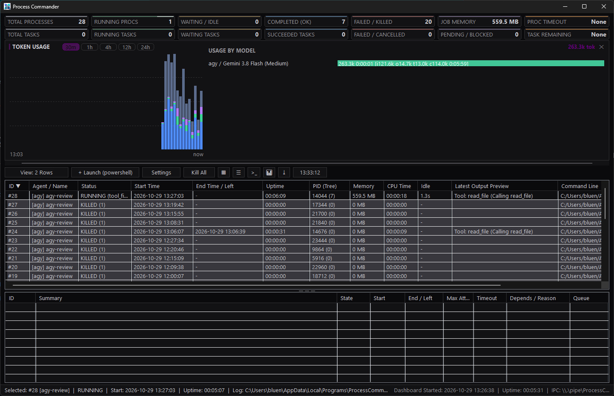
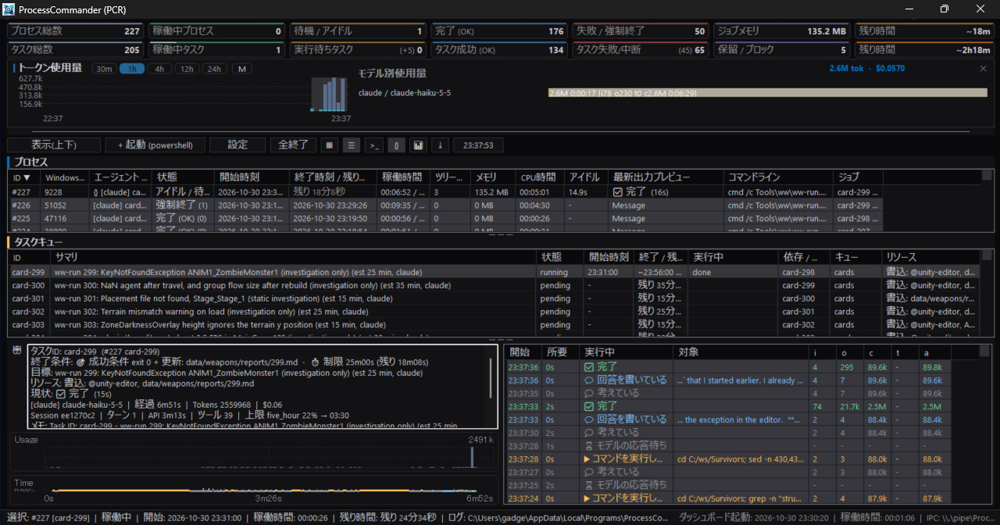
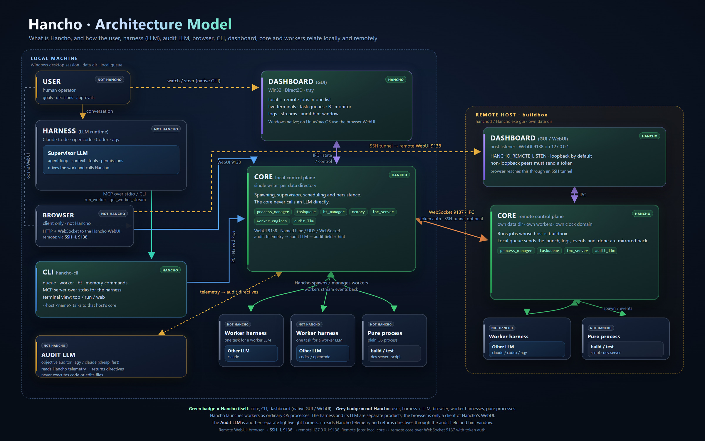

# Hancho

**[English](README.md) | [Japanese](README-ja.md)**

**Hancho** is a native Win32 C++ Multi-Terminal ConPTY Process Manager and Dashboard designed for orchestrating, monitoring, and interacting with multiple parallel CLI agents (`claude`, `opencode`, build scripts, and interactive shells) via both **Model Context Protocol (MCP)** and **CLI commands**.

Check the version with `hancho-cli.exe --version` (current: 0.9.1).

### Who is this for?

- **Windows developers who use LLM coding agents** (Claude Code, opencode, Codex, etc.) and want one supervising LLM to delegate work to other CLI agents running as worker processes.
- **People running long, parallel, or interactive jobs** — builds, test suites, dev servers, TUI agents — that must outlive the chat session, follow a fixed plan with dependencies and retries, or mix in non-Claude workers.
- **Anyone who wants to watch and steer** many agent terminals live on one dashboard, with timeouts, retries, dependencies, and logs that survive restarts.

**Probably not for you if** your tasks are short reasoning or code edits that LLM sub-agents already handle well. Token cost is now about the same either way; see [Sub-agents vs. Hancho](doc/pros-cons-comparison.md#when-token-cost-is-no-longer-the-difference) for what Hancho adds (durability, deterministic control, visibility) and the full [Pros/Cons comparison](doc/pros-cons-comparison.md).




The dashboard has an **execution monitor pane** below the process and task lists. It follows the selected process and shows its goal, what it is doing now, its TODO progress, job success condition, attempts and time limits, plus a plain-language activity history with elapsed times. JSON-streaming processes are marked `{}` in the process list. See [Key Features](doc/features.md) for details.



---

## Express

- Download and install [Hancho-v0.9.7-win64-setup.exe](https://github.com/gadget114514/Hancho/releases/download/v0.9.7/Hancho-v0.9.7-win64-setup.exe)
  (portable: [Hancho-v0.9.7-win64.zip](https://github.com/gadget114514/Hancho/releases/download/v0.9.7/Hancho-v0.9.7-win64.zip), all versions: [Releases](https://github.com/gadget114514/Hancho/releases))
- In your llm, "find hancho in PATH, then read help to use it" 
- In your llm, "create task and use (opencode|claude|agy|codex) to execute the task via hancho" 
- That's all

LLM will execute "hancho help --json", then the llm will know how to use it.
You use the LLM as frontend supervisor llm, and you can specify other llm as worker.


## Delegating to a worker LLM: `run_worker`

The MCP tool `run_worker` hands one task to a worker LLM CLI, blocks until the worker exits, and returns only its final result. The worker's transcript stays out of the supervisor's context, and the raw stream stays in `stream_file`.

```json
{
  "name": "run_worker",
  "arguments": {
    "cmd": "claude -p \"Summarize the failing tests\" --output-format stream-json --verbose",
    "name": "test-summary",
    "cwd": "D:/work/myproject",
    "timeout_sec": 1800
  }
}
```

| Argument | Meaning |
| :--- | :--- |
| `cmd` (required) | Worker command line, one command only |
| `name`, `cwd` | Dashboard label; working directory |
| `agent_type` | Stream format: `claude`, `agy`, `opencode` or `auto` (default: detected from the command) |
| `timeout_sec`, `idle_timeout_sec` | Kill after this runtime, or after this long with no output (0 = unlimited) |
| `supervisor_goal`, `supervisor_notes` | Text shown on the dashboard |
| `wait_ms` | Max wait in ms (default 0 = until the worker exits) |

The response carries `finished`, `success`, `state`, `exit_code`, `result`, `result_source`, `result_truncated`, `tool_calls`, `tool_errors`, `num_turns`, `permission_denials`, `total_tokens`, `cost_usd`, `log_file` and `stream_file`.

- `result` is capped at 64 KB; `result_truncated` tells you it was cut. If the stream has no result event, `result` holds the last output lines and `result_source` is `output`.
- If `wait_ms` runs out, the response has `finished: false` and the worker's current activity, and the worker keeps running. Continue with `wait_worker` and the returned `id`.
- Your harness does not see this as a native sub-agent. To have it shown as one, define a thin custom agent (Claude Code: `.claude/agents/<name>.md`, cheap model, this tool only) that calls `run_worker` and returns the result. The wrapper costs extra tokens; calling `run_worker` directly is cheapest.
- For several steps with an order, dependencies or retries, use the [task queue](doc/taskqueue.md) instead.

## Behavior trees: the next-step decisions run inside Hancho

When the next step depends on the result of the previous one (build → fix → rebuild, test → fix → retest, "if this file says X, do Y"), the supervisor LLM used to stay in the loop: wait for a job, read its result, decide, add the next job, and repeat. Hancho now has a built-in behavior tree (BT) engine. The LLM writes the whole plan once as a JSON tree and submits it with `bt_start`; Hancho walks the tree, runs every step as an ordinary task-queue job, and makes the routine decisions itself.

| | Before (LLM drives each step) | With behavior trees |
| :--- | :--- | :--- |
| Who decides the next step | The supervisor LLM, one turn per step | Hancho, from the tree (branches, loops, retries, condition checks) |
| Tokens and turns | Every step costs a turn and context | One `bt_start`; the LLM is called back only for real decisions (`escalate`) or at the end |
| Supervisor availability | Must stay alive and attentive | Can wait on `bt_wait`, sleep, or have its context compacted; the tree keeps running |
| Runaway loops | Depends on the LLM stopping | `retry` / `repeat` need `max`; `maxNodeRuns` and `maxWallSec` cap the whole tree |
| Mechanical checks | The LLM reads logs and exit codes | Built-in conditions: `exitCode`, `fileExists`, `fileNewer`, `outputMatches`, `jsonValue`, `var` |
| Decisions | Lost in the chat history | `escalate` sends a self-contained decision packet (goal, question, guidance, logs, files) and records the answer with its rationale |
| Restarts | The LLM must remember where it was | The tree's state is saved after every change and resumes after a Hancho restart |
| Worker engines | Command lines written by hand per CLI | `worker` steps name an engine (`claude`, `agy`, `opencode`, `codex` or your own in `engines.json`); one tree can mix engines |

What stays the same: each step is still a normal task-queue job with its own timeout, success check, resource locks and logs, and it appears in the task list like any other job. The **BT** toolbar button (Ctrl+Shift+B) opens a view of each tree, showing which node started which task and how far each tree has run. LLMs learn the format from `hancho-cli help --json` and the documentation linked below.

### Behavior Tree Documentation

- **[Behavior Trees Guide](doc/behavior-tree.md)** ([日本語版](doc/behavior-tree-ja.md)): Comprehensive guide covering JSON definition format, node types, variables, worker engines, escalate decision packets, and complete examples.
- **[Token Optimization Guide](doc/behavior-tree-token-optimization.md)** ([日本語版](doc/behavior-tree-token-optimization-ja.md)): Token-saving principles, `compact: true` in `bt_wait`, escalation line/byte limits, preview truncation, and authoring best practices.
- **[Architecture & Design Plan](doc/behavior-tree-plan-en.md)** ([日本語版](doc/behavior-tree-plan.md)): Original design specification, execution model, safety limits, and integration with the task queue and dashboard.

## Stable events and adapters

Hancho writes a versioned event stream next to the raw one. For a worker process, `logs/proc_<id>_<name>_stream.jsonl` keeps the CLI's raw lines and `logs/proc_<id>_<name>.events.jsonl` holds normalized `hancho.event/1` events (`tool.call`, `tool.result`, `usage`, `run.ended`, ...). The schema is published as [doc/schema/hancho.event.v1.json](doc/schema/hancho.event.v1.json).

- `hancho-cli worker stream <id>` returns the normalized events from `.events.jsonl` (`hancho.event/1`).
- MCP `get_worker_stream` returns the same shape (`hancho.event/1`).
- Add a CLI without C++ by dropping `<data-dir>/adapters/<name>.json` (Tier 1: `match`, `rules`, JSON Pointer `map`), or point `exec` at a converter process (Tier 3: raw lines on stdin, `hancho.event` lines on stdout).
- `engines.json` may set `adapter` and `capabilities` (`jsonStream`, `resume`, `reportsUsage`, `reportsSubagents`, `permissionModes`).
- Wrapper scripts can write events directly: pipe-mode workers get `HANCHO_EVENT_PIPE`, and `hancho-cli event emit --kind message --text "..."` writes to it.
- `hancho-cli adapter test <name>` checks recorded inputs against expected `{kind, data}` pairs under `tests/adapters/<name>/`.

**Event schema and legacy removal.** Both `hancho-cli worker stream` and MCP `get_worker_stream` return `hancho.event/1`. The older internal `type` strings were deprecated in v0.9.3 and removed in **v0.11.0**. Requests passing `--schema legacy` (CLI) or `schema: "legacy"` (MCP) are rejected as unsupported. Migration details and the `type` → `kind` mapping are in [doc/LLM-jsonstream-format.md](doc/LLM-jsonstream-format.md#legacy-type-strings-and-migration-to-hanchoevent1).

## Leaving Hancho (graduation)

Hancho is a means to an end. When your harness covers the reasons in [Hancho v3 Design §5.2](doc/design-v3-en.md), you can leave without losing work.

1. `hancho-cli.exe mcp uninstall` removes the Hancho entry from `.mcp.json` / `opencode.json`.
2. `hancho-cli.exe agent uninstall-template` removes `.claude\agents\hancho-runner.md`.
3. The data directory is kept by default. Add `--delete-data-dir` to either command to remove it too.

All Hancho data is plain JSON / JSONL (task queues, behavior trees, stream events, semantic memory) and stays readable without Hancho. Before leaving, check the feature map and replacement conditions in [design-v3-en.md §5.3–5.5](doc/design-v3-en.md); every release reviews that table using the [release checklist](doc/release-checklist.md).

## Documentation

| Document | Contents |
| :--- | :--- |
| [Start](doc/start.md) | Quick start for LLM agents, build instructions, `Hancho.exe` vs. `hancho-cli.exe` |
| [Key Features](doc/features.md) | Dashboard GUI, shell launcher, history, tray, logs, Job Objects, settings, task queue overview |
| [Console CLI](doc/cli.md) | `hancho-cli.exe` usage, JSON output, stdin modes, completion, `help --json` keys |
| [Task Queue](doc/taskqueue.md) | Ordered jobs, dependencies, job fields, states, ChainGuard |
| [Behavior Trees](doc/behavior-tree.md) | BT format, node types, variables, worker engines, escalate, examples |
| [BT Token Optimization](doc/behavior-tree-token-optimization.md) | Token-saving architecture, `compact: true`, lightweight escalation packets |
| [BT Design Plan](doc/behavior-tree-plan-en.md) | Architecture and implementation plan for the BT engine |
| [MCP Server](doc/mcp.md) | MCP registration and the MCP tools |
| [Data Directory](doc/data-directory.md) | Project-local, git-managed `--data-dir` |
| [Pros/Cons](doc/pros-cons-comparison.md) | When to use Hancho vs. sub-agents and alternatives |
| [Critical Comparison](doc/critical-comparison.md) | A skeptical look at Hancho's limits and when not to use it |
| [Competitive Comparison](doc/competitive-comparison.md) | How Hancho compares with agent frameworks and memory services |
| [Hancho v3 Design](doc/design-v3-en.md) | Event schema and adapters, headless/remote, semantic memory, failure analysis, graduation guide |
| [Release Checklist](doc/release-checklist.md) | Per-release review of the graduation feature map and cleanup commands |
| [tools/ww](tools/ww/README-ww.md) | Optional, independent task-card runner template (not part of Hancho) |

---

## Release Notes

### v0.9.7
- **Audit feedback fixes**: `timing_feedback` now measures only the last successful attempt (a fast-failing attempt no longer reports `diverged_under`), ignores runs under 5 seconds for `diverged_under`, and reads its thresholds from `config.json` (`audit_timing_divergence_threshold`, default 2.0; `audit_timing_under_threshold`, default 0.33).
- **`resource_wait` in `taskqueue list`**: each job shows which job and resource a pending job is waiting for, as `taskqueue graph` already did.
- **Supervisor hint window**: copy prompts use existing commands (`taskqueue why` / `retry`, `bt get --id`, `bt resume`); behavior-tree escalations are detected again; several divergences / failures / resource waits are shown one after another, a visible hint is no longer replaced automatically, and a condition that comes back is shown again.
- **Help**: new AUDIT section in `hancho-cli help` and `agent.audit` in `help --json`; `estimateSec` is listed in `taskqueue add`.
- **Docs**: Audit LLM implementation design (`doc/audit-llm-design.md`).

### v0.9.6
- **Audit LLM / supervisor feedback (preview)**: every finished job with an `estimateSec` now exposes deterministic `timing_feedback` (actual duration, ratio, `accurate` / `diverged_over` / `diverged_under`, and concrete advice). The Windows dashboard adds a supervisor guidance hint window for timing divergences, with a one-click corrective prompt and configurable auto-dismiss. See `doc/audit-llm.md`.
- **WebUI exposure settings**: the `<data-dir>/config.json` -> `webui` object controls `enabled`, `scope` (`loopback` / `lan` / `custom`), `host`, `port`, `allowed_hosts` and `allowed_origins`. The default remains loopback-only; LAN mode binds `0.0.0.0`, keeps token authentication, and accepts IP literals plus configured hostnames. Changes apply live through `config_set`. Settings -> Maintenance exposes enable, exposure and allowed hosts.
- **Help and smoke tests**: `hancho-cli help` states that `start` is a process, not a task, and that task lists / per-model usage require `taskqueue add`, `run` or `bt start`; `fileExists` accepts a final-component glob; fixed the five v0.9.5 review regressions (cli_top_smoke registration, BT IPC streaming and data-dir isolation, headless wait/encoding, timestamp race, event schema path).
- **Docs**: Audit LLM specification, updated feature tables, and a refreshed architecture image.

### v0.9.5
- **Browser dashboard**: `hancho-cli web` opens an embedded HTTP + WebSocket dashboard (127.0.0.1:9138, token auth) with the same process / queue / monitor / why / memory views. See `doc/browser-ui.md`.
- **Interactive TUI**: `hancho-cli top` is now a full terminal dashboard with five tabs, row navigation, stop/retry/cancel, remote jobs and `--once --json`, with no external curses dependency. See `doc/tui-design.md`.
- **Remote hosts completed**: one persistent WebSocket multiplexes requests and streams logs/events with sequence resume; a restarted local dashboard reattaches to remote attempts, and `success.filesNewer` is evaluated on the remote host's own clock.
- **Long-term usage**: daily/monthly `hancho.usage.day/1` rollups, `hancho-cli usage stats|export|compact`, MCP `usage_stats` / `usage_export`, IPC `get_usage_daily`, and dashboard range selection. Per-engine/model attribution comes from task-queue / behavior-tree jobs that emit a JSON stream and receive `--model`.
- **Memory operations**: external ranker plugin with automatic BM25 fallback, `memory prune` with a `memory_max_bytes` cap, L3 promotion by configured workers, and L1 records for plain runs outside task queues (`taskqueue record-plain`, `memory rebuild`).
- **Checks and safety**: `success.testReport` (JUnit/NUnit) and scoped named resource locks (`@name:{root}`, `@name:{cwd}`); `hancho.event/1` `data` is strictly typed; `--schema legacy` is rejected.
- **Docs and help**: `hancho-cli help` now states that `start` is a process, not a task, and that task lists and per-model usage require `taskqueue add` / `run` / `bt start`.

### v0.9.4
- **Semantic memory**: L1 run records, L2 notes and L3 approved knowledge under `memory/`. `hancho-cli memory search|get|brief|stats|note|approve|rebuild|prune` and MCP `memory_search`, `memory_get`, `memory_brief`, `memory_stats`, `memory_note`, `memory_retract`. `{memory}` injects a bounded brief and records the ids on the attempt.
- **Failure analysis**: deterministic per-attempt diagnosis (class, confidence, summary, evidence, last activity, suggested action); `hancho-cli taskqueue why <id>`, MCP task results and behavior-tree conditions use it; retry policy can be class-dependent.
- **Headless, POSIX and remote foundations**: `Hancho.exe --headless`, `hancho-cli run --exit-on-drain --report junit.xml`, POSIX build targets and platform boundaries, `hosts.json` and remote job mirroring. These are early; see `doc/build-posix.md` and `doc/remote-hosts.md`.
- **Graduation**: `hancho-cli export` for queues / BTs / knowledge, `mcp uninstall`, `agent uninstall-template`, and a release checklist.
- **ETA and paused start**: jobs accept `estimateSec` so the dashboard shows the card estimate instead of the timeout; `bt start --paused true` registers a tree without creating jobs.

### v0.9.3
- **Legacy stream shape deprecated**: `hancho-cli worker stream` and MCP `get_worker_stream` return `hancho.event/1` by default. The old `type` strings stay available with `--schema legacy` / `schema: "legacy"` through v0.10.x and are removed in v0.11.0. See [migration steps](doc/LLM-jsonstream-format.md#legacy-type-strings-and-migration-to-hanchoevent1).
- **BT-wide task list**: `hancho-cli bt tasks --id <id>`, `taskqueue list --bt <id>` and MCP `taskqueue_list` with `bt` list every job of a behavior tree across its parallel branch queues. Parallel branches keep their own queues (and their own concurrency); the dashboard already shows all queues together.

### v0.9.2
- **Stable event schema**: worker output is also written as normalized `hancho.event/1` events to `logs/proc_<id>_<name>.events.jsonl`, next to the raw `.stream.jsonl`. Read them with `hancho-cli worker stream <id> --schema v1` or MCP `get_worker_stream` with `schema: "v1"`. The JSON Schema ships in `doc/schema/hancho.event.v1.json`.
- **CLI adapters without C++**: add `<data-dir>/adapters/<name>.json` for a JSON-lines CLI (Tier 1 `match` / `rules` / JSON Pointer `map`), or set `exec` to a converter process that reads raw lines on stdin and writes `hancho.event` lines on stdout (Tier 3). `engines.json` accepts `adapter` and `capabilities`.
- **Events from scripts**: pipe-mode workers receive `HANCHO_EVENT_PIPE`; `hancho-cli event emit --kind ... --text ...` writes to it. `hancho-cli adapter test <name>` checks recorded inputs against expected `{kind, data}` pairs.
- **Parallel behavior-tree branches**: each child of a `parallel` node now runs in its own task queue, so the branches actually run at the same time; long queue names get a hash suffix to keep their files unique.
- **Docs and help**: README and `hancho-cli help` describe the event schema, adapters, `HANCHO_EVENT_PIPE`, the new `--schema v1` option, `event emit` and `adapter test`.

### v0.9.1
- **Fix: Resources column header color**: the `Resources` column header in the task list now uses the same themed owner-drawn color as the other columns instead of the native default.
- **Fix: `help --json` MCP auto-register command**: `setup.mcp.auto_install` now recommends `hancho-cli.exe mcp install`. Previously it showed `Hancho.exe mcp install`, which launched the MCP stdio server instead of writing the client config.

### v0.9.0
- **Renamed from ProcessCommander 2.9.x to Hancho 0.9.0**: the product, executable (`Hancho.exe`), GUI window classes, Named Pipe / mutex names, default data folder (`.hancho`), MCP server name (`hancho`) and the `HANCHO_LOG_DIR` environment variable were renamed. The console client was renamed from `pcder.exe` to `hancho-cli.exe`. Old `.processcommander` data and the old pipe/mutex names are not reused or migrated automatically; create a fresh data directory with `--data-dir`.

### v2.9.3
- **See which session added each task**: every task-queue job records its origin (agent session id, Claude desktop session id, MCP client, working folder, process id), filled in automatically by MCP `taskqueue_add`, `hancho-cli taskqueue add` and behavior trees. Name the work with `originLabel`, `--origin-label` or `PC_ORIGIN_LABEL`. The dashboard shows it in a new **Origin** column (hover for every field), and `taskqueue_list` `origin: "self"` (`hancho-cli taskqueue list --origin self`) lists only your own session's jobs. See [doc/taskqueue.md](doc/taskqueue.md).
- **Fewer tokens in behavior tree replies**: only `bt_get` returns the whole tree; the other BT tools and `bt_wait compact: true` leave it out, and long variable values and prompts are cut to a preview. Escalation `include` takes `lines` and `maxBytes`. Worker nodes now see their `outputSchema`.

### v2.9.1
- **Cheaper `bt_wait` for supervisor LLMs**: when the timeout passes with nothing to act on, `bt_wait` now returns only `{state, version, nodeRuns, timedOut}` instead of the whole tree. Finish and escalation replies are unchanged and still return at once.
- **Long, cancellable waits**: the MCP `bt_wait` waits up to 10 minutes by default (a negative `timeoutMs` waits with no limit). Other MCP calls are still served while it waits, and `notifications/cancelled` stops it within about 2 seconds. `hancho-cli bt wait` keeps a 60-second default.

### v2.9.0
- **Behavior trees**: a supervisor LLM can submit a whole multi-step plan (branches, build-fix loops, retries, condition checks, worker LLM steps, decisions) as one JSON tree with `bt_start`. Hancho runs it, adds each step as an ordinary task-queue job, and calls the LLM back only for `escalate` decisions or at the end. New MCP tools `bt_validate`, `bt_start`, `bt_get`, `bt_list`, `bt_wait`, `bt_resume`, `bt_retry`, `bt_update`, `bt_cancel`, `bt_pause` and `hancho-cli bt ...` commands. See [Behavior trees](#behavior-trees-the-next-step-decisions-run-inside-hancho) and [doc/behavior-tree.md](doc/behavior-tree.md).
- **Worker engines**: `worker` steps name an engine (`claude`, `agy`, `opencode`, `codex`, or your own in `engines.json` in the data directory) and a model; permission flags stay in the engine definition.
- **Behavior tree view**: the **BT** toolbar button (Ctrl+Shift+B), or "Show in Behavior Tree" on a task's right-click menu, shows each tree, which node started which task, and how far it has run. Active trees come first; finished trees older than 24 hours are hidden unless "Show all" is on.
- **Help for LLMs**: `Hancho.exe --help`, `hancho-cli help` and `hancho-cli help --json` explain when to use a behavior tree instead of adding jobs by hand.
- **Task queue**: `taskqueue_retry` / `taskqueue_update` from MCP or the CLI on a job started by a behavior tree are refused (use `bt_retry` / `bt_update`); Retry in the dashboard retries the tree from that step.

### v2.7.2
- **Remaining time ignores jobs that cannot run**: the total remaining time (task remaining KPI and tooltip) no longer counts blocked jobs, or pending jobs whose upstream finished without satisfying them. Their counts are unchanged.
- **Pending / blocked KPI animation**: the PENDING / BLOCKED card animates while its count is 1 or more.
- **OpenCode usage attribution**: OpenCode token usage was recorded under agy in the per-model usage view. It is now recorded under OpenCode.

### v2.7.1
- **Font size for lists**: the process list and the task queue list each have their own font size (10-24 px), set on the 表示 (Appearance) tab of Settings.
- **Row colors on a 色 tab**: the per-state row background colors moved from the Appearance tab to a new 色 (Colors) tab in Settings.
- **Window title**: when started with `--data-dir`, the dashboard title shows the data directory, so several dashboards can be told apart.

### v2.7.0
- **Task queue time filter**: `hancho-cli taskqueue list --since 6h` (and the MCP `taskqueue_list` `since` field) shows only jobs updated within the period. Units are m, h and d.
- **Retry all failures**: `hancho-cli taskqueue retry --failed [<queue>] [--since 6h]` requeues every failed job at once, optionally in one queue or only those that failed recently. The MCP `taskqueue_retry` tool accepts `failed: true` without an id for the same bulk retry.
- **Process cleanup**: when a process exits, its leftover child processes (python, cmd, ...) are terminated too, so nothing is left running in the job.
- **Monitor pane**: the activity tree shows only sub-agents; the root agent's own steps are no longer listed.

### v2.5.2
- **Tray recovery**: the tray icon is registered again after Explorer restarts. If the tray icon cannot be added, minimizing keeps the window on the taskbar instead of hiding it.
- **Crash logging**: an exception in the dashboard, IPC, process monitor or output reader is written to the audit log (`CRASH_GUARD`) instead of silently ending the program. Unhandled exceptions are logged as `CRASH`.
- **End blink**: process and task rows blink for a few seconds when they end. Turn it off or change the duration (1-60 s) in the Settings dialog.
- **Failure sound**: a failed, timed-out or killed process plays a different system sound from a completed one. It follows the completion sound setting.

### v2.5.1
- **Row colors**: the process and task lists can color rows by state (running, idle, completed, timeout, failed) in the Settings dialog. Dark and light themes have separate colors, and the text switches between black and white to stay readable.
- **`hancho-cli reset [--yes]`**: deletes all project data in the data directory. Without `--yes` it only lists what would be deleted, and it is refused while Hancho is running.
- **`hancho-cli taskqueue purge --older-than-days N`**: removes finished jobs (succeeded, failed, cancelled) that have not been updated for N days.

### v2.5.0
- **Dashboard refresh**: the update interval now defaults to 2000 ms and can be set in ms in the Settings dialog (100-60000 ms). It doubles while no process or queue job is running.
- **Dashboard redraw**: the process and task lists and the KPI cards are repainted only when their contents change, so idle refresh ticks do less drawing.
- **Task monitor**: the ID column is 1.5x wider and the Queue column is 3/4 as wide.

### v2.3.7
- **Task monitor**: the goal field takes half the pane height, without the old 150px limit.

### v2.3.6
- **Security**: fixed a command injection in the dashboard auto-start. A path or data directory containing `‘` or `’` could run PowerShell commands as the current user.

### v2.3.5
- **Sub-agents**: Claude sub-agents are tracked separately and shown as a tree in the monitor pane. `hancho-cli worker status` and the IPC state list them.
- **Streams**: Claude partial messages (`--include-partial-messages`) and `codex exec --json` events are parsed.
- **Toolbar**: added a refresh icon button to the left of the clock.
- **Settings**: the number of stream events kept per process is configurable (default 2000; -1 keeps them until memory runs out).
- **Tools**: added `hancho-cli worker install-template` (hancho-runner agent), `-Agent` / `WW_AGENT` for ww-run and ww-watch, and `tools/ww-unity`.
- **Lists**: updates pause while a list scrollbar is held, and the task list keeps its scroll position when it refreshes.
- **Tokens**: Claude usage is counted once per message, and the result line adds only what the messages did not report.

### v2.3.4
- **Task monitor**: the scrollbars of the goal and preview fields now follow the theme colours.

### v2.3.3
- **Themes**: added Deep Purple, Pale Purple, Deep Yellow and Pale Yellow.
- **List headers**: the background now has a slight tint of the theme accent colour.
- **Scrollbars**: the process and task list scrollbars are double-buffered to reduce flicker.
- **Settings**: fixed the sound section overlapping the buttons above it.

### v2.3.2
- **Themes**: five new pastel themes with pale backgrounds: Pastel Blue, Orange, Pink, Red and Green.
- **KPI cards**: the colour bar is twice as tall, the text is bold, and the cards are more compact.
- **CLI**: `hancho-cli agent` is now `hancho-cli worker`. The old name still works.
- **MCP**: `get_agent_stream`, `get_agent_state` and `update_agent_info` are now `get_worker_stream`, `get_worker_state` and `update_worker_info`. The old names still work but are no longer listed.

### v2.3.1
- **MCP**: `run_agent` and `wait_agent` are now `run_worker` and `wait_worker`, so they are not mistaken for your harness's native sub-agent feature. The old names still work but are no longer listed.

### v2.3.0
- **MCP**: added tools that hand one task to a worker LLM and return only its final result.
- **Monitor pane**: a tool call's description has its own column, and the subtask list takes two thirds of the width.
- **Task list**: hover to see the full Resources text, and copy cells.
- **ww-run**: finishes when the engine exits, not when its stdout closes.

Older versions: [Releases](https://github.com/gadget114514/Hancho/releases)

## Appendix: `Hancho.exe --help`

```text
Hancho 0.9.3 - Native Win32 Multi-LLM Process & ConPTY Manager + Live GUI Dashboard

USAGE:
  Hancho.exe [gui] [--data-dir <path>]
      Launch the live Win32 Dashboard GUI and Named Pipe server.

  Hancho.exe quit
      Quit the running GUI, including one hidden in the system tray (its tray icon is removed).

  Hancho.exe mcp [--data-dir <path>]
      Run as a Model Context Protocol (MCP) stdio server for Claude.
      Automatically connects to (or launches) the Win32 GUI Dashboard.

  Hancho.exe --help
      Show this help.

  Hancho.exe --version
      Show the version.

OPTIONS (per launch):
  --data-dir <path>   Store logs, state, task queues and config in <path>.
                      Use a project-local directory to git-manage them. Each
                      data dir gets its own dashboard instance (separate pipe).
                      Equivalent environment variable: HANCHO_LOG_DIR.
                      Consistency: pass the same --data-dir on every call, or embed
                      it once with `hancho-cli.exe mcp install --data-dir <path>`.
                      Different data dirs are isolated dashboard instances.

WORKING MODEL (LLM orchestration):
  Hancho is the execution layer for a supervising LLM.

    Supervisor LLM (Claude Code, opencode, ...)
      |  start_process   -> one long-running worker command
      |  taskqueue_add   -> ordered/dependent worker jobs
      |  bt_start        -> a behavior tree: steps, branches, retries, checks
      v
    Hancho
      |  owns processes, timeouts, logs, retries, state
      v
    Worker LLM / build command
      -> one job command; writes artifacts and logs

    Audit LLM (Objective Auditor / Evaluator)
      -> observes telemetry (timing divergence, thrashing, task hygiene);
         feeds corrective guidance back to the supervisor via hints & MCP.

  Assumed structure:
    1. The supervisor plans and declares jobs. It does not run the work itself,
       does not chain commands, and does not fabricate success.
    2. Each unit of work is one job with a one-line summary, its own timeoutSec,
       and an optional success check (filesNewer / outputRegex). Steps or
       dependencies become separate jobs linked with dependsOn.
    3. Workers are ordinary processes and may themselves be LLM CLIs. Pass
       detailed instructions via instructionsFile/instructionsText; workers read
       {instructions} / PC_JOB_INSTRUCTIONS and write artifacts.
       Role clarity: when supervisor and worker share the same engine
       (Claude/Claude, opencode/opencode), roles can blur; prefer a different
       worker engine or a clearly distinct worker role/prompt.
    4. The supervisor observes with taskqueue_wait / taskqueue_list /
       taskqueue_graph and reads logs; it never polls .done files.
    5. On failure, fix the cause and call taskqueue_retry. Blocked dependents
       resume automatically.
    6. Keep the supervisor context small: read artifacts, not raw transcripts.
    7. When the next step depends on results (build -> fix -> rebuild loops,
       test -> fix -> retest, "if this file says X then ..."), do not watch and
       add jobs by hand: write the whole plan as a behavior tree (BT) and submit
       it once with bt_start. Hancho runs it, adding each step as an
       ordinary job, and returns to you only when a decision is needed
       (escalate) or the tree finishes. See BEHAVIOR TREES below.
    8. The Audit LLM acts as an objective observer of the supervisor's orchestration.
       It detects execution timing divergences (actual duration vs estimate),
       prevents unmodified retry loops (thrashing), and closes the feedback loop
       via popup hints and MCP responses. See doc/audit-llm.md (Japanese: doc/audit-llm-ja.md).

CONSOLE CLIENT / CLI SETUP:
  Use hancho-cli.exe for CLI commands (start, list, logs, send, wait, kill, kill-all, clear).
  It auto-starts the GUI dashboard and locates Hancho.exe in its folder.
  Run `hancho-cli.exe help` for human-readable usage, or `hancho-cli.exe help --json` for
  machine-readable commands and setup instructions for LLMs.

COMPLETION NOTIFICATION / BACKGROUND TASKS:
  `hancho-cli.exe start ... --wait --wait-ms 0 --json` keeps hancho-cli.exe alive until the
  managed process exits. `--wait-ms 0` means unlimited wait. Exit code is 0 on
  completion, the child exit code on failure, and 124 if the wait times out.
  For an existing process: `hancho-cli.exe wait --id <id> --wait-ms 0 --json`.
  Hancho also writes a .done JSON file on exit.

MCP SERVER SETUP:
  Register this executable in .mcp.json (Claude Code) or claude_desktop_config.json:
    {
      "mcpServers": {
        "hancho": {
          "command": "<absolute path to Hancho.exe>",
          "args": ["mcp"]
        }
      }
    }
  Auto-register (recommended for LLM agents):
    hancho-cli.exe mcp install                    (writes .mcp.json in the current directory)
    hancho-cli.exe mcp install --client opencode  (writes/updates opencode.json)

  PRECONDITIONS (LLM agents):
    - Windows 10/11 x64, same user session as the dashboard; no admin required.
    - The dashboard auto-starts on first use and owns the Named Pipe server.
    - Logs, state and task queues live under logs/ (override: HANCHO_LOG_DIR).

  MCP tools (34):
    Process (6):
      start_process, list_processes, get_process_output, send_process_input,
      wait_process, kill_process
    Worker (5):
      run_worker, wait_worker, get_worker_stream, get_worker_state, update_worker_info
    Task queue (13):
      taskqueue_add, taskqueue_list, taskqueue_get, taskqueue_retry,
      taskqueue_update, taskqueue_cancel, taskqueue_pause, taskqueue_resume,
      taskqueue_wait, taskqueue_purge, taskqueue_link, taskqueue_unlink,
      taskqueue_graph
    Behavior tree (10):
      bt_validate, bt_start, bt_get, bt_list, bt_wait, bt_resume, bt_retry,
      bt_update, bt_cancel, bt_pause

  HOW TO USE (decision guide):
    - One command, e.g. a build script, CLI worker or shell -> start_process
    - One task for a worker LLM, final result only         -> run_worker
      Harnesses do not see this as a native sub-agent; a thin custom agent that
      calls run_worker makes it one, at the cost of the wrapper's tokens.
    - Multiple steps, fixed order or dependencies         -> taskqueue_add + dependsOn
    - Steps whose next step depends on results: branches,
      fix loops, checks, worker LLM steps, your decisions -> bt_start + bt_wait
    - Never write &&, ||, a single &, PowerShell ';', newline chains or polling
      loops. ChainGuard rejects them: one job = one command with its own timeoutSec.
    - Required taskqueue job fields: id, command, summary, timeoutSec.
      Optional: cwd, env, dependsOn, idle, maxAttempts, retryDelaySec, success,
      killExclude, resources {write,read}, priority, instructionsFile / instructionsText.
    - resources: jobs whose write/read sets overlap never run together (read/read is
      fine). Paths/globs resolve against cwd; "@name" is a named lock.
    - Success is verified: exit code AND optional filesNewer / outputRegex.
    - States: waiting = queued and ready; pending = dependencies not satisfied;
      blocked = a dependency failed; running; succeeded; failed; cancelled.
    - Observe with taskqueue_wait / taskqueue_list / taskqueue_graph; after fixing
      the cause use taskqueue_retry (blocked dependents resume automatically).

  BEHAVIOR TREES (bt_*):
    A behavior tree is one JSON document describing the whole workflow. Leaves run
    work (job = one command, worker = one task for a worker LLM); composites decide
    what runs next (sequence, fallback, parallel, if, retry, repeat, timeout);
    conditions check results (fileExists, fileNewer, outputMatches, exitCode,
    jsonValue, var, nodeState); escalate hands a decision back to you.
    Flow:
      1. bt_validate (optional), then bt_start {bt: {...}} or {file: "plan.json"}.
      2. Loop on bt_wait {id, sinceVersion, timeoutMs}. It returns when the tree
         finishes or waits for you (state "waitingForLlm" + a decision packet).
      3. Answer with bt_resume {id, node, answer, rationale}. The packet holds the
         question, guidance, allowed answers and the logs/files/vars you asked to
         include, so you can decide even after your context was compacted.
      4. On failure read bt_get {id, compact: true}; fix the cause (bt_update for
         a non-running node's definition) and call bt_retry {id, from}.
    Rules:
      - retry / repeat need "max". Jobs need command, summary, timeoutSec; workers
        need prompt, summary, timeoutSec and optionally engine / model (claude,
        agy, opencode, codex or ones defined in <data dir>\engines.json).
      - Write "intent" (the goal) and, on escalate, "question" + "guidance" for
        your future self. ${name} expands variables; in command it is quoted as
        one argument. Do not retry BT jobs with taskqueue_retry; use bt_retry.
    Minimal example (build, and on failure let a worker fix it, up to 3 times):
      {"id": "fix-build", "summary": "Build and fix", "intent": "Release build passes",
       "cwd": "D:/repo",
       "root": {"type": "retry", "max": 3, "child": {"type": "fallback", "children": [
         {"type": "job", "id": "build", "summary": "Build", "timeoutSec": 1800,
          "command": "cmake --build build --config Release"},
         {"type": "sequence", "children": [
           {"type": "worker", "id": "fix", "engine": "claude", "summary": "Fix build",
            "timeoutSec": 3600, "prompt": "Fix the build errors in ${build.logFile}."},
           {"type": "fail"}]}]}}}
    Full format, every node type and three complete examples:
      doc\behavior-tree.md (English), doc\behavior-tree-ja.md (Japanese), in the
      Hancho installation folder. `hancho-cli.exe bt --help` lists the CLI.

  For the full machine-readable guide (agent.quick_start, decision, states):
    hancho-cli.exe help --json
```

---

## Appendix: `hancho-cli.exe help` output

```text
hancho-cli 0.9.3 - Hancho console client

USAGE:
  hancho-cli [--json] <command> [options]

GLOBAL OPTIONS:
  --json, -j               Print machine-readable JSON instead of human-friendly text.
  -h, --help               Show this help.
  -V, --version            Show the version (also: hancho-cli version).

DATA DIRECTORY (per invocation):
  --data-dir <path>        Store logs, state, task queues and config in <path> for
                           THIS hancho-cli call. May be placed before or after the command.
                           Point it at a project folder to git-manage the data:
                             hancho-cli.exe --data-dir .hancho taskqueue add --file jobs.json
                             hancho-cli.exe taskqueue list main --data-dir .hancho
                           Each data dir gets its own dashboard instance, so different
                           projects can run at the same time.

  CONSISTENCY (one data dir per project):
    --data-dir is per invocation, not a global setting. To keep a project's
    logs/state/task queues consistent:
      1. Choose one project-local directory, e.g. .hancho in the project root.
      2. Register the MCP server once with it:
           hancho-cli.exe mcp install --data-dir .hancho
         This writes "--data-dir .hancho" into the project's MCP config,
         so every MCP tool call for the project uses the same directory.
      3. Pass the same --data-dir on every direct hancho-cli call.
      4. Relative paths resolve against the caller's current directory. MCP clients
         normally start the server in the project root; if the cwd is uncertain,
         put an absolute path in the MCP config.
      5. Different data dirs are isolated (own dashboard instance, Named Pipe and
         mutex); they never share processes or queues.
      6. Verify: hancho-cli.exe --data-dir <path> help --json prints
         "effective_data_dir", and the dashboard status bar shows the same path.

HANCHO-CLI CONCEPTS:
  Process IDs : Numeric IDs assigned by the dashboard (#1, #2, ...). Use them with
                list --id, logs --id, send --id, wait --id and kill --id.
  Modes       : pipe    = anonymous pipes (default; non-interactive CLI workers)
                pty     = Win32 ConPTY (interactive TUI: opencode, claude)
                console = separate visible console window
  stdin       : pipe mode keeps stdin writable (hancho-cli send) unless --close-stdin;
                close it for programs that wait for EOF.
  Logs        : logs/proc_<id>_<name>_<timestamp>.log (or --log-file).
  Streams     : logs/proc_<id>_<name>_stream.jsonl (raw) and
                logs/proc_<id>_<name>.events.jsonl (normalized hancho.event/1).
  Adapters    : <data dir>/adapters/<name>.json (Tier 1 declarative or Tier 3 exec).
  Done file   : atomic JSON on exit (logs/proc_<id>.done or --done-file) with
                state, exit_code, reason, log_file and done_file.
  cwd / env   : --cwd defaults to the caller's directory; PWD and INIT_CWD are
                set for the child and OLDPWD is removed.
  JSON output : --json / -j before or after the command prints one JSON object.
  Lifecycle   : start returns immediately unless --wait; use wait --id or the
                .done file to detect completion.

EXIT CODES:
  0    success / completed
  1    CLI or configuration error (also: process failure without --wait)
  124  wait timed out while the process is still running
       start --wait / wait return the managed process's exit code

ENVIRONMENT:
  HANCHO_LOG_DIR     Override the logs directory (state, logs, queues).
  HANCHO_EVENT_PIPE  Set by Hancho for pipe-mode workers; hancho-cli event emit
                     writes hancho.event/1 lines to this pipe.

EXAMPLES:
  hancho-cli.exe list --json
  hancho-cli.exe start --name build --cmd "cmd /c build.cmd" --timeout 1800 --wait --wait-ms 0 --json
  hancho-cli.exe start --name tui --pty --cmd "opencode"
  hancho-cli.exe logs --id 1 --tail 80
  hancho-cli.exe send --id 1 --input "status"
  hancho-cli.exe taskqueue add --file jobs.json --taskqueue main
  hancho-cli.exe mcp install --client opencode

COMMANDS:
  list [--id <id>]
      List all managed processes and their live metrics.

  logs --id <id> [--tail <lines>] [--wait-ms <ms>] [--raw]
      Fetch process output logs (ANSI codes stripped by default unless --raw).

  start [options] -- <command...>
      Start a managed process (e.g. claude, opencode) under a Win32 Job Object.
      Options:
        --cmd "<command>"        Command line to execute
        --name <label>           Display name on dashboard (e.g. "opencode-worker")
        --mode <pty|pipe|console>
                                 pty     = Win32 ConPTY interactive session
                                 pipe    = Anonymous pipes (default; no ConPTY)
                                 console = Separate visible console window
        --pty                    Shortcut for --mode pty (enable ConPTY).
        --open-stdin             Pipe mode only (default): keep stdin writable for hancho-cli send.
        --close-stdin            Pipe mode only: close stdin after launch so non-interactive
                                 programs (e.g. opencode run) receive EOF and can finish.
        --cwd <dir>              Working directory (default: the caller's current directory)
        --log-file <path>        Custom path for live output log
        --done-file <path>       Custom completion marker file created on exit
        --timeout <sec>          Max runtime timeout in seconds (0 = unlimited)
        --idle-timeout <sec>     Hang timeout if no output for N seconds (0 = unlimited)
        --eta <time>             Estimated end time shown in gray while running
                                 (e.g. "18:30" or "2026-10-22 18:30:00").
                                 If omitted, --timeout shows "remaining N seconds".
         --estimate-end <time>    Alias for --eta
         --agent-type <claude|agy|antigravity|opencode|codex|aider|ollama|adapter>
                                  Hint worker type for JSON stream parsing (auto-detected if omitted).
                                  A name with <data-dir>/adapters/<name>.json uses that Tier 1/3 adapter.
         --json-stream            Enable JSONL stream parsing; writes <log>.stream.jsonl and the
                                  normalized <log>.events.jsonl (hancho.event/1) for LLM workers.
         --wait                   Block until process exits (unlimited unless --wait-ms is set)
        --wait-ms <ms>           Max wait when --wait is set; initial output wait otherwise
                                 (default: 500; 0 = unlimited with --wait)

  send --id <id> --input "<text>" [--no-newline] [--wait-ms <ms>]
      Send input text to a running process's stdin or ConPTY session.

  wait --id <id> [--wait-ms <ms>]
      Wait until the specified process exits (or wait-ms elapses).

  kill --id <id>
      Forcefully kill the entire process tree (Job Object) for <id>.

  kill-all
      Forcefully kill all running managed process trees.

  clear
      Remove finished processes from the dashboard list.

  event emit --kind <kind> [--text <text>] [--tool <name>] [--activity <a>] [--target <t>]
             [--status <s>] [--data <json>] [--pipe <name>]
      Write one hancho.event/1 line to HANCHO_EVENT_PIPE (set for pipe-mode workers).

  adapter test <name> [--file <adapter.json>] [--dir <test-dir>]
      Run the Tier 1 declarative adapter against tests/adapters/<name>/*.input.jsonl and
      *.expected.jsonl (each expected line is {kind, data}).

  worker status <id>
      Show current worker status, active tool, thoughts, message, and supervisor context.

  worker stream <id> [--tail <n>] [--type <kind>] [--since <seq>] [--summary] [--schema <v1>]
      View captured JSON streaming events for claude, agy, or opencode workers.
      --schema v1 (default) returns the stable hancho.event/1 shape from <log>.events.jsonl.
      --schema legacy is not supported (removed in v0.11.0).
      --type matches the kind (tool.call, message, ...).

  worker info <id> [--notes "<notes>"] [--goal "<goal>"]
      Update supervisor notes or goal for an ongoing worker.

  agent install-template [--path <dir>] [--dry-run]
      Write the hancho-runner subagent to <dir>\.claude\agents\hancho-runner.md (default: the current
      directory). It runs long commands through Hancho and returns a short summary.
      An existing file is not overwritten.

  agent uninstall-template [--path <dir>] [--dry-run] [--delete-data-dir]
      Remove the hancho-runner subagent written by install-template (the inverse command).
      Empty .claude\agents and .claude directories are removed too. Add --delete-data-dir
      to also delete the data directory (kept by default).

  mcp install [--client claude|opencode] [--path <file>] [--name <name>] [--data-dir <path>] [--dry-run]
      Register Hancho as an MCP server automatically. Writes or updates
      .mcp.json (Claude Code, default) or opencode.json (--client opencode).
      --data-dir embeds "--data-dir <path>" in the generated MCP server args so the
      project keeps its logs/state/task queues inside that directory.
      --json prints the machine-readable result; --dry-run previews without writing.

  mcp uninstall [--client claude|opencode] [--path <file>] [--name <name>] [--data-dir <path>]
                [--delete-data-dir] [--dry-run]
      Remove the Hancho entry from the MCP config (the inverse of mcp install).
      The data directory is kept by default; add --delete-data-dir to delete it too.
      The data directory is the one embedded by mcp install, --data-dir, or the default.

LEAVING HANCHO (graduation):
  Stop using Hancho without losing your work:
    1. hancho-cli.exe mcp uninstall                  # remove MCP registration (keep data)
    2. hancho-cli.exe agent uninstall-template       # remove hancho-runner.md
    3. Delete the data directory only if you want to:
         hancho-cli.exe mcp uninstall --delete-data-dir
  While you keep it, all Hancho data stays in open formats: queues, behavior trees,
  events and memory are JSON / JSONL and readable without Hancho.
  When a harness covers your use, compare it with doc\design-v3.md sections 5.3-5.5
  (feature map and conditions) before leaving. doc\release-checklist.md records the
  per-release review of that table.

TASK QUEUE:
  taskqueue add --file <jobs.json> [--taskqueue <name>] [--concurrency <n>] [--notify-file <path>]
                [--origin-label <text>]
      Register jobs (array, or an object with "jobs"/"taskqueue"/"concurrency").
      Each job records its origin: the caller's session id (CLAUDE_CODE_SESSION_ID
      or PC_ORIGIN_SESSION), working folder and pid, plus --origin-label (or
      PC_ORIGIN_LABEL). The dashboard shows it in the Origin column.
      Each job needs id, command, summary, timeoutSec; dependsOn replaces '&&'.
      Optional: cwd, env, dependsOn, idle, maxAttempts, retryDelaySec, success,
      killExclude, resources {write,read}, defer, priority, instructionsFile/instructionsText.
      resources: jobs whose write/read sets overlap (write/write, write/read) never
      run together, across all queues; read/read may. Paths/globs resolve against
      cwd; a bare file name (Foo.cs) means **/Foo.cs; "@name" is a named lock.
      Disable with Settings / config.json resource_locks.
      defer {exitCodes,delaySec,limit} (default [75], 60, 60): an attempt that exits
      with one of exitCodes ("nothing ran, try again later", e.g. ww-run refusing an
      overlapping card) goes back to pending after delaySec without using up
      maxAttempts; after limit deferrals (0 = no limit) it is an ordinary failure.

  taskqueue list [<name>] [--state <state>] [--since <period>] [--origin <self|label|session>] [--bt <id>]
      List jobs with state, queue, summary and blockedBy. --since keeps only
      jobs updated within the period (30m, 6h, 2d), e.g. --since 6h.
      --bt <id> lists every job of a behavior tree across its parallel branch queues.
      --origin self keeps only the jobs this session added.

  taskqueue get <id> [--rev <n>] [--no-instructions]
  taskqueue retry <id>
  taskqueue retry --failed [<name>] [--since <period>]
      Retry every failed job at once, optionally only one queue and only jobs
      that failed within the period, e.g. `taskqueue retry --failed --since 6h`
      retries the failures of the last 6 hours. Blocked dependents resume.
  taskqueue cancel <id>
  taskqueue pause|resume <name>
  taskqueue graph [<name>] [--root <id>]     (ready, waiting_for, resource_wait, retry_in_sec, blocked)
  taskqueue wait <name> [--since <version>] [--timeout-ms <ms>]
  taskqueue purge <name> [--states succeeded,failed,cancelled]
  taskqueue purge [<name>] --older-than-days <N>   (finished jobs not updated for N days; all queues if <name> omitted)
  reset [--yes]                                    (delete ALL project data in the data directory; lists targets without --yes; refused while running)

BEHAVIOR TREES (for LLM agents; next step depends on results):
  bt validate|start --file <bt.json>    Check / register and run a behavior tree
  bt wait --id <id> [--since-version <n>] [--timeout-ms <ms>]
      Long-poll until the tree finishes or waits for your decision (escalate).
  bt resume --id <id> --node <node> --answer <a> --rationale <why> [--vars <json>]
  bt get --id <id> [--compact]  |  bt list
  bt retry --id <id> [--from <node>] [--reset-counters]
  bt update --id <id> [--node <node>] (--file <path> | --bt <json> | --patch <json>)
  bt cancel --id <id>  |  bt pause --id <id> [--paused true|false]
      Leaves: job (one command), worker (one task for a worker LLM; engine/model);
      composites: sequence, fallback, parallel, if, retry/repeat (max required),
      timeout; conditions: fileExists, fileNewer, outputMatches, exitCode,
      jsonValue, var, nodeState; escalate returns a decision packet to you.
      Each leaf runs as an ordinary task-queue job; retry BT jobs with bt retry,
      not taskqueue retry. Full format and examples: doc\behavior-tree.md in the
      installation folder; `hancho-cli bt --help` for all options.

  start/run ... --allow-chain
      Allow a chained command (&&, ||, &, ';') as a single process. Task-queue
      jobs never allow chains; use dependsOn instead.

COMPLETION / BACKGROUND TASKS:
  Use --wait to keep hancho-cli.exe alive until the managed process exits. Add
  --wait-ms 0 for an unlimited wait (or a positive value for a maximum).
  The exit code is 0 on completion, the child exit code on failure, and 124
  if the wait times out.

    hancho-cli.exe start --name task --wait --wait-ms 0 --json --cmd "opencode run ..."
    hancho-cli.exe wait --id <id> --wait-ms 0 --json

  Hancho also writes a .done JSON file on exit. Without --wait,
  start returns immediately; poll the .done file or call wait.

SETUP FOR LLM AGENTS:
  CLI:
    Use hancho-cli.exe (recommended) or the legacy "Hancho.exe <command>" form.
    Run "hancho-cli.exe help --json" to retrieve this help as machine-readable JSON.
    hancho-cli.exe auto-starts the GUI dashboard on first use if it is not running.

  MCP (stdio):
    Register Hancho.exe in .mcp.json (Claude Code) or
    claude_desktop_config.json (Claude Desktop):
      {
        "mcpServers": {
          "hancho": {
            "command": "D:\\wsgit\\Hancho\\build\\Release\\Hancho.exe",
            "args": ["mcp"]
          }
        }
      }

    AUTO-REGISTER (for LLM agents; no manual JSON editing):
      hancho-cli.exe mcp install                    # .mcp.json (Claude Code)
      hancho-cli.exe mcp install --client opencode  # opencode.json
      hancho-cli.exe mcp install --path <file> --json --dry-run

    ORCHESTRATION MODEL (how an LLM should use this):
      A supervising LLM uses Hancho as its execution layer to run
      child-process worker LLMs/CLIs as managed jobs.

        Supervisor LLM  ->  Hancho  ->  Worker LLM / build command
        plans + declares    timeouts, logs,        one job command;
        jobs                retries, state         writes artifacts

      - The supervisor keeps its context small: it plans and declares jobs; it
        does not run the work itself, chain commands, or fabricate success.
      - One job = one command. Use start_process for a single worker; use
        taskqueue_add with dependsOn for multiple steps or dependencies.
      - When the next step depends on results (build -> fix -> rebuild,
        test -> fix -> retest, branch on a file's content), do not watch and
        add jobs by hand: write the plan as a behavior tree and submit it once
        with bt_start, then loop on bt_wait and answer escalations with
        bt_resume (answer + rationale). See BEHAVIOR TREES above and
        doc\behavior-tree.md.
      - Each job needs a one-line summary and its own timeoutSec. Pass detailed
        instructions via instructionsFile/instructionsText; the worker reads
        {instructions} / PC_JOB_INSTRUCTIONS and writes artifacts.
      - Workers may be LLM CLIs (opencode run, claude -p, ...) or build scripts.
      - Role clarity: when the supervisor and worker use the same engine
        (e.g. Claude supervising `claude -p`, or opencode supervising
        `opencode run`), roles can blur and cause confusion; prefer a
        different worker engine for workers, or give workers a clearly
        distinct role/prompt and avoid nested supervision.
      - Verify success with exit code + filesNewer/outputRegex; observe with
        taskqueue_wait / taskqueue_list / taskqueue_graph and logs; retry with
        taskqueue_retry. Blocked dependents resume automatically.
      - Never poll .done files; use taskqueue_wait or wait_process.
      - Delegating to a worker LLM: run_worker blocks until the worker exits and
        returns only its final result; the raw stream stays in stream_file.
      - Your harness does not see Hancho as a native sub-agent. To have
        it shown as one, define a thin custom agent (Claude Code:
        .claude/agents/<name>.md, cheap model, this tool only) that calls run_worker
        and returns the result. The wrapper costs extra tokens; calling run_worker
        directly is cheapest.

    MCP tools (34):
      Process:    start_process, list_processes, get_process_output,
                  send_process_input, wait_process, kill_process
      Worker:     run_worker, wait_worker, get_worker_stream, get_worker_state,
                  update_worker_info
      Task queue: taskqueue_add, taskqueue_list, taskqueue_get, taskqueue_retry,
                  taskqueue_update, taskqueue_cancel, taskqueue_pause, taskqueue_resume,
                  taskqueue_wait, taskqueue_purge, taskqueue_link, taskqueue_unlink,
                  taskqueue_graph
      Behavior tree: bt_validate, bt_start, bt_get, bt_list, bt_wait, bt_resume,
                  bt_retry, bt_update, bt_cancel, bt_pause

NOTE:
  The GUI dashboard is provided by Hancho.exe, which is auto-started
  on first use if it is not already running.
```
