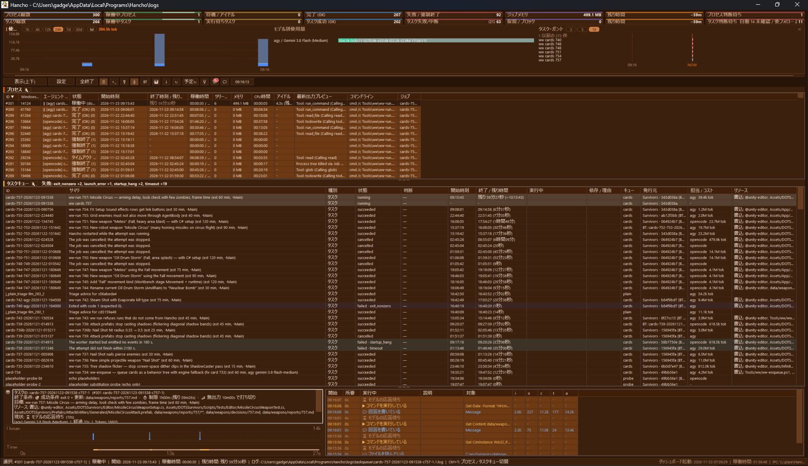
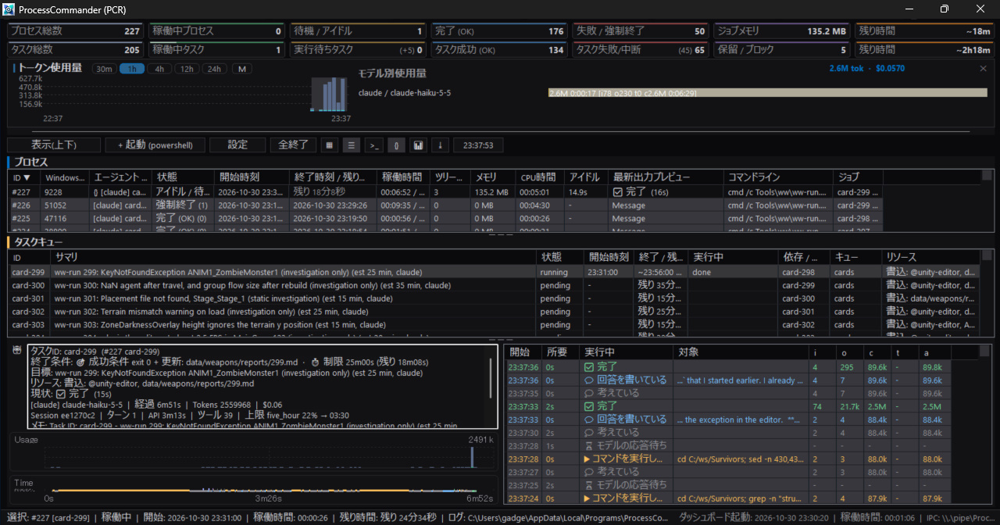
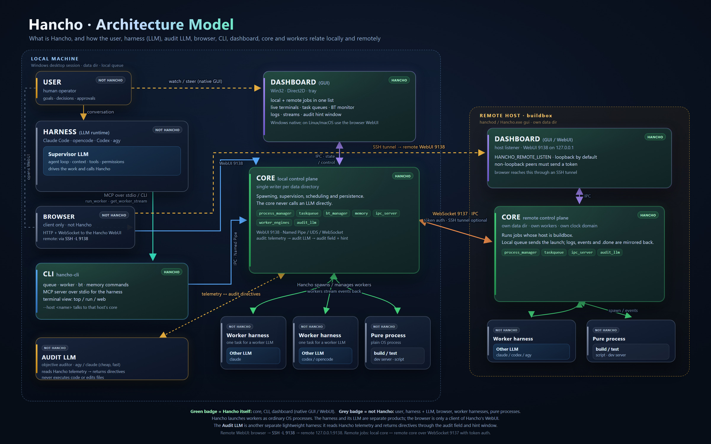

# Hancho

**[English](README.md) | [Japanese](README-ja.md)**

**Hancho** (班長, "foreman") is a dashboard for llm task management; thus a job foreman for AI coding agents on Windows: your LLM, or you, hands it work, and Hancho runs that work as real terminal processes, in order, with retries, on a dashboard you can watch.

Built around that one idea: a ConPTY multi-terminal dashboard, a task queue with dependencies, timeouts and retries, behavior trees for multi-step plans, and control from both **MCP** and the **CLI**. It treats `claude`, `opencode`, `codex`, build scripts and interactive shells alike.

Check the version with `hancho-cli.exe --version` (current: 0.10.0).

### Who is this for?

- **Windows developers who use LLM coding agents** (Claude Code, opencode, Codex, etc.) and want one supervising LLM to delegate work to other CLI agents running as worker processes.
- **People running long, parallel, or interactive jobs** — builds, test suites, dev servers, TUI agents — that must outlive the chat session, follow a fixed plan with dependencies and retries, or mix in non-Claude workers.
- **Anyone who wants to watch and steer** many agent terminals live on one dashboard, with timeouts, retries, dependencies, and logs that survive restarts.

**Probably not for you if** your tasks are short reasoning or code edits that LLM sub-agents already handle well. Token cost is now about the same either way; see [Sub-agents vs. Hancho](doc/obsoleted/pros-cons-comparison.md#when-token-cost-is-no-longer-the-difference) for what Hancho adds (durability, deterministic control, visibility) and the full [Pros/Cons comparison](doc/obsoleted/pros-cons-comparison.md).




The dashboard has an **execution monitor pane** below the process and task lists. It follows the selected process and shows its goal, what it is doing now, its TODO progress, job success condition, attempts and time limits, plus a plain-language activity history with elapsed times. JSON-streaming processes are marked `{}` in the process list. See [Key Features](doc/obsoleted/features.md) for details.



---

## What it does

Hand Hancho one command, a queue of ordered jobs, or a whole behavior tree. It runs each step as a real terminal process with its own timeout, success check, retries, resource locks and logs, and reports the result back to your LLM. The supervisor LLM stays in charge of the plan; Hancho owns the processes.

### Execution Model: task → direction (指示) → job → attempt

In Hancho 0.10.0, work is organized in four distinct hierarchical layers:
1. **`task`**: High-level goal or user request grouping multiple directions, jobs, and execution logs (`task create/update/show/list/note/close/reopen/purge/wait`, MCP `task_*`).
2. **`direction` (`指示`)**: Work packages within a task, including behavior trees and planned task cards (`direction add/list/show/edit/remove/run/redo/import/export/translate/close/reopen/purge`, MCP `direction_*`).
3. **`job`**: A concrete, single command queued in a task queue with strict timeouts, retry limits, success checks, and resource locks (`taskqueue add/list/get/retry/supersede/cancel/takeover/complete/pause/resume/graph/wait/purge/update`, MCP `taskqueue_*`).
4. **`attempt`**: A single runtime execution of a job with isolated logs, events, and failure analysis records.

### Direction & Task Card Workflow

Large tasks are split into cards (planned directions) inside a task:
- **Add / Import**: Add individual cards via `hancho-cli direction add --task <id> --number <num> --title "..."` or batch import from Markdown files via `direction import --task <id> --file <md> [--translate-cards <all|title|off>]`.
- **Run Ready Cards**: Advance dependency-satisfied cards with `hancho-cli direction run --ready --task <id> [--max <n>]` (or run a specific card with `direction run <num>`).
- **Rescue & Redo**: Rescue failed, cancelled, or closed cards with `hancho-cli direction redo <num> --task <id> [--run] [--force]`, creating an explicit superseding `<number>-r<n>` card.
- **Export & Translate**: Export task cards back to Markdown with `direction export --task <id> [--lang <en|ja|es>]`, and translate stored non-English cards with `direction translate --task <id>`.

### Modernized Behavior Tree Nodes (exec & agent)

Behavior tree leaf types are aligned around modern terminology:
- **`exec`**: Runs a single OS command (alias: `job`).
- **`agent`**: Delegates work to an LLM agent with engine, model, and automatic engine switching (alias: `worker`).
- Saved workflows can be registered as named **routines** (`routine list/show/run/save/check/ask/approve/reject`) and executed repeatedly with unique run IDs without LLM intervention. Each run is one direction under a task: pass `--task <id>` (`routine_run` MCP: `task`) to attach it to an existing open task, or omit it to have Hancho create a task automatically. See [Routines](doc/obsoleted/routines.md).
- A standalone BT definition can be registered as a **planned direction** of an existing task without starting it: `hancho-cli bt register --file plan.json --task <id>` (MCP `bt_register`). No jobs are created, and a later `bt start` with the same definition reuses the direction.

### Dashboard & UI Highlights

- **3-Row KPI Cards & Settings KPI Tab**: The dashboard features dedicated KPI rows for Processes, Tasks, and Jobs. Each row can be shown or hidden independently via the **KPI** tab in the Settings dialog (`Show Process KPI row`, `Show Task KPI row`, `Show Job KPI row`).
- **Routine Management Dialog**: The `Routines` (`ルーチン`) button on the toolbar opens the Routine Management dialog (`IDC_BTN_ROUTINES`) to inspect definitions, view run history, check stale inputs, and trigger runs.
- **Task List Collapse All (`全部閉じる`) & Stable Expand State**: The `Collapse All` (`全部閉じる`, `IDC_BTN_COLLAPSE_ALL_TASKS`) button on the toolbar collapses all task and direction groups. Expanding or collapsing groups is preserved stably across background refresh ticks and queue updates (`taskExpandedOverrides`).

For CI pipelines (Jenkins, GitHub Actions self-hosted runners), see [CI Guide](doc/ci.md): opt-in `run --ephemeral`, `run --bt`, `--wait-scope direction`, `--cancel-on-exit`, `--follow`, `--logs-dir`, `--report-output`, `--timeout`, `HANCHO_AUTOSTART`, and `HANCHO_NO_DIALOGS`. Without those flags, interactive defaults remain unchanged.

In v0.10.0, terminology was aligned around `task` → `direction` → `job` → `attempt`, `exec` / `agent` BT nodes, `agent` lists, `peer` / `host` in Chat, and `run_agent` / `agent stream|probe|health` (with all 0.9.x names kept as aliases; see [doc/terminology.md](doc/terminology.md)). Note: rolling back to 0.9.x drops lineage/task/direction links and 0.9.x cannot run BTs written with `exec`/`agent`.

### Executables

| File | Description |
| :--- | :--- |
| `Hancho.exe` | Main entry point. With no arguments (or `gui`) it starts or attaches to the core and opens the dashboard; it also hosts the CLI and MCP commands. |
| `HanchoDashboard.exe` | Dashboard role process. Created next to `Hancho.exe` on first launch so Task Manager shows it separately; it uses the app icon and keeps the classic tray icon. |
| `HanchoCore.exe` | Headless core role process (process manager, task queue, behavior trees, IPC, WebUI, WCSP). Created next to `Hancho.exe` on first launch. |
| `HanchoChat.exe` | Chat (IPMsg) dialog, built as its own binary with the chat icon. Open it with `Hancho.exe chat` (or `ipmsg`). |
| `HanchoTerm.exe` | Standalone tabbed WinConsoleServer (WCSP) terminal client. The dashboard's `[>_]` button launches it; it can also connect to a remote core. |
| `hancho-cli.exe` | Console CLI for scripts and MCP clients: task queue, behavior trees, triage, memory, worker engines, exports and more. |
| `wct.exe` | Console WCSP terminal client for the current terminal window. `wct` opens a local shell; `wct <job-id>` reattaches to a retained job; `--remote <name>` connects through a host registered in `hosts.json`. |
| `OpenConsole.exe` | ConPTY support host shipped with Hancho, used by the terminal backend; it is not launched by hand. |

`conpty.dll` is the matching ConPTY library; keep it next to the executables.

### Network ports
- **WebUI (browser dashboard)**: TCP **9138** by default. It listens on `127.0.0.1` unless the exposure scope is LAN, in which case it binds `0.0.0.0`; token authentication is always required.
- **WinConsoleServer (WCSP)**: TCP **9139** by default when `terminal.remote` is enabled. The local listener uses an ephemeral loopback port.
- **Chat (IPMsg)**: UDP and TCP **2426**, off by default.

## Using the Hancho skill

`skills/hancho/SKILL.md` teaches an AI agent how to drive Hancho well: the supervisor / Hancho / worker model, the one-command-per-job rule, `start` vs. task queues vs. behavior trees, `run_worker`, triage, Chat, memory and the common mistakes. It is a normal agent skill (Markdown only), so no build step is needed.

**1. Install Hancho first.** Install the release, then make `hancho-cli.exe` reachable on `PATH`. Optionally register the MCP server once per project:

```powershell
hancho-cli.exe --version
hancho-cli.exe mcp install --client opencode   # or --client claude
```

**Data directory per project.** Hancho picks its data directory (logs, state, task queues, BTs) in this order: `--data-dir`, then the `HANCHO_LOG_DIR` environment variable, then `<folder of the exe>\logs`. It does not look for `.hancho` in the current folder by itself. So an MCP server registered for all projects without `--data-dir` (for example in the user scope of Claude Code) makes every project share `%LOCALAPPDATA%\Programs\Hancho\logs`.

To give one project its own data directory, register the server for that project under the same name `hancho`. Claude Code uses the narrowest scope that has the name (local > project > user), so the user-scope entry stays for other projects:

```powershell
# project scope: writes .mcp.json in the current folder (shared through git)
hancho-cli.exe mcp install --client claude --data-dir .hancho

# local scope: only you, only this project (kept in ~/.claude.json)
claude mcp add hancho --scope local -- "$env:LOCALAPPDATA\Programs\Hancho\Hancho.exe" mcp --data-dir D:\path\to\project\.hancho
```

- In `.mcp.json`, which goes into git, keep the relative `.hancho` so the file works on every clone. A relative path resolves against the folder the MCP client starts the server in, which is normally the project root; start the agent there. In the local scope, which is per machine and not in git, an absolute path is safe.
- `.hancho/` holds logs and state, so keep it out of git (this repository ignores `.hancho/*` and only keeps `.hancho/routines/`).
- Restart the agent session after changing the registration. Claude Code asks once before it uses a server from `.mcp.json`.
- Pass the same `--data-dir` to direct `hancho-cli` calls in that project.
- A different data directory is a separate Hancho: its own task queues, BTs, history and dashboard. Jobs in the old directory are not moved, so switch when nothing is running there.

**2. Put the skill where your agent looks for skills.** From this repository (after the setup, the same folder is at `%LOCALAPPDATA%\Programs\Hancho\skills\hancho`):

```powershell
# opencode: project scope
New-Item -ItemType Directory -Force .opencode\skills | Out-Null
New-Item -ItemType Junction -Path .opencode\skills\hancho -Target (Resolve-Path skills\hancho)

# opencode: global scope (all projects)
New-Item -ItemType Directory -Force "$env:USERPROFILE\.config\opencode\skills" | Out-Null
New-Item -ItemType Junction -Path "$env:USERPROFILE\.config\opencode\skills\hancho" -Target "D:\path\to\Hancho\skills\hancho"

# Claude Code: project scope
New-Item -ItemType Directory -Force .claude\skills | Out-Null
New-Item -ItemType Junction -Path .claude\skills\hancho -Target (Resolve-Path skills\hancho)
```

A plain copy of the `hancho` folder works too; a junction keeps one source of truth. On opencode, adding `"skills": ["./skills"]` to `opencode.json` is an alternative to linking.

**3. Restart or reload your agent, then just ask.** The skill is advertised by its description, so requests like "build this with Hancho", "run these steps as a queue", or "delegate this to a worker LLM" load it automatically. In opencode you can also name it directly with `@hancho`.

The skill starts with `hancho-cli.exe help --json`, so the commands it shows always come from the installed version rather than a stale list.


## Documentation

| Document | Contents |
| :--- | :--- |
| [Docs index](doc/README.md) | Index of the documents under `doc/`, and which ones are in English |
| [Overview](doc/obsoleted/overview.md) | Working model, `run_worker`, suspend, behavior trees, stable events, graduation |
| [Start](doc/obsoleted/start.md) | Quick start for LLM agents, build instructions, `Hancho.exe` vs. `hancho-cli.exe` |
| [Key Features](doc/obsoleted/features.md) | Dashboard GUI, shell launcher, history, tray, logs, Job Objects, settings, task queue overview |
| [Triage improvements](doc/obsoleted/triage-improvements.md) | LLM summary, intent section and readability fixes |
| [Console CLI](doc/obsoleted/cli.md) | `hancho-cli.exe` usage, JSON output, stdin modes, completion, `help --json` keys |
| [Task Queue](doc/obsoleted/taskqueue.md) | Ordered jobs, dependencies, job fields, states, ChainGuard |
| [Behavior Trees](doc/obsoleted/behavior-tree.md) | BT format, node types, variables, worker engines, escalate, examples |
| [Routines](doc/obsoleted/routines.md) | Named, repeatable BT workflows: `routine list/show/run/save/check`, run ids, stale/absorbed, triage and dashboard |
| [BT Token Optimization](doc/obsoleted/behavior-tree-token-optimization.md) | Token-saving architecture, `compact: true`, lightweight escalation packets |
| [BT Design Plan](doc/obsoleted/behavior-tree-plan-en.md) | Architecture and implementation plan for the BT engine |
| [MCP Server](doc/obsoleted/mcp.md) | MCP registration and the MCP tools |
| [WCSP](doc/obsoleted/wcsp.md) | WinConsoleServer protocol (WCSP v1): framing, handshake, frames, sessions and security |
| [Data Directory](doc/obsoleted/data-directory.md) | Project-local, git-managed `--data-dir` |
| [Pros/Cons](doc/obsoleted/pros-cons-comparison.md) | When to use Hancho vs. sub-agents and alternatives |
| [Critical Comparison](doc/obsoleted/critical-comparison.md) | A skeptical look at Hancho's limits and when not to use it |
| [Competitive Comparison](doc/obsoleted/competitive-comparison.md) | How Hancho compares with agent frameworks and memory services |
| [Hancho v3 Design](doc/obsoleted/design-v3-en.md) | Event schema and adapters, headless/remote, semantic memory, failure analysis, graduation guide |
| [Release Checklist](doc/obsoleted/release-checklist.md) | Per-release review of the graduation feature map and cleanup commands |
| [CLI help output](doc/obsoleted/cli-help.md) | Full `Hancho.exe --help` and `hancho-cli.exe help` text |
| [Hancho skill](skills/hancho/SKILL.md) | Agent skill for using Hancho well (Japanese: [SKILL-ja.md](skills/hancho/SKILL-ja.md)) |
| [CLAUDE.md example](doc/obsoleted/example-claude.md) | Example of CLAUDE.md |
| [tools/ww](tools/ww/README-ww.md) | Optional, independent task-card runner template (not part of Hancho) |

---

## Icons

The application icons are modeled on the character "Telephone Cat" (電話猫, Denwa Neko) by Kumamine. The face portion uses Kumamine's character "Telephone Cat".

## Release Notes

### v0.10.4
- **Result file format**: every report or result file that a job checks must start with one status line, `Status: DONE`, `Status: BLOCKED` or `Status: FAILED`, and end with `<!-- hancho:report-complete -->`. Worker prompts from `ww-run` and the LLM review (`Status: CORRECT` / `Status: INCORRECT`) write this line, and the `ww-enqueue` success checks match it.
- **Report success checks need a content regex**: `success.contentFile` (a report) now requires `success.contentRegex` (for example the `<!-- hancho:report-complete -->` marker), so a report is no longer judged only by existence and mtime. To judge by the file alone, set `success.contentFileOnly` (JSON `content_file_only`) to `true`. A job that breaks this rule is refused at registration in the BT parser and the task queue, and fails at run time if it was registered before this change.
- **Demo mode code ships in every build**: the release binaries contain the demo mode code (see `doc/demo.md`). It stays inert unless `--demo`, `--demo-now` or `HANCHO_DEMO=1` is given. The C++ dummy `hancho-dummy` remains a build option (`HANCHO_BUILD_DEMO`) and is not shipped.
- **`--dummy-llm <path>`**: `Hancho.exe` and `hancho-cli` accept this option to choose the executable that the built-in dummy engine and demo jobs run. The core also reads the `HANCHO_DUMMY_LLM` environment variable.
- **Regression test harness (`tests/regression`)**: a Python runner (standard library only) runs the same operations through the core named pipe, `hancho-cli` and MCP (Claude and OpenCode configurations), and compares the normalized results with recorded goldens. This is for development; nothing changes for users.

### v0.10.3
- **Register a standalone BT as a task direction**: `hancho-cli bt register --file <bt.json> --task <id>` (MCP `bt_register`) creates a planned direction under an open task without starting the tree or creating jobs; a later `bt start` with the same definition reuses it.
- **Configurable task-list window**: the settings dialog now labels the finished-item count as `finished_limit` and adds a numeric display-days setting (`task_list_display_days`, 1 or more, default 2). The "keep recent tasks" window uses this value instead of a hard-coded yesterday.
- **Task list rows no longer flicker**: the dashboard now fetches all finished tasks/jobs (`finished_limit: 0`) when building the "keep yesterday/today" set, so rows no longer appear and disappear as the 30-item recent window slides.
- **Deterministic task-open reason card**: `task show <id> --why` and the dashboard's "Why is task open" dialog list structured blockers (planned/open directions, card dependencies, blocked/pending/waitingForPermit/waitingForLlm jobs, superseded runs and BT escalations). No LLM is called; the same `why` array is returned by `--json`, MCP `task_show` and `task_wait`. A `task_` blocker id is reported as `taskId`, otherwise as `jobId`.
- **Static runtime for vendored codecs**: msgpack-c and zlib-ng are built with the static `/MT` MSVC runtime (set before the zlib-ng subdirectory), so the executables need no VC++ redistributable.
- **Help and skill docs**: CLI and Hancho skills now explain `--why` and where the reason list appears.

### v0.10.2
- **Task column shows task IDs**: the task queue list's Task column shows the task ID instead of its title.
- **Recent tasks stay visible**: tasks created yesterday or today and their children are kept regardless of the finished-row limit; other finished rows are limited to 30.
- **IPC and BT state fixes**: an empty IPC request no longer produces invalid JSON, a completed overlapped read keeps its error state, removing a BT records the cancellation on its direction, and the task state is recomputed even when a job has no direction of its own.
- **Task state follows the newest direction**: running work wins over an older failure, a planned recovery card shows `open`, and the task succeeds once the newest direction succeeds. Directions in the task list are listed newest first; a running task/direction no longer shows an end time but the remaining time instead.
- **Task list countdown and column widths**: running task/direction rows show the estimate/timeout countdown (or the over-budget / elapsed text), and manually sized columns stay put when the list is resized.
- **Compact IPC responses**: the CLI and dashboard request msgpack + deflate responses and fall back to plain JSON with older cores. Brief process lists reduce the payload and the IPC read path no longer drops a chunk that completes immediately.
- **Task list tree stays intact**: explicit direction records now always keep their heading, even when the behavior tree has finished and has only one job. The task → direction → job shape remains visible; the "Running" column still shows only work that is currently running.
- **Task list refresh fix**: changed cells are no longer blanked out after an in-place refresh. The installer setup carries the copyright line for gadget114514 and 2nek.
- **Escalation no longer hangs forever**: BT templates now give escalation `timeoutSec: 1800`; on timeout the node defaults to `stop` (a configured proxy fallback may still answer first). A build/test that exits 1 within 30 seconds is retried once before escalation, and the question now quotes the failed step, exit code, class and log tail.
- **BT state and lineage propagate**: every BT run belongs to a task and records `supersedes` lineage. The tree's state is cached on its direction, replaced directions follow their successor, and direction/task states are recomputed on job and attempt changes. Change events are emitted only when the derived state actually changes.
- **Task list job indentation**: job rows in the task tree use four spaces in both the dashboard and the CLI.
- **BT working directory**: behavior trees start in the submitter's working directory.
- **BT specification document**: `doc/bt-spec.md` documents the direction ↔ BT relationship, state derivation and propagation, node types, variables, escalation and routines.
- **Dashboard / data-dir alignment**: a running core publishes its data directory and a later CLI or dashboard adopts it, so a headless core started by another process stays visible. `.hancho` is used only when it exists in the current project folder; parent folders are not searched.
- **`hancho-cli dashboard [show|status]`**: asks the running core to show its desktop dashboard using the core's own data directory.
- **Running Tasks KPI**: the job count was removed from the 稼働中タスク card; only the task count is shown.
- **Vendored codecs**: `thirdparty/msgpack-c` and `thirdparty/zlib-ng` are built into Hancho (static `/MT` runtime); the About page now lists their copyrights. IPC responses are sanitized to valid UTF-8, and smoke tests cover 16 KB / 64 KB / 128 KB / 1 MB payloads with json/msgpack and none/lznt1/deflate round trips.

### v0.10.1
- **Task list refresh**: the list no longer recreates all rows on every 5-second refresh when the row count is unchanged, and column widths are no longer reset by the refresh loop. Duplicate task numbers or ids no longer make the list clear and redraw on each tick.
- **Routine JSON viewer**: the Routine Management dialog is wider and has a read-only, monospace BT JSON viewer on the right; the BT preview is no longer mixed into the details pane.
- **Installer finish page**: no longer launches Hancho after installation. It now says "Ask your agent, find hancho and read its help to start".
- **CLI help completeness**: all `bt` subcommands (`tasks`, `template`, `remove` / `rm`) are now listed in both plain and JSON help.
- **Task-first guidance**: the Hancho skills now require creating a task before submitting work and attaching that task id to every routine, BT and job submission.

### v0.10.0
- **`task` → `direction` (指示) → `job` → `attempt` Architecture**: Full domain model hierarchy separating high-level tasks, execution directions/cards, queued jobs, and individual run attempts.
- **`direction` CLI & MCP Suite**: Complete card workflow (`direction add/list/show/edit/remove/run/redo/import/export/translate/close/reopen/purge`, MCP `direction_*`) with Markdown import/export, dependency-ready dispatch (`direction run --ready`), and redo rescue (`direction redo`).
- **`exec` / `agent` Behavior Tree Nodes**: Modernized BT leaf names to `exec` (single command, alias `job`) and `agent` (LLM worker, alias `worker`), matching `run_agent` and `llm list --list agent`.
- **3-Row KPI Cards & Settings KPI Tab**: Split dashboard KPI cards into three configurable rows (Process, Task, Job), toggleable in the Settings dialog's KPI tab (`Show Process KPI row`, `Show Task KPI row`, `Show Job KPI row`).
- **Routine Management Dialog**: Dedicated dialog accessed from the toolbar `Routines` (`ルーチン`) button to view, execute, check, and manage reusable behavior trees.
- **Task List Collapse All & Stable Expansion State**: Toolbar `Collapse All` (`全部閉じる`) button collapses all groups at once; group expansion state is preserved stably across list refreshes.
- **CI / Headless Automation**: Opt-in `run --ephemeral`, `run --bt`, `--wait-scope direction`, `--cancel-on-exit`, `--follow`, `--logs-dir`, `--report-output`, and `HANCHO_AUTOSTART` for non-interactive CI execution.

### v0.9.47
- **Behavior tree engine fallback**: when a worker's attempt fails and its engine is then marked down (for example after `idle_stall`), the node now switches to the next approved candidate in `engines` that is up, even if the failure class is not listed in `switchEngineOn`. The `engineSwitched` event says "engine down". The node waits for recovery only when no later candidate can be used (before, it waited for the down engine while other candidates were healthy).

### v0.9.46
- **Task list performance**: IPC pipe reads now use overlapped I/O (`FILE_FLAG_OVERLAPPED` with event waits) instead of `Sleep(10)` polling, removing the 10-16 ms delay from every wait with a timeout. The dashboard caches task-list rows and updates the ListView incrementally, so a large queue no longer repaints every row on each refresh.

### v0.9.45
- **Structured LLM error classification**: failures are now classified from the HTTP status (401 / 403 / 429 / 5xx) and error codes (`authentication_error`, `insufficient_quota`, `overloaded_error`, and so on) instead of matching text in logs. `ww-run` uses the same classification, so rate limits and quota errors switch engines reliably.

### v0.9.44
- **Failure classifier fix**: a plain (non-LLM) job whose output merely contains a permission-like identifier, such as the job JSON key `"on_permission_denied"`, is no longer classified as `permission_denied` and parked in `waitingForPermit`; it now fails normally so behavior trees take their fallback branch. The log-line permission rule matches whole words only and applies only to LLM worker jobs.

### v0.9.43
- **Display scale setting**: the Appearance tab has a "Display scale (DPI)" dropdown: follow Windows, 100% (96 DPI), 125% (120 DPI) or 150% (144 DPI). The list fonts, toolbar buttons and margins scale together; saved as `display_scale_dpi` in `config.json`.
- **Docs**: updated the dashboard graph screenshot.

### v0.9.42
- **Async startup task loading**: the dashboard renders the window and initial task rows immediately on startup (`WM_PC_INITIAL_REFRESH`) and loads per-job token / cost usage from event logs on a background worker thread (`WM_PC_INITIAL_TASK_USAGE`), preventing UI freezes when many jobs are in the queue.
- **Settings (Appearance tab)**: fixed layout overlap between the usage graph bar-size controls and the font rows.

### v0.9.41
- **Usage graph bar size**: the 表示 tab sets the bar size for each range (1h, 4h, 12h, 24h). Bar count = range / size. Defaults: 1h 1 min (60 bars), 4h 10 min (24), 12h 30 min (24), 24h 1 h (24). Saved as `usage_bucket_1h_sec` etc. in `config.json`.
- **Token usage graph**: the dashboard reads usage history from HanchoCore over IPC (refreshed every 2 seconds), so calls recorded by the core appear in 1h, 4h, 12h and 24h without restarting the dashboard. If the core cannot be reached, the dashboard falls back to its own data.
- **Installer upgrade**: installing a new version removes the old `HanchoCore.exe` and `HanchoDashboard.exe` copies, so the next launch uses the new build.

### v0.9.40
- **Token usage graph (24h)**: the 24h view reads the older part of the window from `usage_history.jsonl` and the last 12 hours from memory, so recent calls are no longer missing from 24h.
- **ww engine switch**: `ww-run`, `ww-watch` and `-Jobs` tasks switch to the next approved engine from `llms.json` when an engine hits a usage limit (rate limit, quota, 429). Use `-NoEngineSwitch` or `WW_NO_ENGINE_SWITCH=1` to turn it off. `-Provider` and `-Model` (or `WW_PROVIDER` / `WW_MODEL`) choose the provider and model.
- **Task groups waiting for a decision**: `waitingForLlm` task groups stay in the "pending" / "waiting" filters, and `taskqueue list` includes planned jobs in the dashboard and Web UI.
- **Permits page**: copy the selected targets or rows with a button.

### v0.9.39
- **Permits page**: every field has a label, and the rules are explained under the list. The kind is a dropdown (`read_path`, `write_path`, `command`, `network`).
- **Draft with LLM**: describe what you want in plain language and press "Draft with LLM". A read-only worker LLM proposes the fields; they are filled in when it finishes. Nothing is saved until you check them and press Request.


### v0.9.38
### v0.9.38
- **Chat window**: Chat no longer has its own tray icon. Closing it ends Chat; the `--tray` option is removed. Open Chat from the toolbar or the Hancho dashboard tray menu ("Open Chat").
- **Chat notifications**: new incoming Chat messages show a balloon on the Hancho dashboard's tray icon. Messages already waiting at dashboard start are not announced.
- **Relative program paths**: job commands such as `build\Releasepp.exe` resolve against the job's working directory.


### v0.9.37
- **Routines**: save a behavior tree under a name and run it again without an LLM (`hancho-cli routine list/show/run/save/check`, MCP `routine_*`). Each run gets its own ID, so repeated runs do not collide. A `foreach` node expands a file glob at run time, so new tests are picked up automatically. Hancho reports a routine as `stale` when its input files change; a failed stale run opens a triage card. `routine ask` lets a worker LLM write or fix a routine, which runs only after you approve it. The dashboard has a Routines page.
- **Hang handling**: startup hangs are detected early and diagnosed with likely causes and next steps. Behavior trees gain a `catch` node, defaults, failure variables, `bt template`, and validate warnings. Pre-approved worker / consult / supervisor LLM lists with probes, and a shared circuit breaker for broken engines.
- **Worker permits**: a worker that is refused a permission is reported as `permission_denied` instead of a misdiagnosed failure. Approve permissions ahead of time with `hancho-cli permit` (MCP `permit_*`).
- **`bt retry --from`** now also re-runs the nodes after the retried node, instead of keeping their old results.
- **Dashboard**: the window title always shows the data directory. Task list origin filter with bulk actions per origin. MCP `dashboard_snapshot` and a tray "Save Screenshot" item.

### v0.9.36
- **Usage panel time axis**: the 4h/24h token-usage bars now line up with the axis labels. Previously the bars were aligned to fixed two-hour boundaries while the labels showed `now - range` to `now`, so the whole chart could be shifted by up to one bucket.
- **Usage fallback after a restart**: when the in-memory usage history is empty, daily rollups are now spread over the time they cover instead of being placed at the first event of the day. Records outside the selected range are skipped and partially overlapping ones are scaled to the visible portion, so the 4h view no longer shows a full day's tokens in the leftmost bar.

### v0.9.35
- **Task details: raw JSON and JSON tree tabs**: the task details window now offers a "Raw JSON" tab and a "JSON Tree" tab. The tree expands objects and arrays; selecting a node shows that node's JSON and JSON path in the pane beside it. "Past runs" and "Why failed" remain available.
- **Failed task groups stay listed**: a failed behavior tree is not finished yet — its `group:` row remains in the task list so it can be retried or closed (`bt_retry` / `bt_cancel` / `bt_remove`). Planned rows disappear until the tree moves on. The CLI state documentation was updated to match.
- **Unique BT job IDs across retries**: behavior-tree jobs now use a per-node launch counter (`<btId>-<nodeKey>-<launchSeq>`) that `bt_retry` does not reset, so a retried node no longer proposes the same job ID as an earlier attempt. Older saved trees fall back to their run count.
- **Task-group actions accept `group:` ids**: `taskqueue get|cancel|close|remove` now strip the `group:` prefix before routing a virtual task-group row to its tree, so these actions no longer fail with "job not found".
- **Standalone GUI finds the right dashboard**: the core only reuses an open dashboard whose title matches the current `--data-dir`, instead of picking up a dashboard for a different data directory.
- **Triage: closed jobs are finished**: a `closed` job is treated as cancelled, a still-running or waiting behavior tree keeps its triage card open, and a failed dependent without a card of its own no longer blocks a branch. A second decision for the same card is refused while one is in progress.

### v0.9.34
- **Deleting a task group removes its tasks**: `bt_remove` (and `taskqueue remove <btId>`) now also deletes the tree's task-queue jobs, so the group's rows leave the task list instead of reappearing. `taskqueue close <btId>` stops the group but keeps it; `taskqueue remove <btId>` deletes the tree and its jobs.
- **Force-removing a running job kills its process**: a force-removed running job no longer keeps its process alive, so it does not finish later and reappear as a plain run.

### v0.9.33
- **Task-group ids in taskqueue commands**: `taskqueue get|close|cancel|remove|retry|pause|resume <id>` now accept a task-group (behavior-tree) id, not only a job id. When the id is not a stored job (or is a tree-owned job), the command routes to the tree: `get` → `bt_get`, `close`/`remove` → `bt_remove`, `cancel` → `bt_cancel`, `pause`/`resume` → `bt_pause`, `retry` → `bt_retry`. This fixes `taskqueue close <btId>` returning "job not found" for a task group such as `delcheck`.

### v0.9.32
- **Act on virtual task-group rows**: right-clicking a task-group or planned row now offers the same cleanup actions as a job, routed to the owning tree: "Remove from task list" (`bt_remove`), "Force state to closed" and "Stop (cancel)" (`bt_cancel`), and "Retry task group" (`bt_retry`). This replaces the previous "job not found" dead end. Stored jobs still use `taskqueue_remove` / `taskqueue_close` / `taskqueue_cancel` / `taskqueue_retry`.

### v0.9.31
- **Force a task to `closed`**: right-click a task row and choose "Force state to closed". A running process is stopped and the row becomes a terminal `closed` state (the same level as succeeded/failed/cancelled): the scheduler never picks it up, it is purged with finished jobs, and it is not triaged but can be retried. Use it for stale or invalid rows. CLI: `taskqueue close <id>`; IPC: `taskqueue_close`. A behavior-tree job is reported to the tree as failed with detail `closed`.
- **Delete task-group rows**: right-click a task-group or planned row and choose "Delete task group (stop and remove its rows)"; the tree is stopped and its state/events files are deleted, so the `group:` and `btplan:` rows disappear. This also fixes the "job not found" error when trying to remove those virtual rows. CLI: `bt remove --id <id>`; IPC: `bt_remove`. Per-job removal is `taskqueue remove <id> [--force]`.
- **Docs**: the task-queue state table describes `closed`.

### v0.9.30
- **Remove tasks from the list (multi-select)**: the task list now supports Ctrl+click and Shift+click. Select one or several rows and right-click → "Remove from task list"; a confirmation appears and the jobs are deleted from their queues. A row that still looks running but is actually dead shows "Remove from task list (force)" with a stronger warning (if it is genuinely running, its process is no longer tracked; cancel first). Backend: `TaskQueueManager::TaskQueueRemove(id, force)` and the `taskqueue_remove` IPC action.

### v0.9.29
- **Pause / resume / stop a task**: right-click a job row in the task list and choose Pause, Resume or Stop (Cancel). A queued job is held; a running local job has its process tree suspended and its timeout/idle clocks frozen. CLI: `taskqueue pause-job|resume-job`; MCP: `taskqueue_pause_job` / `taskqueue_resume_job`.
- **Pause / stop a task group**: right-click a group row to stop starting new tasks (`bt_pause`) or to stop the group together with its unfinished and provisionally registered jobs (`bt_cancel`).
- **Kind column**: the task list now has a Kind column that distinguishes task group, planned (group) and task.
- **Diagnose an LLM wait**: right-click a waiting group → "Answer and resume... (check the cause)" to see the actual reason (rate limit, auth, provider outage, context/turn limit, permissions, tool loop, hung request, elapsed wait). Answer, retry the stuck branch (`bt_retry`), wait, or cancel. Pausing does not fix an LLM wait, so handle the cause with answer/retry/stop.
- **Consult a local LLM**: the incorrect "Send to Hancho Chat" action was removed; "Copy consultation to clipboard" prepares the investigation prompt for a local LLM.
- **Docs and help**: CLI, MCP, the task-queue spec, the Hancho skill and `--help` now cover pause and how to handle an LLM wait.

### v0.9.28
- **Answer a waiting task group from the task list**: right-click a `group:<id>` row in `waitingForLlm` and pick a choice under "Answer and resume"; the dashboard sends `bt_resume` with the selected `expect` value, so a waiting group no longer needs the CLI.
- **Branch numbers in task IDs**: behavior-tree jobs now get IDs of the form `<btId>-<node>-<run>` (e.g. `idcheck-slow_one-1`) instead of a bare sequence, so each task is clearly a branch of its group. Provisional `planned` rows show the same job ID in advance (`btplan:<btId>-<node>-<run>`), and `bt_get` / `bt_list` `plannedTasks` include it as `jobId`.
- **Docs**: behavior-tree, task-queue, CLI, MCP and skill docs describe the task-group row, answering it, and the new job-ID format.

### v0.9.27
- **Task groups in the task list**: the active task group (the BT root) now appears as a virtual `group:<id>` row above its `planned` leaves, with its current state (`running`, `waiting for LLM`, `paused`). It is re-derived from the live state on every query and disappears together with its planned rows when the group finishes.
- **Re-evaluate planned rows**: a refresh button (`↻`) re-reads the task queue and task-group state from the core and re-renders the provisional rows immediately.
- **Task group wording**: user-facing labels now say "task group"; the group's state has a readable label, and its detail and context menu are handled without trying to fetch a queue job that does not exist.
- **Docs**: the task queue documentation describes the task-group row.

### v0.9.26
- **Quick fix**: `hancho-cli quickfix --file <path> --find <text> --replace <text> [--all] [--check <regex>]` and the MCP `quickfix` tool apply a tiny deterministic edit as a short task-queue job (no LLM, `maxAttempts=1`). The job fails when the text is absent or the check does not match.
- **Triage actions and status**: the action pane has a "🚫 Ignore" button (a reason is required; process cards are recorded as acknowledged). The status column now combines the card state with the decision/result and shows Rerunning, Handled, Awaiting decision, Ignored and so on, so a retried job that succeeded no longer looks pending.
- **Planned rows everywhere**: `taskqueue_list` includes provisional `planned` rows for idle behavior-tree leaves by default in the desktop dashboard, CLI, Web UI and MCP. The CLI has `--no-planned` and MCP `includePlanned: false` to omit them.
- **Task list owner and cost**: the new Owner / Cost column shows the owning engine and sums token usage and USD cost over a job's attempts; hover for the full breakdown.
- **Runaway-worker guard**: LLM jobs without an explicit timeout get a 10-minute idle/hang timeout (`llm_idle_timeout_sec`), and changing a job's model in `taskqueue update` requires human approval (`--approve-model-change --reason "..."`, `require_model_change_approval`).
- **Supervisor permissions**: `triage_supervisor_permissions` controls what the batch triage supervisor may do (read files, run commands, write files, or the worker permissions); the default keeps the previous worker behaviour.
- **Docs and assets**: updated CLI, MCP, task-queue, triage and skill docs, the 2026-11-17 incident notes, and new icon source images.

### v0.9.25
- **Shut down when tasks finish**: `hancho-cli power shutdown --after-job <id>` (or a job's `shutdownWhenDone` / `shutdownDelaySec`) powers the PC off after that job and every other job and Hancho-managed process is idle. `power suspend` is unchanged; when both are armed, a shutdown wins. Power actions need the shutdown privilege, so run Hancho elevated if Windows refuses.
- **Help and skill**: `power shutdown` is documented in `hancho-cli help`, `help --json`, the MCP tools (`power_shutdown`) and the Hancho skill, next to suspend.
- **Power privilege check**: Settings -> Maintenance shows whether Hancho holds the shutdown privilege (and why not), and `power status` reports it as `can_power`.

### v0.9.24
- **Triage advice is immediate**: advice now runs as an ordinary worker process instead of a hidden `_triage` queue job, so asking for advice starts at once instead of waiting behind queued work. `triage_llm_concurrency` (default 2) limits how many advice engines run at the same time.
- **Triage window performance**: resizing and splitter drags coalesce their layout work, child controls repaint once when the drag settles, and a refresh rewrites only the rows and cells that changed. GDI brushes and pens are cached per theme, and the window does no work while it is hidden or minimized.
- **Triage list actions**: right-click the list to copy the target or the whole row, or fit the columns to their content. Ctrl+C copies the target.
- **Task queue**: `hidden: true` on a registered job is honoured (internal jobs stay hidden), and `taskqueue add` reports the data directory that received the jobs.
- **Installer icon**: the setup executable now uses the Hancho app icon.

### v0.9.23
- **Triage summary**: the information pane starts with a self-contained LLM summary, followed by intent, cause, background, environment, conditions and reason. In the default uncertain mode an unreviewed card gets the summary automatically, so its state can be judged without opening a file.
- **Triage intent**: failed jobs show their captured instructions in the intent section, so a long task-file path no longer hides what the job was asked to do.
- **Triage readability**: candidate radio labels follow the dashboard theme (they were black on dark themes), and prose headings ending with a colon are kept.
- **Quit Hancho**: the core releases its instance lock only after jobs stop and state is saved, a 10-second shutdown watchdog and force-terminate fallback finish a stuck quit, and quit IPC calls have timeouts. Quit now completes in about one second.
- **Process names**: the core, dashboard and chat run as `HanchoCore.exe`, `HanchoDashboard.exe` and `HanchoChat.exe`, so Task Manager distinguishes them.
- **Icons**: Hancho and HanchoDashboard use `hanchoappico-512x512.ico`; HanchoChat is built as its own binary with `hanchochat-512x512.ico`, so its file icon is the chat icon. The tray icons are unchanged.
- **Chat**: list headers and scrollbars follow the active theme.
- **wct remote**: `wct --remote <name>` looks the host up in `hosts.json`, asks its core for the WCSP endpoint through the authenticated IPC channel, and connects with the returned port and token. `--host <name>` resolves a registered name the same way; `--host/--port/--token` still works for direct connections.
- **Docs**: the READMEs list each executable and its role, and have an Icons section crediting Kumamine's "Telephone Cat" character.

### v0.9.22
- **Chat selection**: picking a host sets the destination back to the selected host(s); selecting a received (`in`) message enters reply mode, while selecting a sent (`out`) message leaves the current destination and reply state untouched. Refreshing the message list no longer re-enters reply mode after **New** or a host change.
- **Terminal connections**: the `[🔌]` window now shows a lower **Retained sessions** list (running ConPTY jobs with command, active connection count and elapsed time) below the active connections. `term_sessions` reports the job id so sessions can be matched to their job.
- **Dashboard rendering**: the parent-drawn terminal canvas repaints only the dirty region and reuses a size-matched GDI backbuffer and monospace font, cutting repaint cost while terminals animate.
- **Terminal VT**: `?2026` is Synchronized Output, with a 100 ms watchdog so a missing reset cannot freeze the view. CHT/CBT and VPR are supported, DECST8C and the tab-stop reset modes are correct, and the `?2026` state is saved/restored with the alternate screen.
- **HanchoTerm**: tabs reconnect to the same server session automatically after a disconnect (with backoff), show connection status dots, and have detailed tab tooltips. **File > Terminate all tab sessions...** stops every open session and closes the tabs after a confirmation.
- **WebUI**: task start/end times, process end times and a chat refresh check are shown in the browser UI.
- **Chat details**: the body and attachment labels follow the selected message (received or sent), and the compose hint has more room.
- **Docs**: WCSP documents the `JOB_ID` TLV.

### v0.9.21
- **WebUI settings**: turning the browser UI off no longer freezes the dashboard. Listener restarts run on a dedicated serial worker, in-flight handlers are detached instead of waited for, and the dashboard IPC has a bounded timeout. A `webui_config_smoke` regression test covers the disable path.
- **LAN WebUI**: WebSocket upgrades use the same Host / Origin rules as HTTP, so a browser on another PC can connect by IP or a configured `allowed_hosts` name while foreign origins are still rejected.
- **WebUI token**: the WebUI tab has a token field and **Regenerate** button. The token is stored in `webui.token`, survives disabling and restarts, and rebuilds the access URL. Disabled shows a clear message instead of a stale token URL. Scope, host, port and token changes rebind immediately without restarting Hancho.
- **Settings tabs**: separate **WebUI** and **Maintenance** tabs, the terminal tab is named **WinConsole**, and **Colors** became **Color details**. Shell Config, Reset Process IDs and Clear Ended moved to Maintenance.
- **Chat**: clicking a message shows its body and attachments without reply mode (received and sent). Double-click or choose Reply in the destination combo to reply.
- **Terminal sessions**: the `[🔌]` button opens the active connection list, shows a connection-count badge, and connect/disconnect tray notifications include the count. The `+ Launch` toolbar button is gone; use `[>_]` / HanchoTerm.
- **Theme**: the light theme keeps the modern DWM window frame instead of classic caption buttons.
- **Docs**: the README network ports section lists the WebUI port (TCP 9138).

### v0.9.20
- **Standalone HanchoTerm.exe**: the WCSP terminal client is now its own executable (`HanchoTerm.exe`) instead of `Hancho.exe terminal`. The dashboard `[>_]` button launches it, the installer adds it with a Start Menu shortcut, and local core discovery (`term_endpoint` / `attach:<id>`) still works. `Hancho.exe terminal` now points to the new program.
- **Terminal robustness**: the terminal ignores the temporary 100x100 size used while a view is hidden or being created, and the buffer bounds-checks cursor writes during resize, avoiding a wrong grid or a crash on some jobs.
- **Quit Hancho**: the tray action now keeps the dashboard open until the core has actually stopped, and reports when the core is still running after 10 seconds instead of closing silently.
- **Shared theme**: the terminal client and dashboard now read the same theme implementation, so palette changes match exactly.

### v0.9.19
- **Terminal sizing**: cells are measured in physical pixels again, so WCSP `HELLO` / `RESIZE` sizes match the visible console at 150%/200% scaling. The 80x25 minimum is gone and the scroll bar no longer counts as a column.
- **WCSP 1.2 size sync**: when one client resizes a shared job, other clients that advertise `FeatureSizeSync` follow the new size and re-assert their own on focus or input.
- **Retained sessions**: the reconnect picker has a **Connect all** button, and **File** > **Connect to all retained sessions** attaches every running session at once, one tab each (sessions already open are skipped).
- **Settings**: closing the Settings dialog no longer blocks the dashboard. Saves send only dashboard-owned keys, and the core restarts WebUI / Chat / terminal only when that block actually changed.
- **WinConsoleServer tab**: the active-session list refreshes while the tab is open and keeps the selected session selected.

### v0.9.18
- **wct keys**: `Ctrl+]` detaches after a short timeout; press `Ctrl+]` twice quickly to close the session (WCSP `CLOSE`). `Ctrl+\` is no longer used.
- **Tray**: the existing item is now **Close Dashboard** (the core and jobs keep running); **Quit Hancho (stop core and jobs)** stops the core and all jobs after confirmation.
- **wct smoke test**: now runs against an in-process WCSP server and verifies both the detach (no `CLOSE`) and terminate (`CLOSE` frame) paths.

### v0.9.17
- **wct console client**: `wct.exe` connects to the WCSP terminal server from a normal console. `wct` starts a local PowerShell session, `wct <job-id>` attaches to a retained job, and `--host/--port/--token/--shell` connect to a remote core. `Ctrl+]` detaches (the ConPTY keeps running) and `Ctrl+]` twice terminates it. The installer adds `wct.exe` next to `hancho-cli.exe` and the PATH task now covers both.
- **Retained sessions**: disconnecting no longer kills the ConPTY. Closing a tab or the window asks **Terminate / Detach / Cancel**: Terminate closes the server-side ConPTY; Detach keeps it for a later connection.
- **Reconnect list**: the terminal client lists retained sessions on startup (and from `File > Reconnect to session...`) and reattaches the selected jobs. WCSP 1.1 adds the `LIST_SESSIONS` / `SESSION_LIST` control session (documented in `doc/obsoleted/wcsp.md`).
- **Terminal client menu-only UI**: the New / Attach / Remote / Close toolbar buttons were removed; all commands are in the File menu, the tab right-click menu, and the Ctrl+T / Ctrl+W shortcuts.
- **Theme**: the tab strip background and empty area now follow the dashboard theme instead of the system colour.
- **Settings**: the WinConsoleServer tab shows WCSP connections and can refresh the token or disconnect a session.

### v0.9.16
- **Tabbed terminal client window**: the WCSP client moved out of the dashboard into its own executable and window (`HanchoTerm.exe`). Each tab is an independent session, so several local or remote consoles can be connected at once; `[>_]` opens the terminal client; `[🔌]` opens the active connection list with connect/disconnect notifications.
- **Terminal client controls**: follows the dashboard theme, Copy/Paste in the Edit and right-click menus, always-on-top, window-position memory, and a byte-based scrollback budget (64-2048 MB per tab, default 1024 MB). `terminal.history_bytes` (default 32 MiB) controls the server-side replay budget; replays are split into frames, so a 6 MB (~100k-line) history attaches correctly.
- **Dashboard**: remembers the window layout and shows status-aware tooltips; the standalone dashboard no longer draws embedded terminal tabs.
- **Performance**: the usage graph and monitor pane have configurable refresh intervals, task-queue lookups use a job index, and idle polling does less work.
- **Chat**: Answers are extracted from worker result events, and hidden Chat starts keep the window hidden.
- **Auto-start**: clients hide their console and keep working when the hidden WMI launch fails.
- **Docs**: new Overview, WCSP protocol and CLI help pages, the `skills/hancho` agent skill, and a rewritten README.
- **Parsing**: replaced `sscanf`/`sscanf_s` with `src/parse_util.h` helpers (no MSVC C4996 warnings).

### v0.9.15
- **Triage**: every failed task-queue job, BT escalation, standalone process failure, timing divergence or resource wait now gets one persistent card. Hancho collects the information (cause, background, environment, conditions, reason), candidate actions and a deterministic recommendation; a person chooses and records a decision from the dashboard, `hancho-cli triage`, or the MCP `triage_list` / `triage_get` / `triage_decide` tools. `triage_mode` selects manual, semi (default; safe high-confidence recommendations run automatically) or auto, optional LLM advice runs as a hidden `_triage` job, and `triage handoff` gives pending cards to a batch supervisor in the hidden `_supervisor` queue. Cards resolve naturally, support follow-up and acknowledgement of automatic decisions, and each kind can be turned on or off. See `doc/obsoleted/triage.md`.
- **Terminal sessions (WCSP)**: the core exposes every ConPTY job over the WinConsoleServer protocol (WCSP v1), and the standalone dashboard attaches through a local TCP listener (`terminal` in `config.json`), so closing the dashboard, switching tabs or detaching no longer stops the job. Enable `terminal.remote` to attach from WinConsoleTerminal on another PC with `attach:<id>`. Plain TCP without encryption; trusted LAN only. See `doc/obsoleted/features.md`.
- **Dashboard**: a Triage KPI shows pending task/process cards and unreviewed automatic decisions, and the task list has a Triage column. The Settings dialog gains dedicated **WinConsoleServer** (local/remote connection switches) and **Triage** (mode, LLM mode and per-kind switches) tabs.
- **Gantt**: the range buttons now pick the latest 3 / 5 / 10 jobs (default 10) instead of a time range, so the chart changes even when there are few jobs.
- **Core startup**: callers wait up to 30 seconds for a starting core, refuse further auto-starts for 60 seconds after a failure, and launch the dashboard outside the caller's process tree, preventing duplicate cores and spawn storms.
- **Fix**: the hidden-tasks toggle is on the Settings Behavior tab.

### v0.9.14
- **Chat handler jobs are hidden**: messages handled by the answering LLM no longer appear in `taskqueue list` or the dashboard task list. They still run (with timeout/concurrency and usage accounting); `taskqueue get <id>` still shows one.
- **Replies work again**: the handler prompt is passed inline instead of asking the worker to read a file, so headless permission checks no longer block the answer; raw stream output is never sent as a Chat reply.
- **Settings**: a "Skip tool permissions (dangerous)" checkbox sets `handler.skip_permissions`, so a received message can run local tools on a trusted LAN.
- **Show hidden tasks**: the dashboard Settings has a "Show hidden tasks" toggle, so the Chat handler jobs can be shown again when needed.
- **Agent name follows the nickname**: the default `<nickname>-llm` tracks nickname changes, and a stored `noname-llm` is treated as automatic and regenerated.
- **Chat send mode**: choosing a host in the Chat host list switches the compose back to send mode.
- **Chat toolbar badge**: the dashboard's Chat button shows the unread Chat count.
- **Dark theme**: combo boxes in the Chat window use the dark theme instead of white fields with dark text.

### v0.9.13
- **Chat tray menu**: the exit item is now labelled **Hancho Chat終了** (Quit Hancho Chat) so it is clear that only the Chat window closes and the dashboard/core keeps running.

### v0.9.12
- **Chat dialog layout**: messages (list, received body and attachments) on the left, hosts in the upper right and the compose in the lower right.
- **Simpler compose**: the send row only picks the destination (selected hosts / local agents / reply). The sender name comes from Settings; `to_agent` and the audience selector are no longer shown, so messages are handled by the destination's answering LLM.
- **Reply mode**: selecting a message, or choosing Reply in the destination combo, shows the received body and attachments (empty when nothing is selected). Choosing another destination leaves reply mode.
- **Log**: separate Sender and Destination columns.
- **Hosts**: the address:port column is gone; peer names fall back to the host name before the key.
- **Settings**: the answering-LLM controls live only in the Settings tab.
- **Defaults**: nickname `noname`; agent name auto-generated as `<nickname>-llm` and used as the sender name.

### v0.9.11
- **Chat**: the IPMsg-compatible feature is now named Chat everywhere: `hancho-cli chat` (alias `msg`), the MCP `chat_*` tools, the standalone `Hancho.exe chat` window and the dashboard toolbar. `doc/ipmsg.md` became `doc/obsoleted/chat.md`.
- **`chat_handler` MCP tool**: show or change the LLM that answers incoming Chat messages (engine, model, agent, cwd, instructions, taskqueue, auto-reply, timeout, max hops, concurrency).
- **Chat reliability**: restarting the node is serialised, untrusted message text is delimited before it reaches the answering LLM, and older `ipmsg` message data is moved to `chat`.
- **Docs**: CLI, MCP and feature docs renamed and updated for Chat.

### v0.9.10
- **Chat (IPMsg compatible)**: the core speaks the classic IPMsg protocol (presence, messages, read receipts, regular-file transfer) on UDP/TCP port 2426, off by default. LLM-to-LLM messaging adds `from_agent` / `to_agent` / `reply_to`, an `audience` (human or agent) and a hop guard, and a worker-LLM handler replies automatically. Use `hancho-cli chat` (alias `msg`), the MCP `chat_*` tools (including `chat_handler` to change the answering LLM), or the standalone dialog (`Hancho.exe chat [--tray]`, also on the dashboard toolbar) with tray notifications. See `doc/obsoleted/chat.md`.
- **Dashboard hover**: truncated cells in the process, task, monitor and hint lists and in the JSON tree show their full text in a tooltip.
- **WebUI settings**: Settings -> Maintenance has a port field (1-65535) and a read-only access URL that includes the LAN address and session token.
- **Dashboard Gantt**: range buttons (6h / 12h / 24h / All) and tick labels placed on local hour / day boundaries.
- **Usage panel**: added a 4h range. Hints that have not been opened yet show a badge on the hint-history button.
- **Execution monitor**: right-click a subtask or step in the list to open a details window with its description, status, timing, tokens, tool calls, event content and raw JSON, plus a Copy button.

### v0.9.9
- **Supervisor hint toast**: the default auto-dismiss time is now 7 seconds (previously 6). `hint_auto_dismiss_sec` now uses `-1` to keep the toast open until it is closed, `0` to disable the toast, and a positive number for auto-dismiss. A value already stored in `config.json` still overrides the default.

### v0.9.8
- **Suspend after a task**: arm a job with `suspendWhenDone` / `suspendDelaySec` / `suspendHibernate`, or run `hancho-cli power suspend --after-job <id>`. The PC sleeps or hibernates after that job and every other task-queue job / Hancho-managed process is idle; new work cancels and restarts the countdown. `power status` / `power cancel`, MCP `power_suspend` / `power_cancel` / `power_status`, and `--dry-run` are included. Local host only.
- **Behavior-tree remaining time and provisional tasks**: the dashboard shows idle job/worker leaves of a running BT as `planned` rows and adds their estimates to the task remaining time. Rows are re-derived from the current tree, so retry / fallback / `if` branch changes and completion remove stale rows automatically. `bt_get` / `bt_list` expose `pendingEstimateSec` and `plannedTasks`; `taskqueue_list` accepts `include_planned`.
- **Dashboard**: `Hancho.exe gui` starts a missing headless core automatically instead of asking (`--no-prompt` keeps the fail-instead behavior). The supervisor hint window button is labeled "Resolve".
- **List search and Gantt**: the process and task list captions have a search button with an inline case-insensitive filter. The task Gantt lays out provisional BT rows as a forecast chain in BT order and repaints as soon as the task/BT state changes.
- **Docs**: power/suspend, planned BT tasks and the `planned` queue state.

### v0.9.7
- **Audit feedback fixes**: `timing_feedback` now measures only the last successful attempt (a fast-failing attempt no longer reports `diverged_under`), ignores runs under 5 seconds for `diverged_under`, and reads its thresholds from `config.json` (`audit_timing_divergence_threshold`, default 2.0; `audit_timing_under_threshold`, default 0.33).
- **`resource_wait` in `taskqueue list`**: each job shows which job and resource a pending job is waiting for, as `taskqueue graph` already did.
- **Supervisor hint window**: copy prompts use existing commands (`taskqueue why` / `retry`, `bt get --id`, `bt resume`); behavior-tree escalations are detected again; several divergences / failures / resource waits are shown one after another, a visible hint is no longer replaced automatically, and a condition that comes back is shown again.
- **Help**: new AUDIT section in `hancho-cli help` and `agent.audit` in `help --json`; `estimateSec` is listed in `taskqueue add`.
- **Docs**: Audit LLM implementation design (`doc/obsoleted/audit-llm-design.md`).

### v0.9.6
- **Audit LLM / supervisor feedback (preview)**: every finished job with an `estimateSec` now exposes deterministic `timing_feedback` (actual duration, ratio, `accurate` / `diverged_over` / `diverged_under`, and concrete advice). The Windows dashboard adds a supervisor guidance hint window for timing divergences, with a one-click corrective prompt and configurable auto-dismiss. See `doc/obsoleted/audit-llm.md`.
- **WebUI exposure settings**: the `<data-dir>/config.json` -> `webui` object controls `enabled`, `scope` (`loopback` / `lan` / `custom`), `host`, `port`, `allowed_hosts` and `allowed_origins`. The default remains loopback-only; LAN mode binds `0.0.0.0`, keeps token authentication, and accepts IP literals plus configured hostnames. Changes apply live through `config_set`. Settings -> Maintenance exposes enable, exposure and allowed hosts.
- **Help and smoke tests**: `hancho-cli help` states that `start` is a process, not a task, and that task lists / per-model usage require `taskqueue add`, `run` or `bt start`; `fileExists` accepts a final-component glob; fixed the five v0.9.5 review regressions (cli_top_smoke registration, BT IPC streaming and data-dir isolation, headless wait/encoding, timestamp race, event schema path).
- **Docs**: Audit LLM specification, updated feature tables, and a refreshed architecture image.

### v0.9.5
- **Browser dashboard**: `hancho-cli web` opens an embedded HTTP + WebSocket dashboard (127.0.0.1:9138, token auth) with the same process / queue / monitor / why / memory views. See `doc/obsoleted/browser-ui.md`.
- **Interactive TUI**: `hancho-cli top` is now a full terminal dashboard with five tabs, row navigation, stop/retry/cancel, remote jobs and `--once --json`, with no external curses dependency. See `doc/obsoleted/tui-design.md`.
- **Remote hosts completed**: one persistent WebSocket multiplexes requests and streams logs/events with sequence resume; a restarted local dashboard reattaches to remote attempts, and `success.filesNewer` is evaluated on the remote host's own clock.
- **Long-term usage**: daily/monthly `hancho.usage.day/1` rollups, `hancho-cli usage stats|export|compact`, MCP `usage_stats` / `usage_export`, IPC `get_usage_daily`, and dashboard range selection. Per-engine/model attribution comes from task-queue / behavior-tree jobs that emit a JSON stream and receive `--model`.
- **Memory operations**: external ranker plugin with automatic BM25 fallback, `memory prune` with a `memory_max_bytes` cap, L3 promotion by configured workers, and L1 records for plain runs outside task queues (`taskqueue record-plain`, `memory rebuild`).
- **Checks and safety**: `success.testReport` (JUnit/NUnit) and scoped named resource locks (`@name:{root}`, `@name:{cwd}`); `hancho.event/1` `data` is strictly typed; `--schema legacy` is rejected.
- **Docs and help**: `hancho-cli help` now states that `start` is a process, not a task, and that task lists and per-model usage require `taskqueue add` / `run` / `bt start`.

### v0.9.4
- **Semantic memory**: L1 run records, L2 notes and L3 approved knowledge under `memory/`. `hancho-cli memory search|get|brief|stats|note|approve|rebuild|prune` and MCP `memory_search`, `memory_get`, `memory_brief`, `memory_stats`, `memory_note`, `memory_retract`. `{memory}` injects a bounded brief and records the ids on the attempt.
- **Failure analysis**: deterministic per-attempt diagnosis (class, confidence, summary, evidence, last activity, suggested action); `hancho-cli taskqueue why <id>`, MCP task results and behavior-tree conditions use it; retry policy can be class-dependent.
- **Headless, POSIX and remote foundations**: `Hancho.exe --headless`, `hancho-cli run --exit-on-drain --report junit.xml`, POSIX build targets and platform boundaries, `hosts.json` and remote job mirroring. These are early; see `doc/obsoleted/build-posix.md` and `doc/obsoleted/remote-hosts.md`.
- **Graduation**: `hancho-cli export` for queues / BTs / knowledge, `mcp uninstall`, `agent uninstall-template`, and a release checklist.
- **ETA and paused start**: jobs accept `estimateSec` so the dashboard shows the card estimate instead of the timeout; `bt start --paused true` registers a tree without creating jobs.

### v0.9.3
- **Legacy stream shape deprecated**: `hancho-cli worker stream` and MCP `get_worker_stream` return `hancho.event/1` by default. The old `type` strings stay available with `--schema legacy` / `schema: "legacy"` through v0.10.x and are removed in v0.11.0. See [migration steps](doc/obsoleted/LLM-jsonstream-format.md#legacy-type-strings-and-migration-to-hanchoevent1).
- **BT-wide task list**: `hancho-cli bt tasks --id <id>`, `taskqueue list --bt <id>` and MCP `taskqueue_list` with `bt` list every job of a behavior tree across its parallel branch queues. Parallel branches keep their own queues (and their own concurrency); the dashboard already shows all queues together.

### v0.9.2
- **Stable event schema**: worker output is also written as normalized `hancho.event/1` events to `logs/proc_<id>_<name>.events.jsonl`, next to the raw `.stream.jsonl`. Read them with `hancho-cli worker stream <id> --schema v1` or MCP `get_worker_stream` with `schema: "v1"`. The JSON Schema ships in `doc/schema/hancho.event.v1.json`.
- **CLI adapters without C++**: add `<data-dir>/adapters/<name>.json` for a JSON-lines CLI (Tier 1 `match` / `rules` / JSON Pointer `map`), or set `exec` to a converter process that reads raw lines on stdin and writes `hancho.event` lines on stdout (Tier 3). `engines.json` accepts `adapter` and `capabilities`.
- **Events from scripts**: pipe-mode workers receive `HANCHO_EVENT_PIPE`; `hancho-cli event emit --kind ... --text ...` writes to it. `hancho-cli adapter test <name>` checks recorded inputs against expected `{kind, data}` pairs.
- **Parallel behavior-tree branches**: each child of a `parallel` node now runs in its own task queue, so the branches actually run at the same time; long queue names get a hash suffix to keep their files unique.
- **Docs and help**: README and `hancho-cli help` describe the event schema, adapters, `HANCHO_EVENT_PIPE`, the new `--schema v1` option, `event emit` and `adapter test`.

### v0.9.1
- **Fix: Resources column header color**: the `Resources` column header in the task list now uses the same themed owner-drawn color as the other columns instead of the native default.
- **Fix: `help --json` MCP auto-register command**: `setup.mcp.auto_install` now recommends `hancho-cli.exe mcp install`. Previously it showed `Hancho.exe mcp install`, which launched the MCP stdio server instead of writing the client config.

### v0.9.0
- **Renamed from ProcessCommander 2.9.x to Hancho 0.9.0**: the product, executable (`Hancho.exe`), GUI window classes, Named Pipe / mutex names, default data folder (`.hancho`), MCP server name (`hancho`) and the `HANCHO_LOG_DIR` environment variable were renamed. The console client was renamed from `pcder.exe` to `hancho-cli.exe`. Old `.processcommander` data and the old pipe/mutex names are not reused or migrated automatically; create a fresh data directory with `--data-dir`.

### v2.9.3
- **See which session added each task**: every task-queue job records its origin (agent session id, Claude desktop session id, MCP client, working folder, process id), filled in automatically by MCP `taskqueue_add`, `hancho-cli taskqueue add` and behavior trees. Name the work with `originLabel`, `--origin-label` or `PC_ORIGIN_LABEL`. The dashboard shows it in a new **Origin** column (hover for every field), and `taskqueue_list` `origin: "self"` (`hancho-cli taskqueue list --origin self`) lists only your own session's jobs. See [doc/obsoleted/taskqueue.md](doc/obsoleted/taskqueue.md).
- **Fewer tokens in behavior tree replies**: only `bt_get` returns the whole tree; the other BT tools and `bt_wait compact: true` leave it out, and long variable values and prompts are cut to a preview. Escalation `include` takes `lines` and `maxBytes`. Worker nodes now see their `outputSchema`.

### v2.9.1
- **Cheaper `bt_wait` for supervisor LLMs**: when the timeout passes with nothing to act on, `bt_wait` now returns only `{state, version, nodeRuns, timedOut}` instead of the whole tree. Finish and escalation replies are unchanged and still return at once.
- **Long, cancellable waits**: the MCP `bt_wait` waits up to 10 minutes by default (a negative `timeoutMs` waits with no limit). Other MCP calls are still served while it waits, and `notifications/cancelled` stops it within about 2 seconds. `hancho-cli bt wait` keeps a 60-second default.

### v2.9.0
- **Behavior trees**: a supervisor LLM can submit a whole multi-step plan (branches, build-fix loops, retries, condition checks, worker LLM steps, decisions) as one JSON tree with `bt_start`. Hancho runs it, adds each step as an ordinary task-queue job, and calls the LLM back only for `escalate` decisions or at the end. New MCP tools `bt_validate`, `bt_start`, `bt_get`, `bt_list`, `bt_wait`, `bt_resume`, `bt_retry`, `bt_update`, `bt_cancel`, `bt_pause` and `hancho-cli bt ...` commands. See [Behavior trees](#behavior-trees-the-next-step-decisions-run-inside-hancho) and [doc/obsoleted/behavior-tree.md](doc/obsoleted/behavior-tree.md).
- **Worker engines**: `worker` steps name an engine (`claude`, `agy`, `opencode`, `codex`, or your own in `engines.json` in the data directory) and a model; permission flags stay in the engine definition.
- **Behavior tree view**: the **BT** toolbar button (Ctrl+Shift+B), or "Show in Behavior Tree" on a task's right-click menu, shows each tree, which node started which task, and how far it has run. Active trees come first; finished trees older than 24 hours are hidden unless "Show all" is on.
- **Help for LLMs**: `Hancho.exe --help`, `hancho-cli help` and `hancho-cli help --json` explain when to use a behavior tree instead of adding jobs by hand.
- **Task queue**: `taskqueue_retry` / `taskqueue_update` from MCP or the CLI on a job started by a behavior tree are refused (use `bt_retry` / `bt_update`); Retry in the dashboard retries the tree from that step.

### v2.7.2
- **Remaining time ignores jobs that cannot run**: the total remaining time (task remaining KPI and tooltip) no longer counts blocked jobs, or pending jobs whose upstream finished without satisfying them. Their counts are unchanged.
- **Pending / blocked KPI animation**: the PENDING / BLOCKED card animates while its count is 1 or more.
- **OpenCode usage attribution**: OpenCode token usage was recorded under agy in the per-model usage view. It is now recorded under OpenCode.

### v2.7.1
- **Font size for lists**: the process list and the task queue list each have their own font size (10-24 px), set on the 表示 (Appearance) tab of Settings.
- **Row colors on a 色 tab**: the per-state row background colors moved from the Appearance tab to a new 色 (Colors) tab in Settings.
- **Window title**: when started with `--data-dir`, the dashboard title shows the data directory, so several dashboards can be told apart.

### v2.7.0
- **Task queue time filter**: `hancho-cli taskqueue list --since 6h` (and the MCP `taskqueue_list` `since` field) shows only jobs updated within the period. Units are m, h and d.
- **Retry all failures**: `hancho-cli taskqueue retry --failed [<queue>] [--since 6h]` requeues every failed job at once, optionally in one queue or only those that failed recently. The MCP `taskqueue_retry` tool accepts `failed: true` without an id for the same bulk retry.
- **Process cleanup**: when a process exits, its leftover child processes (python, cmd, ...) are terminated too, so nothing is left running in the job.
- **Monitor pane**: the activity tree shows only sub-agents; the root agent's own steps are no longer listed.

### v2.5.2
- **Tray recovery**: the tray icon is registered again after Explorer restarts. If the tray icon cannot be added, minimizing keeps the window on the taskbar instead of hiding it.
- **Crash logging**: an exception in the dashboard, IPC, process monitor or output reader is written to the audit log (`CRASH_GUARD`) instead of silently ending the program. Unhandled exceptions are logged as `CRASH`.
- **End blink**: process and task rows blink for a few seconds when they end. Turn it off or change the duration (1-60 s) in the Settings dialog.
- **Failure sound**: a failed, timed-out or killed process plays a different system sound from a completed one. It follows the completion sound setting.

### v2.5.1
- **Row colors**: the process and task lists can color rows by state (running, idle, completed, timeout, failed) in the Settings dialog. Dark and light themes have separate colors, and the text switches between black and white to stay readable.
- **`hancho-cli reset [--yes]`**: deletes all project data in the data directory. Without `--yes` it only lists what would be deleted, and it is refused while Hancho is running.
- **`hancho-cli taskqueue purge --older-than-days N`**: removes finished jobs (succeeded, failed, cancelled) that have not been updated for N days.

### v2.5.0
- **Dashboard refresh**: the update interval now defaults to 2000 ms and can be set in ms in the Settings dialog (100-60000 ms). It doubles while no process or queue job is running.
- **Dashboard redraw**: the process and task lists and the KPI cards are repainted only when their contents change, so idle refresh ticks do less drawing.
- **Task monitor**: the ID column is 1.5x wider and the Queue column is 3/4 as wide.

### v2.3.7
- **Task monitor**: the goal field takes half the pane height, without the old 150px limit.

### v2.3.6
- **Security**: fixed a command injection in the dashboard auto-start. A path or data directory containing `‘` or `’` could run PowerShell commands as the current user.

### v2.3.5
- **Sub-agents**: Claude sub-agents are tracked separately and shown as a tree in the monitor pane. `hancho-cli worker status` and the IPC state list them.
- **Streams**: Claude partial messages (`--include-partial-messages`) and `codex exec --json` events are parsed.
- **Toolbar**: added a refresh icon button to the left of the clock.
- **Settings**: the number of stream events kept per process is configurable (default 2000; -1 keeps them until memory runs out).
- **Tools**: added `hancho-cli worker install-template` (hancho-runner agent), `-Agent` / `WW_AGENT` for ww-run and ww-watch, and `tools/ww-unity`.
- **Lists**: updates pause while a list scrollbar is held, and the task list keeps its scroll position when it refreshes.
- **Tokens**: Claude usage is counted once per message, and the result line adds only what the messages did not report.

### v2.3.4
- **Task monitor**: the scrollbars of the goal and preview fields now follow the theme colours.

### v2.3.3
- **Themes**: added Deep Purple, Pale Purple, Deep Yellow and Pale Yellow.
- **List headers**: the background now has a slight tint of the theme accent colour.
- **Scrollbars**: the process and task list scrollbars are double-buffered to reduce flicker.
- **Settings**: fixed the sound section overlapping the buttons above it.

### v2.3.2
- **Themes**: five new pastel themes with pale backgrounds: Pastel Blue, Orange, Pink, Red and Green.
- **KPI cards**: the colour bar is twice as tall, the text is bold, and the cards are more compact.
- **CLI**: `hancho-cli agent` is now `hancho-cli worker`. The old name still works.
- **MCP**: `get_agent_stream`, `get_agent_state` and `update_agent_info` are now `get_worker_stream`, `get_worker_state` and `update_worker_info`. The old names still work but are no longer listed.

### v2.3.1
- **MCP**: `run_agent` and `wait_agent` are now `run_worker` and `wait_worker`, so they are not mistaken for your harness's native sub-agent feature. The old names still work but are no longer listed.

### v2.3.0
- **MCP**: added tools that hand one task to a worker LLM and return only its final result.
- **Monitor pane**: a tool call's description has its own column, and the subtask list takes two thirds of the width.
- **Task list**: hover to see the full Resources text, and copy cells.
- **ww-run**: finishes when the engine exits, not when its stdout closes.

Older versions: [Releases](https://github.com/gadget114514/Hancho/releases)

