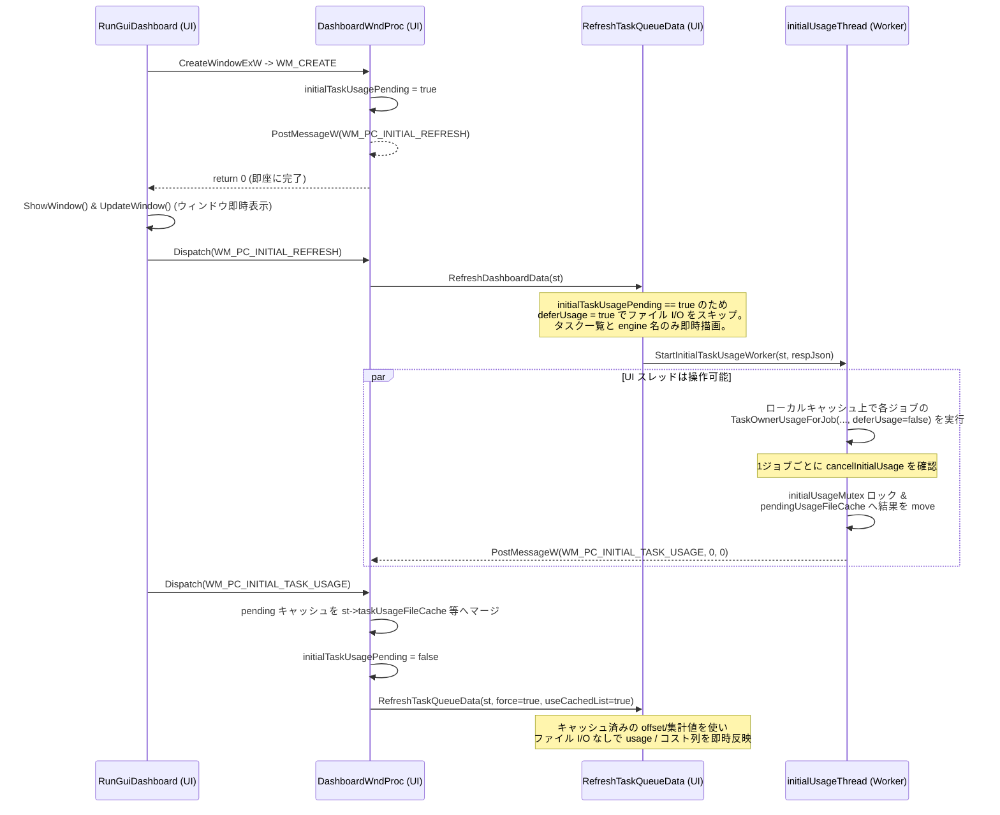

# 起動時のタスク読み込み非同期化 — 詳細設計書

本ドキュメントは [doc/async-initialize.md](async-initialize.md) の方針に基づき、`src/gui_dashboard.cpp` への具体的な実装仕様（データ構造、関数シグネチャ、変更コード、状態遷移、エッジケース処理）を定義する。

---

## 1. 現状の起動シーケンスと問題の詳細解析

### 1.1 現状のコード動作

1. `RunGuiDashboard`（`:21838`）で `CreateWindowExW` を呼び出す（この時点では `WS_VISIBLE` スタイルなし）。
2. `CreateWindowExW` 内部から同期的に `DashboardWndProc` の `WM_CREATE`（`:20804`）が呼ばれ、`RefreshDashboardData(st)` が実行される。
   - この時点ではまだ `ShowWindow` 前で `IsWindowVisible(st->hwndMain) == FALSE` のため、`RefreshDashboardData` 先頭（`:7403`）の非表示時分岐に入り、`FetchProcessSnapshotsIpc`（`:7404`）と `GetMemoryStorageStatsIpc`（`:7423`）の同期 IPC だけを実行して `:7437` で早期リターンする。
   - すなわち、**`WM_CREATE` 内の `RefreshDashboardData(st)` はウィンドウ表示を遅らせるだけで、リストビューの初期化すら行っていない**。
3. `CreateWindowExW` の完了後、`ShowWindow` / `UpdateWindow`（`:21876`）で空のリストを持つウィンドウが表示される。
4. 直後の最初の `WM_TIMER`（`TIMER_REFRESH_ID`）または `WM_PC_IPC_EVENT`（`:20966`）で初めて `IsWindowVisible(st->hwndMain) == TRUE` の状態で `RefreshDashboardData` の本処理（`:7439` 以降）が走る。
5. `:7688` と `:7690` で `RefreshTaskQueueData` が 2 回呼ばれ、全ジョブ・全 attempt に対して `TaskOwnerUsageForJob`（`:6696`）が同期実行される。
   - 各 attempt ごとに `ListDirectoryWide` によるディレクトリスキャンと、`.events.jsonl` / `_stream.jsonl` ファイル全体の読み込み＋行単位の `nlohmann::json::parse` が UI スレッド上で直列実行される。
   - この間 UI スレッドが完全にブロックされ、ウィンドウが「応答なし（固まった状態）」になる。

### 1.2 解決アーキテクチャ（シーケンス図）



---

## 2. 定数・データ構造の詳細設計

### 2.1 メッセージ定数とタイムアウト定数（`:73` 付近）

```cpp
constexpr UINT WM_PC_IPC_EVENT          = WM_APP + 101;
constexpr UINT WM_PC_CREATE_TERMVIEW    = WM_APP + 102;
constexpr UINT WM_PC_DESTROY_TERMVIEW   = WM_APP + 103;
constexpr UINT WM_PC_TRAYICON           = WM_APP + 104;
constexpr UINT WM_PC_INITIAL_REFRESH    = WM_APP + 105;
constexpr UINT WM_PC_INITIAL_TASK_USAGE = WM_APP + 106;

// 初回 usage ワーカースレッドのフェイルセーフタイムアウト (ms)
constexpr uint64_t kInitialUsageTimeoutMs = 15000;
```

### 2.2 `DashboardState` への追加メンバ（`:978` 付近）

| メンバ名 | 型 | 初期値 | アクセス権・役割 |
|---|---|---|---|
| `initialTaskUsagePending` | `bool` | `false` | **UI スレッド専用**。`true` の間は `TaskOwnerUsageForJob` のファイル I/O をスキップする。 |
| `initialUsageThreadStarted` | `bool` | `false` | **UI スレッド専用**。初回ワーカーを 1 度だけ起動するためのガード。 |
| `initialUsageStartTickMs` | `uint64_t` | `0` | **UI スレッド専用**。ワーカー起動時刻（タイムアウト判定用）。 |
| `cancelInitialUsage` | `std::atomic<bool>` | `false` | **スレッド間共有 (atomic)**。`WM_DESTROY` 時に `true` を書き込み、ワーカーへ中断を通知する。 |
| `initialUsageThread` | `std::thread` | デフォルト | **UI スレッド管理**。バックグラウンド集計スレッド。`WM_DESTROY` 等で `join()` する。 |
| `initialUsageMutex` | `std::mutex` | デフォルト | **スレッド間共有**。下記 `pending*` マップの受け渡しを保護する。 |
| `pendingUsageFileCache` | `std::map<std::wstring, TaskUsageFileCache>` | 空 | **`initialUsageMutex` 保護**。ワーカーが集計したファイルキャッシュの一時格納先。 |
| `pendingAttemptEventsPath` | `std::map<std::wstring, std::wstring>` | 空 | **`initialUsageMutex` 保護**。ワーカーが解決したイベントファイルパスの一時格納先。 |

```cpp
    std::map<std::wstring, TaskUsageFileCache> taskUsageFileCache; // attempt events file -> parsed usage
    std::map<std::wstring, std::wstring> taskAttemptEventsPath;    // jobId:attempt -> resolved events file
    bool initialTaskUsagePending = false;
    bool initialUsageThreadStarted = false;
    uint64_t initialUsageStartTickMs = 0;
    std::atomic<bool> cancelInitialUsage{false};
    std::thread initialUsageThread;
    std::mutex initialUsageMutex;
    std::map<std::wstring, TaskUsageFileCache> pendingUsageFileCache;
    std::map<std::wstring, std::wstring> pendingAttemptEventsPath;
```

> **設計根拠（なぜ `LPARAM` でヒープポインタを `PostMessageW` しないのか）**:  
> ワーカーが `PostMessageW` に成功した直後、UI スレッドがそのメッセージを取り出す前にウィンドウが破棄（`WM_DESTROY`）された場合、メッセージキュー内の未処理メッセージに紐づく `LPARAM` ポインタは誰にも `delete` されずメモリリークする。結果を `DashboardState` のメンバ変数（`pendingUsageFileCache` 等）に格納し、`PostMessageW` は引数 `(0, 0)` の通知トリガーとしてのみ使うことで、`DashboardState` のデストラクタにより 100% 確実にメモリが解放される。

---

## 3. 関数別の詳細変更仕様

### 3.1 `TaskUsageAccumulateFile` / `TaskUsageAccumulateStreamFile`（`:6541`, `:6632`）

第 1 引数を `DashboardState* st` から `std::map<std::wstring, TaskUsageFileCache>& usageCache` に変更する。関数内部のロジックは 1 行目（`usageCache[path]` の参照）以外すべて同一。

```cpp
// 変更前:
// static void TaskUsageAccumulateFile(DashboardState* st, const std::wstring& path, TaskOwnerUsage& out)
//     TaskUsageFileCache& entry = st->taskUsageFileCache[path];

// 変更後:
static void TaskUsageAccumulateFile(std::map<std::wstring, TaskUsageFileCache>& usageCache,
                                    const std::wstring& path, TaskOwnerUsage& out) {
    TaskUsageFileCache& entry = usageCache[path];
    // 以降のファイル読み込み・JSON パース処理は既存コードと同一
```

```cpp
// 変更前:
// static void TaskUsageAccumulateStreamFile(DashboardState* st, const std::wstring& path, TaskOwnerUsage& out)
//     TaskUsageFileCache& entry = st->taskUsageFileCache[path];

// 変更後:
static void TaskUsageAccumulateStreamFile(std::map<std::wstring, TaskUsageFileCache>& usageCache,
                                          const std::wstring& path, TaskOwnerUsage& out) {
    TaskUsageFileCache& entry = usageCache[path];
    // 以降のファイル読み込み・JSON パース処理は既存コードと同一
```

### 3.2 `TaskOwnerUsageForJob`（`:6696`）

`DashboardState* st` の代わりに 2 つのキャッシュマップ参照と `bool deferUsage = false` を受け取る。

```cpp
static TaskOwnerUsage TaskOwnerUsageForJob(
    std::map<std::wstring, TaskUsageFileCache>& usageCache,
    std::map<std::wstring, std::wstring>& eventsPathCache,
    const std::string& jobId, const std::string& jobJson,
    const std::string& command, bool deferUsage = false) {
    TaskOwnerUsage out;
    // Shows the worker engine before its first usage event arrives, and for plain commands
    // (empty when the command is not one of the known agent CLIs).
    out.engine = DetectAgentType(command, "");
    if (deferUsage) return out;

    const std::wstring logsDir = GetLogsDirectoryWide();
    const std::wstring tqDir = PathJoinWide(logsDir, L"taskqueue");
    for (const auto& attemptJson : SplitJsonObjectArray(jobJson, "attempts")) {
        const int n = static_cast<int>(JsonGetInt(attemptJson, "n", 1));
        const std::wstring cacheKey = Utf8ToWide(jobId) + L":" + std::to_wstring(n);
        std::wstring eventsPath;
        auto cached = eventsPathCache.find(cacheKey);
        if (cached != eventsPathCache.end()) eventsPath = cached->second;
        const bool remote = !JsonGetString(attemptJson, "remote_host", "").empty();
        const int64_t pid = JsonGetInt(attemptJson, "process_id", 0);
        if (eventsPath.empty()) {
            const std::wstring jobEvents = PathJoinWide(
                tqDir, Utf8ToWide(SanitizeFileNameComponent(jobId)) + L"." + std::to_wstring(n) + L".events.jsonl");
            if (!remote && pid > 0) {
                auto procFiles = ListDirectoryWide(
                    logsDir, L"proc_" + std::to_wstring(pid) + L"_*.events.jsonl");
                if (!procFiles.empty()) eventsPath = procFiles.front();
            }
            if (eventsPath.empty()) {
                WIN32_FILE_ATTRIBUTE_DATA fad = {};
                if (GetFileAttributesExW(jobEvents.c_str(), GetFileExInfoStandard, &fad)) eventsPath = jobEvents;
            }
            if (!eventsPath.empty()) eventsPathCache[cacheKey] = eventsPath;
        }
        if (!eventsPath.empty()) TaskUsageAccumulateFile(usageCache, eventsPath, out);
        if (!out.hasUsage && !remote && pid > 0) {
            auto streamFiles = ListDirectoryWide(
                logsDir, L"proc_" + std::to_wstring(pid) + L"_*_stream.jsonl");
            if (!streamFiles.empty()) {
                TaskUsageAccumulateStreamFile(usageCache, streamFiles.front(), out);
            }
        }
    }
    return out;
}
```

### 3.3 ワーカースレッド起動ヘルパー `StartInitialTaskUsageWorker`（新規追加）

`RefreshTaskQueueData` の直前に定義する。
- **ポイント**: `WM_PC_INITIAL_REFRESH` 時点ではなく、`RefreshTaskQueueData` が**初めてタスクリスト JSON を取得した時点**で起動する。
- これにより、起動時に `ListDisplayMode::ProcessOnly`（プロセスのみ表示）や最小化状態だった場合でも、後からユーザーがタスク表示に切り替えた際に初回非同期読み込みが確実に動作する。また、ジョブが 0 件の場合はスレッドを起動せず即座に `initialTaskUsagePending = false` に解除する。

```cpp
static void StartInitialTaskUsageWorker(DashboardState* st, const std::vector<std::string>& jobs) {
    if (!st || !st->initialTaskUsagePending || st->initialUsageThreadStarted) return;

    if (jobs.empty()) {
        // ジョブが 0 件ならバックグラウンド集計は不要
        st->initialTaskUsagePending = false;
        st->initialUsageThreadStarted = true;
        return;
    }

    st->initialUsageThreadStarted = true;
    st->initialUsageStartTickMs = GetNowTickMs();
    st->cancelInitialUsage.store(false, std::memory_order_relaxed);

    HWND hwnd = st->hwndMain;
    // スレッド内で安全に使えるようジョブ JSON 配列を値コピーして渡す
    std::vector<std::string> jobsCopy = jobs;

    st->initialUsageThread = std::thread([st, hwnd, jobsCopy = std::move(jobsCopy)]() {
        std::map<std::wstring, TaskUsageFileCache> localUsageCache;
        std::map<std::wstring, std::wstring> localEventsPath;
        try {
            for (const auto& j : jobsCopy) {
                if (st->cancelInitialUsage.load(std::memory_order_relaxed)) return;
                std::string jobId = JsonGetString(j, "id", "");
                std::string cmd = JsonGetString(j, "command", "");
                TaskOwnerUsageForJob(localUsageCache, localEventsPath, jobId, j, cmd, /*deferUsage=*/false);
            }
        } catch (...) {
            // 例外発生時も完了通知を送って UI 側の pending 状態を必ず解除させる
        }

        if (st->cancelInitialUsage.load(std::memory_order_relaxed)) return;

        {
            std::lock_guard<std::mutex> lock(st->initialUsageMutex);
            st->pendingUsageFileCache = std::move(localUsageCache);
            st->pendingAttemptEventsPath = std::move(localEventsPath);
        }

        if (hwnd && IsWindow(hwnd)) {
            PostMessageW(hwnd, WM_PC_INITIAL_TASK_USAGE, 0, 0);
        }
    });
}
```

### 3.4 `RefreshTaskQueueData` 内の変更（`:6814`, `:7023` 付近）

1. `:6814` で `auto jobs = SplitJsonObjectArray(resp, "jobs");` を取得した直後に、初回ワーカーが未起動であれば `StartInitialTaskUsageWorker(st, jobs)` を呼ぶ。
   （※ `jobs` が 0 件の場合はこの中で即座に `st->initialTaskUsagePending = false` になる）。
2. `:7023` の `TaskOwnerUsageForJob` 呼び出しで、`st->initialTaskUsagePending` を `deferUsage` として渡す。

```cpp
    auto jobs = SplitJsonObjectArray(resp, "jobs");
    if (st->initialTaskUsagePending && !st->initialUsageThreadStarted) {
        StartInitialTaskUsageWorker(st, jobs);
    }
```

```cpp
        // Who runs the job (the worker CLI) and the tokens / cost its attempts used.
        TaskOwnerUsage ownerUsage = TaskOwnerUsageForJob(
            st->taskUsageFileCache, st->taskAttemptEventsPath,
            jobId, j, JsonGetString(j, "command", ""), st->initialTaskUsagePending);
```

### 3.5 `RefreshDashboardData` のフェイルセーフタイムアウト（`:7400` 付近）

万が一ワーカースレッドからの `PostMessageW` がロストしたり、I/O が長時間停滞した場合に備え、`RefreshDashboardData` の先頭でタイムアウト判定を行う。

```cpp
static void RefreshDashboardData(DashboardState* st) {
    if (!st) return;
    if (st->initialTaskUsagePending && st->initialUsageThreadStarted &&
        st->initialUsageStartTickMs > 0 &&
        GetNowTickMs() - st->initialUsageStartTickMs > kInitialUsageTimeoutMs) {
        st->initialTaskUsagePending = false;
    }
```

### 3.6 `DashboardWndProc` のメッセージハンドラ変更

#### (1) `WM_CREATE`（`:20804` 付近）

`RefreshDashboardData(st)` の同期呼び出しをやめ、`st->initialTaskUsagePending = true` を設定して `WM_PC_INITIAL_REFRESH` をポストする。

```cpp
            SetTimer(hwnd, TIMER_KPI_ANIM_ID, 60, nullptr);
            st->initialTaskUsagePending = true;
            PostMessageW(hwnd, WM_PC_INITIAL_REFRESH, 0, 0);
            ApplyDashboardRefreshTimer(st);
            return 0;
```

#### (2) `WM_PC_INITIAL_REFRESH` / `WM_PC_INITIAL_TASK_USAGE` ハンドラの追加（`:20970` 付近）

```cpp
        case WM_PC_INITIAL_REFRESH: {
            if (st) {
                RefreshDashboardData(st);
            }
            return 0;
        }

        case WM_PC_INITIAL_TASK_USAGE: {
            if (st) {
                {
                    std::lock_guard<std::mutex> lock(st->initialUsageMutex);
                    for (auto& kv : st->pendingUsageFileCache) {
                        st->taskUsageFileCache[kv.first] = std::move(kv.second);
                    }
                    st->pendingUsageFileCache.clear();
                    for (auto& kv : st->pendingAttemptEventsPath) {
                        st->taskAttemptEventsPath[kv.first] = std::move(kv.second);
                    }
                    st->pendingAttemptEventsPath.clear();
                }
                st->initialTaskUsagePending = false;
                if (st->initialUsageThread.joinable()) {
                    st->initialUsageThread.join();
                }
                // キャッシュ済みの JSON リストを使って即座に usage 列を再構築・再描画する
                RefreshTaskQueueData(st, /*force=*/true, /*useCachedList=*/!st->lastTaskListJson.empty());
            }
            return 0;
        }
```

#### (3) `WM_DESTROY`（`:21764` 付近）

ウィンドウ破棄時にキャンセルフラグを立て、ワーカースレッドが稼働中または未 join であれば確実に `join()` する。

```cpp
        case WM_DESTROY: {
            KillTimer(hwnd, TIMER_REFRESH_ID);
            KillTimer(hwnd, TIMER_KPI_ANIM_ID);
            KillTimer(hwnd, TIMER_QUIT_WAIT_ID);
            if (st) {
                st->cancelInitialUsage.store(true, std::memory_order_relaxed);
                if (st->initialUsageThread.joinable()) {
                    st->initialUsageThread.join();
                }
                if (st->coreProcessHandle) {
```

---

## 4. 状態遷移とエッジケースの検証マトリクス

| # | シナリオ | 状態遷移と挙動 | 安全性・結果 |
|---|---|---|---|
| 1 | **通常起動（タスク多数）** | `WM_CREATE` で `initialTaskUsagePending = true` & `PostMessage(WM_PC_INITIAL_REFRESH)` → `ShowWindow` 完了後に第 1 段階描画（usage スキップ）＆ワーカー起動 → ワーカー完了後に `WM_PC_INITIAL_TASK_USAGE` でキャッシュマージ＆再描画 | ウィンドウは即座に表示され、後から usage / コスト列が埋まる |
| 2 | **タスク 0 件で起動** | `RefreshTaskQueueData` 内の `StartInitialTaskUsageWorker` で `jobs.empty()` が真となり、スレッドを起動せずその場で `initialTaskUsagePending = false` に遷移 | 余分なスレッド生成なしで即座に通常状態へ移行 |
| 3 | **`ProcessOnly` モードまたは最小化状態で起動** | 起動時は `RefreshTaskQueueData` が早期リターンするためワーカーは起動しない。後からユーザーがタスク表示へ切り替えた（または最小化解除した）最初の `RefreshTaskQueueData` で `StartInitialTaskUsageWorker` が呼ばれ、非同期読み込みが走る | モード切替時も UI が固まらず、フラグ残留も起きない |
| 4 | **ワーカー実行中に定期タイマー（2秒）または IPC イベントが発火** | `initialTaskUsagePending == true` のため、定期リフレッシュでも `deferUsage = true` となり UI スレッドでのファイル走査はスキップされる | UI スレッドとワーカーの二重 I/O を防止 |
| 5 | **ワーカー実行中に新しいタスクが追加・進行** | ワーカー完了時に `pendingUsageFileCache` を `st->taskUsageFileCache` へマージした後、`RefreshTaskQueueData` が実行される。ワーカー起動後に追記されたファイル差分も `size > entry.offset` により差分のみ読み込まれる | データの欠落や巻き戻りは発生しない |
| 6 | **ワーカー実行中にウィンドウを閉じた場合** | `WM_DESTROY` で `cancelInitialUsage = true` がセットされ、ワーカーは次のジョブ境界で即中断。`initialUsageThread.join()` で終了を待ってから `DashboardState` が破棄される | ダングリングポインタ（UAF）や `std::terminate()` クラッシュは発生しない |
| 7 | **`PostMessage(WM_PC_INITIAL_TASK_USAGE)` 成功直後、処理前にウィンドウを閉じた場合** | メッセージ自体はディスパッチされないが、データ本体は `st->pendingUsageFileCache` にあり、`WM_DESTROY` で `join()` 後に `RunGuiDashboard` 終了時の `DashboardState` デストラクタで自動解放される | メモリリークは一切発生しない |

---

## 5. 今後の発展的最適化（オプション）

今回の非同期化により UI スレッドのフリーズは解消されるが、タスク数が非常に多い環境でのさらなる負荷低減として以下も検討可能（別タスクとして分離可能）：

1. **`ListDirectoryWide` の一括スキャンまたはネガティブキャッシュ**:
   - `TaskOwnerUsageForJob`（`:6731`）では `!out.hasUsage && !remote && pid > 0` の場合にフォールバックとして `ListDirectoryWide(logsDir, L"proc_<pid>_*_stream.jsonl")` を呼んでいる。
   - usage イベントを出力しない通常のコマンドジョブでは `out.hasUsage` が常に `false` となるため、2 秒ごとの通常 tick でも毎回この `ListDirectoryWide` が実行される。
   - 終了済み attempt（ジョブが `succeeded` / `failed` / `cancelled`）で一度探索して存在しなかったパスは空文字としてキャッシュするか、完了済みジョブの `TaskOwnerUsage` 自体をキャッシュすることで、定常時のディスクアクセスをさらに削減できる。
