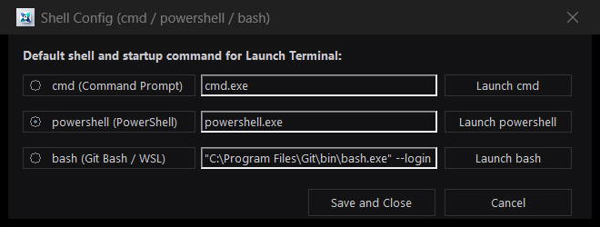
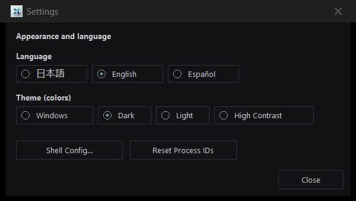

# Key Features

**[English](features.md) | [日本語 (Japanese)](features-ja.md)**

## 1. Native Win32 + Direct2D Multi-Terminal Dashboard GUI
- **14 Top KPI Summary Cards (Two Rows: Processes & Task Queues)**:
  - **Compact Horizontal Layout**: Labels and numbers are placed side-by-side on a single line, minimizing header height to maximize vertical space for process lists and terminals.
  - **Top Row (Processes)**: Real-time metrics for Total Terminals, Active Running, Waiting/Idle (no output or CPU activity for `>= 10s`), Completed (`Exit 0`), Failed/Killed, **Shortest Remaining Time** (live countdown of nearest active process timeout), and Total Job Object Memory & Process Count.
  - **Bottom Row (Tasks)**: Real-time metrics for Total Tasks, Active Running, Waiting/Pending, Succeeded, Failed, **Shortest Remaining Time** (live countdown of nearest active task timeout), and Active Queues / Concurrency summary.
  - Hover over any card for detailed tooltips and breakdown counts.
- **Two-Row Stacked Layout with Draggable Splitter**:
  - View both the **Process Summary Table** (top) and **Task Queue Table** (bottom) simultaneously in a dual-row view. Each list has a caption bar ("PROCESSES" / "TASK QUEUE") so it is clear which is which.
  - Interactive **draggable horizontal splitter bar** between the two tables allows smooth resizing of their relative heights.
  - **View Mode Cycling (`Ctrl+T` / View Toggle Button)**: Cycle between **Two Rows** (Processes + Tasks), **Processes Only**, and **Tasks Only** at any time.
- **Sortable Process Summary Table (Newest on Top)**:
  - Newly launched processes are automatically added to the **top of the list** (`ID ▼` descending by default).
  - Click **any column header** (`ID`, `Windows PID`, `Agent / Name`, `Status`, `Start Time`, `End Time`, `Uptime`, `Tree Procs`, `Memory`, `CPU Time`, `Idle`, `Latest Output Preview`, `Command Line`, `Job`) to toggle **Ascending (`▲`) / Descending (`▼`)** sort order.
  - `ID` is Hancho's internal number; `Windows PID` is the root process's OS PID, so you can find it immediately in Task Manager.
  - **CPU-Aware Idle Detection**: While a process's CPU time keeps increasing, it stays `RUNNING` instead of being shown as `IDLE / WAITING`, and it is not killed by `--idle-timeout`. CPU time includes all processes in the Win32 Job Object tree.
- **Tab-Switched Full-Size Direct2D Terminal (`>= 80x25`)**:
  - Embedded hardware-accelerated Direct2D / DirectWrite / IME / Sixel VT terminal emulator (`TerminalView` + `ConPtySession`).
  - Switch between active terminals using the **Terminal Tab Bar** while always preserving at least **80 columns × 25 rows** of terminal viewport so TUI apps (`claude`, `opencode`, `vim`, `htop`) never wrap or corrupt their layout.
  - Type directly into the terminal (full keyboard input, `Ctrl+C`, IME composition, mouse wheel scrollback, and text selection).
- **Up to 16 Parallel Terminals in Live Grid View (`[▦]`)**:
  - Click **`[▦]`** on the toolbar to open a live DWM thumbnail & snapshot grid (up to **16 parallel terminals** in a `4×4` matrix). Click any cell or use arrow keys + Enter to jump directly to that terminal tab.
- **Compact Icon Buttons with Hover Tooltips**:
  - **`[▦]`** Grid View toggle
  - **`[☰]`** Hide/Show Process List toggle
  - **`[>_]`** Hide/Show Terminal Panel toggle
  - **`[⤓]`** Minimize to System Tray
  - All toolbar icon buttons provide instant status-aware hover tooltips.
- **Triage**: Review one persistent card per failed job or other condition, with Hancho-collected information, candidate actions and a deterministic recommendation; choose and record a decision, request LLM advice, and track pending, acted, ignored or naturally resolved cards. See [Triage](triage.md).

## 2. Multi-Shell Launcher & `[Config]` Dialog (`cmd` / `powershell` / `bash`)
- Click **`[+ Launch (...)]`** on the toolbar to immediately spawn a new interactive ConPTY terminal tab.
- Open **`[Settings]`** → **`[Shell Config...]`** to select the default shell (`cmd`, `powershell`, or `bash` — auto-detecting Git Bash / WSL Bash), customize startup command lines, or launch any shell on the spot. Settings are persisted in `logs/config.json`.



## 3. History Management, Task Details & LLM JSON Tree Viewer
- **Hide Ended Processes** (Settings dialog): A convenient checkbox in the Settings dialog lets you toggle hiding/showing finished processes so you can focus exclusively on currently running tasks without deleting history.
- **`[Clear Ended]`** & **`[Reset Process IDs]`** (Settings dialog): Clear all completed/failed process history or renumber processes sequentially from `#1`.
- **Right-Click Context Menu & Task Details Dialog**: Right-click any process row or terminal tab (or double-click a row) to terminate the process tree (**`Kill Tree`** with confirmation), inspect full command lines, working directory, PID/Job metrics, log paths, `.done` files, and output preview, or copy commands to the clipboard.
- **LLM JSON Output Streaming & Interactive Tree Viewer**:
  - Native streaming event capture for major AI coding agents (`claude`, `agy`, `opencode`, `codex`).
  - Automatically captures structured event streams into `<logfile>.stream.jsonl` in addition to raw console logs.
  - The Task Details dialog features an embedded **JSON Tree Viewer** (powered by `nlohmann/json`): expand, collapse, and inspect hierarchical JSON payloads, tool inputs/outputs, thought blocks, and token usage without having to manually read raw JSONL streams.
- **Execution Monitor Pane**:
  - A pane below the process and task lists that **follows the selected process**. Show or hide it with the `{}` toolbar button or the right-click item "Show JSON Stream in Bottom Pane"; drag the bar above it to change its height. Visibility and height are saved in `logs/config.json`.
  - **Goal**: the process's goal (or the task queue job's summary when a job started the process).
  - **Now**: what the agent is doing, with elapsed time (e.g. `✏️ Editing file src/a.cpp (1m20s)`).
  - **Ends**: the agent's own TODO progress (`3/7 done: ...`), the job's success condition, the current attempt, the time limit with time left, and the no-output limit.
  - **Activity history**: one plain-language row per step instead of raw JSON events — start time, duration, what it was doing, and the file or command. The running row's time updates every second, and selecting a row shows the raw JSON.
  - Activity types (read file, edit file, search, run command, web, subagent, update plan, other tool, thinking, writing a reply, waiting for the model) are colour-coded with icons. The running row and long steps are highlighted. A setting turns colour and icons off together.
  - JSON-streaming processes are marked `{}` in the process list, and the preview column also shows what the agent is doing with elapsed time.
  - **Event retention** (Settings → "Events kept per process"): how many stream events each process keeps in memory. Default 2000; values are kept within 100–100000, and 0 or other negatives become 100. `-1` keeps every event until memory runs out; if memory runs out, the older half of one process's events is dropped and a note is written to the audit log. The setting applies to running processes at their next event and is saved in `logs/config.json`.
  - **Claude sub-agents**: `Agent` calls and their sub-agents' steps are tracked in the stream state (`subagents`, with the parent agent id, status, tokens and tool count). The monitor pane shows each sub-agent as a branch with its steps below it, in time order (oldest on top, running work at the bottom). A branch closes 3 seconds after it completes, unless it failed or still has running work; click its ▶/▼ or press Left/Right on it to open or close it yourself. The list keeps the selection and, while you are scrolled to the bottom, follows the running step. Without sub-agents the list is unchanged (newest first). `hancho-cli agent status` and the JSON stream show them too.
- **Claude sub-agent helper (`hancho-runner`)**: `hancho-cli agent install-template` writes `.claude\agents\hancho-runner.md`, a Claude Code subagent that runs long builds and tests through Hancho and returns a short summary.

## 4. System Tray Integration
- Click **`[⤓]`** (Tray icon button), minimize the window, or press the window close button (`[X]`) to hide Hancho into the **Windows System Tray** while keeping all background ConPTY processes and IPC/MCP services running.
- Left-click or double-click the tray icon (or right-click to open the tray menu) to restore and expand the dashboard at any time.

## 5. Persistent Logs, State Recovery & `.done` Completion Marker Files
- **Real-Time Per-Process Logs**: Every process's stdout/ConPTY stream is continuously written to `logs/proc_<id>_<name>_<YYYYMMDD_HHMMSS>.log` (or a custom `--log-file <path>`).
- **Completion Marker Files (`.done`) for AI Agents**: On process exit, Hancho atomically writes a JSON completion file (`logs/proc_<id>.done` or custom `--done-file <path>`), allowing Claude or automation scripts to detect task completion via simple file-existence checks.
- **State Persistence Across Restarts**: Process metadata and history are saved in `logs/processes_state.json` and automatically restored when Hancho starts.

## 6. Reliable Win32 Job Object Process Tree Control
- Each process runs inside a dedicated Win32 `Job Object` (`JOB_OBJECT_LIMIT_KILL_ON_JOB_CLOSE`), tracking all child/grandchild processes and memory usage and guaranteeing clean tree termination on `kill`, `--timeout`, or `--idle-timeout`.

## 7. Settings Dialog, Theme & Localization
- Click **`[Settings]`** to open the settings dialog.
- **Language**: switch between **Japanese / English / Español** buttons; the dashboard, dialogs, menus, and status bar update immediately.
- **Theme (colors)**: **Windows** (default; follows the Windows light/dark mode and personalization accent color), **Dark**, **Light**, **High Contrast**, **Pastel**, the pastel-background **Pastel Blue / Orange / Pink / Red / Green**, the **Deep / Pale Purple** and **Deep / Pale Yellow** themes, and the Midnight, Ember, Berry, Crimson, Forest and Mist colour themes. Buttons, list headers (both process list and job queue list), scrollbars, and tab labels follow the active theme colors.
- **`[Shell Config...]`**, **`[Reset Process IDs]`**, **`[Clear Ended]`**, and the **Hide Ended Processes** and **Execution monitor pane: colour rows and show icons** checkboxes are available here (keeping the toolbar clean and focused).
- Settings, language, theme, list/terminal visibility, and layout are **auto-saved** to `logs/config.json` and restored on the next start.



## 8. Task Queue: Ordering, Dependencies, Timeouts and Automatic Retries
- Register jobs with **one command each**; Hancho decides when to run them (concurrency, dependencies, priority) and persists the queue across restarts (`logs/taskqueues/<name>.json`).
- Per-job `timeoutSec`, idle detection (output **and** CPU), success checks (`exitCode`, `filesNewer`, `outputRegex`, `testReport` for JUnit/NUnit XML), automatic retries (`maxAttempts`), and `blocked` dependents when a dependency fails.
- **ChainGuard** rejects shell chains and wait loops in `start_process` / `taskqueue_add`; use `dependsOn` instead. CLI `--allow-chain` is the only escape hatch (never exposed over MCP).
- GUI: click the leftmost view mode toggle button or press **Ctrl+T** to cycle between **Two Rows** (Processes + Tasks), **Processes Only**, and **Tasks Only**. In Two Rows mode, drag the horizontal splitter bar to adjust relative heights. Running jobs are listed first and highlighted; failed rows are muted red and timed-out rows muted amber (theme-based, low saturation).
- See [Task Queue](taskqueue.md) for the data model and examples.

## 9. Audit LLM: Supervisor LLM Monitoring and Closed-Loop Feedback
- **Supervisor Auditor Role**: An objective third-party engine that audits the Supervisor LLM's orchestration decisions (task decomposition, timing estimates, failure retry strategies).
- **5 Core Audit Metrics**:
  1. Execution duration vs pre-run estimate (`estimate_sec`) divergence.
  2. Unmodified retry detection (preventing repetitive failing loops without code edits).
  3. Command design and task granularity (ChainGuard compliance and avoiding deadlock risks).
  4. Token consumption and context hygiene (preventing ingestion of raw verbose logs).
  5. Resource contention and lock serialization.
- **Two Feedback Channels**:
  - **Hint Window (Pop-up Toast)**: Non-intrusive toasts with one-click prompt copy buttons for human guidance.
  - **MCP Response Injection**: Attaching actionable `"audit"` guidance objects directly into `taskqueue_wait` returns.
- See [Audit LLM Specification](audit-llm.md) for details.

## 10. Chat (IPMsg Compatible LAN Messaging)
- The core speaks the classic IPMsg protocol (presence, messages, read receipts, regular-file transfer) on UDP/TCP port 2426, off by default. Stock IPMsg clients on the same LAN see Hancho as a host.
- LLM-to-LLM messaging with `from_agent` / `to_agent` / `reply_to`, an `audience` (human or agent) and a hop guard. Incoming messages can be handed to a worker LLM whose JSON answer is sent back as a reply.
- `hancho-cli chat ...`, the MCP `chat_*` tools, and a standalone dialog (`Hancho.exe chat [--tray]`, also openable from the dashboard toolbar) with tray notifications, a searchable log and settings.
- Trusted LAN only; nothing is encrypted. See [Chat](chat.md) for the protocol, configuration, security notes and examples.

## 11. Terminal sessions (WCSP)
- The core exposes every ConPTY job over the WinConsoleServer protocol (WCSP v1). The standalone dashboard (`Hancho.exe gui`) attaches to those jobs through a local TCP listener and shows the live screen and keyboard input in the existing terminal tabs. Closing the dashboard, switching tabs or detaching does not stop the job.
- The listener is configured in `<data-dir>/config.json`:

  ```json
  "terminal": { "local": true, "remote": false, "host": "0.0.0.0", "port": 9139, "token": "" }
  ```

  With `local: true` (the default) it binds `127.0.0.1` on an ephemeral port. The dashboard learns the address and token through the local named pipe (`term_endpoint`); when `token` is empty, a random token is generated on first start and written back to the config file.
- Set `remote: true` to bind `host:port` so WinConsoleTerminal on another PC can connect:

  `WinConsoleTerminal --host <pc> --port 9139 --shell powershell --token <token>`

  Use `attach:<id>` as the shell/target to view an existing Hancho job instead of starting a new one.
- Settings → **WinConsoleServer** has **local** and **remote** switches (`terminal.local` / `terminal.remote`). Turning both off stops the listener, so neither the dashboard nor WinConsoleTerminal can attach.
- WCSP is plain TCP without encryption. Enable `remote` only on a trusted LAN and keep the token private.
